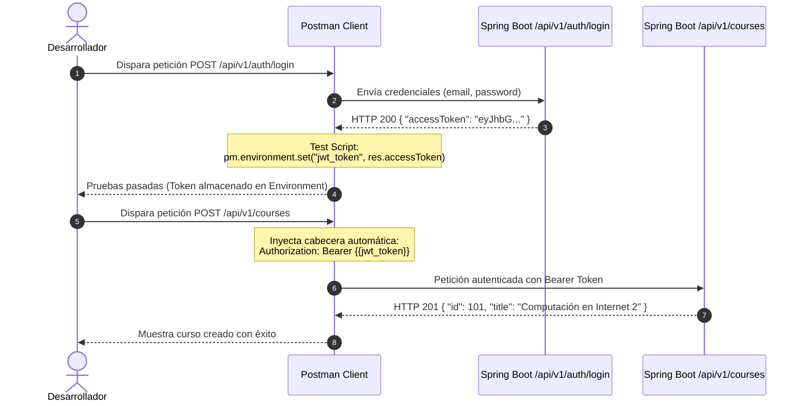

# Postman

En el desarrollo de aplicaciones empresariales con **Spring Boot**, construir controladores REST, servicios y repositorios JPA es solo la mitad del trabajo. Para garantizar que los servicios respondan de forma consistente, procesen adecuadamente los datos de entrada y rechacen solicitudes maliciosas o malformadas, es indispensable contar con una estrategia rigurosa de prueba y validación de endpoints HTTP.

**Postman** es la plataforma estándar en la industria para diseñar, probar, documentar y automatizar APIs HTTP. Permite a los desarrolladores simular clientes frontend o móviles, inspeccionar respuestas en tiempo real, encadenar flujos de autenticación basados en JSON Web Tokens (JWT) y automatizar suites de pruebas de regresión antes de desplegar a producción.

---

## 1. Fundamentos Teóricos y Arquitectura

### ¿Por qué utilizar Postman para probar APIs en Spring Boot?

Aunque herramientas de terminal como `curl` o archivos `.http` permiten enviar solicitudes HTTP básicas, Postman proporciona una arquitectura completa para el ciclo de vida de desarrollo de APIs:

- **Inspección visual estructurada**: Formateo automático de payloads JSON, análisis de cabeceras HTTP, tiempos de latencia y tamaños de transferencia.
- **Gestión modular de entornos (Environments)**: Capacidad de alternar variables de configuración (por ejemplo, URLs de desarrollo local `http://localhost:8080` vs. servidores de staging o producción) con un solo clic y sin modificar las rutas a mano.
- **Encadenamiento reactivo de peticiones**: Captura dinámica de tokens JWT generados en un endpoint de autenticación (`/api/v1/auth/login`) para inyectarlos automáticamente en las peticiones posteriores mediante variables de entorno.
- **Automatización de aserciones**: Scripts de pruebas en JavaScript (`pm.test`, `pm.expect`) para verificar códigos de estado HTTP, esquemas de datos y tiempos de respuesta.
- **Automatización de suites completas con Collection Runner**: Ejecución secuencial de colecciones completas para pruebas de regresión y validación continua.

---

### Anatomía de la Interfaz de Postman

Recorre interactivamente cada componente esencial de la interfaz para comprender cómo configurar entornos, construir peticiones y validar respuestas contra tu backend en Spring Boot:

<iframe src="/interactive/computacion-2/semana-13/postman-interface/index.html" title="Anatomía de la Interfaz de Postman" style={{ width: '100%', height: 750, border: 0 }} loading="lazy" />

---

### El Ciclo de Vida de una Petición: Postman y Spring Boot

Cuando pulsas el botón **Send**, la petición viaja a través de una arquitectura de cajas conectadas: parte del cliente Postman, ingresa al servidor Tomcat, atraviesa el filtro de Spring Security, el DispatcherServlet, el controlador y la base de datos, retornando en orden inverso a través del pipeline hasta Postman para ejecutar aserciones y actualizar variables.

Explora cada una de las 6 fases del ciclo paso a paso con el siguiente reproductor interactivo:

<iframe src="/interactive/computacion-2/semana-13/postman-spring-lifecycle/index.html" title="Ciclo de Vida Postman y Spring Boot" style={{ width: '100%', height: 790, border: 0 }} loading="lazy" />

---

### Jerarquía y Ámbitos de Variables

Postman organiza las variables en cajas anidadas: el ámbito más interno y específico tiene máxima prioridad y sobrescribe cualquier valor definido en los niveles externos.


| Ámbito | Nivel de Alcance | Caso de Uso Típico en Spring Boot |
| :--- | :--- | :--- |
| **Global** | Todo el espacio de trabajo de Postman | Constantes universales o formateadores compartidos entre múltiples APIs. |
| **Collection** | Exclusivo de una colección completa | URLs relativas o constantes propias de un microservicio específico. |
| **Environment** | Vinculado al entorno activo (Dev, Staging, Prod) | `base_url` (`http://localhost:8080`) y tokens de sesión activos (`jwt_token`). |
| **Data** | Cargado desde archivos externos (`.csv` o `.json`) | Matrices de datos de prueba para ejecuciones masivas en el Runner. |
| **Local** | Solo durante la ejecución de la petición actual | Variables temporales en scripts (`pm.variables.set('tempVal', 123)`). |

---

### Flujo de Autenticación y Encadenamiento de Peticiones

En aplicaciones protegidas con JSON Web Tokens (JWT) y Spring Security, es ineficiente y propenso a errores copiar y pegar manualmente el token en cada endpoint. El encadenamiento automatizado permite sincronizar el flujo completo:



---

## 2. Guía Práctica Paso a Paso: Validación de una API Spring Boot

A continuación desarrollaremos un flujo completo de pruebas sobre un backend en Spring Boot que cuenta con autenticación JWT y recursos protegidos con validación de DTOs.

<StepByStep>
  <Step number="1" title="Crear la Colección y Definir el Entorno">
    El primer paso consiste en organizar las peticiones en una colección y configurar las variables base del servidor local.

    1. Abre Postman y en la barra lateral izquierda selecciona **Collections** > **Create Collection (+)**. Nómbrala `Spring Boot Web API`.
    2. En el panel izquierdo, dirígete a **Environments** > **Create Environment (+)**. Nómbralo `Dev - Spring Boot (Local)`.
    3. Añade las siguientes variables:

    | Variable | Tipo | Initial Value | Current Value |
    | :--- | :--- | :--- | :--- |
    | `base_url` | default | `http://localhost:8080` | `http://localhost:8080` |
    | `jwt_token` | secret | *(vacío)* | *(vacío)* |
    | `course_id` | default | *(vacío)* | *(vacío)* |

    :::tip[Valor Inicial vs. Valor Actual]
    El campo **Initial Value** se comparte si sincronizas con tu equipo en un espacio colaborativo. El campo **Current Value** se almacena exclusivamente en tu cliente local, protegiendo credenciales sensibles contra filtraciones involuntarias en repositorios.
    :::
  </Step>

  <Step number="2" title="Crear la Petición de Inicio de Sesión (Login)">
    Configuraremos la petición HTTP para autenticarnos contra el controlador de autenticación de Spring Boot (`AuthController`).

    1. Dentro de la colección `Spring Boot Web API`, añade una nueva petición seleccionando **Add request**.
    2. Configura los siguientes parámetros:
       - **Nombre**: `01 - Login de Usuario`
       - **Método**: `POST`
       - **URL**: `{{base_url}}/api/v1/auth/login`
    3. En la pestaña **Headers**, verifica que esté presente la cabecera:
       - `Content-Type: application/json`
    4. En la pestaña **Body**, selecciona la opción **raw** y formato **JSON**, ingresando el payload correspondiente:

    ```json title="request-body-login.json"
    {
      "email": "estudiante@icesi.edu.co",
      "password": "PasswordSeguro123!"
    }
    ```
  </Step>

  <Step number="3" title="Configurar Tests Automatizados y Captura del Token JWT">
    En la pestaña **Tests** de la petición de login, escribiremos aserciones para validar el código de respuesta y extraer el `accessToken` hacia el entorno activo.

    ```javascript title="postman-tests-login.js" showLineNumbers
    // 1. Validar que el servidor responda con código HTTP 200 OK
    pm.test("Status code es 200 OK", function () {
        pm.response.to.have.status(200);
    });

    // 2. Verificar que el cuerpo de respuesta contenga el token
    pm.test("La respuesta contiene un accessToken en formato JWT", function () {
        const responseData = pm.response.json();
        
        pm.expect(responseData).to.have.property("accessToken");
        pm.expect(responseData.accessToken).to.be.a("string").and.not.empty;

        // 3. Persistir el token recibido en la variable de entorno jwt_token
        pm.environment.set("jwt_token", responseData.accessToken);
        console.log("Token JWT actualizado exitosamente en el entorno activo.");
    });

    // 4. Validar que el tiempo de respuesta esté dentro de límites aceptables
    pm.test("Tiempo de respuesta inferior a 800ms", function () {
        pm.expect(pm.response.responseTime).to.be.below(800);
    });
    ```

    Haz clic en **Send**. En el panel inferior deberás observar **Test Results (3/3 PASS)** y la variable `jwt_token` actualizada automáticamente.
  </Step>

  <Step number="4" title="Configurar Petición Protegida con Bearer Token">
    Ahora crearemos un endpoint protegido por Spring Security, consumiendo la variable `{{jwt_token}}`.

    1. Añade una nueva petición en la colección:
       - **Nombre**: `02 - Crear Curso Protegido`
       - **Método**: `POST`
       - **URL**: `{{base_url}}/api/v1/courses`
    2. Dirígete a la pestaña **Authorization**:
       - **Type**: `Bearer Token`
       - **Token**: `{{jwt_token}}`
    3. En la pestaña **Body**, selecciona **raw** > **JSON** y añade los datos del curso según el DTO de Spring Boot:

    ```json title="request-body-create-course.json"
    {
      "title": "Computación en Internet 2",
      "code": "C2-2026-1",
      "credits": 3,
      "description": "Desarrollo backend empresarial con Spring Boot y testing automatizado"
    }
    ```
    
    4. En la pestaña **Tests**, incluye aserciones para validar la persistencia en base de datos y guardar el `course_id`:

    ```javascript title="postman-tests-create-course.js" showLineNumbers
    // Validar creación exitosa según convención REST
    pm.test("Status code es 201 Created", function () {
        pm.response.to.have.status(201);
    });

    // Validar coherencia del schema devuelto por el controlador
    pm.test("El objeto retornado contiene un id numérico autogenerado", function () {
        const body = pm.response.json();
        pm.expect(body).to.have.property("id");
        pm.expect(body.id).to.be.a("number");
        pm.expect(body.title).to.eql("Computación en Internet 2");
        
        // Guardar el ID creado para su consulta o borrado posterior
        pm.environment.set("course_id", body.id);
    });
    ```
  </Step>

  <Step number="5" title="Pruebas de Frontera y Errores de Validación (@Valid)">
    Una suite de pruebas completa debe validar también los escenarios negativos y el rechazo de datos inconsistentes.

    1. Añade una petición con datos deliberadamente inválidos:
       - **Nombre**: `03 - Error de Validación DTO (Negative Test)`
       - **Método**: `POST`
       - **URL**: `{{base_url}}/api/v1/courses`
       - **Authorization**: `Bearer Token` con `{{jwt_token}}`
    2. Envía créditos negativos y un título en blanco para detonar `@NotBlank` y `@Positive`:

    ```json title="request-body-invalid.json"
    {
      "title": "",
      "code": "C2-INVALID",
      "credits": -5,
      "description": "Intento de registrar curso con datos inconsistentes"
    }
    ```

    3. Configura el script de tests para verificar que `@RestControllerAdvice` responda con `400 Bad Request` y un listado de errores:

    ```javascript title="postman-tests-validation-error.js" showLineNumbers
    // Validar que Spring Boot capture la inconsistencia del DTO
    pm.test("El servidor responde con HTTP 400 Bad Request", function () {
        pm.response.to.have.status(400);
    });

    pm.test("La respuesta contiene lista de errores de validación", function () {
        const errorResponse = pm.response.json();
        pm.expect(errorResponse).to.have.property("errors");
        pm.expect(errorResponse.errors).to.be.an("array").and.not.empty;
    });
    ```
  </Step>

  <Step number="6" title="Ejecución de la Suite Completa con Collection Runner">
    El **Collection Runner** permite correr todas las peticiones de la colección en secuencia, verificando la estabilidad general del sistema.

    1. En el panel izquierdo de Postman, haz clic en el botón de tres puntos `...` junto a `Spring Boot Web API` > **Run collection**.
    2. Comprueba el orden de ejecución:
       - `01 - Login de Usuario`
       - `02 - Crear Curso Protegido`
       - `03 - Error de Validación DTO`
    3. Asegúrate de tener seleccionado el entorno `Dev - Spring Boot (Local)`.
    4. Pulsa **Run Spring Boot Web API**. Postman ejecutará las llamadas consecutivamente y generará una matriz detallada con todas las aserciones superadas.
  </Step>
</StepByStep>

---

## 3. Buenas Prácticas para Pruebas en Postman

Al construir suites de pruebas en Postman para backends en Spring Boot, es recomendable aplicar los siguientes principios de calidad:

### Variables Dinámicas Integradas (Dynamic Variables)

Para evitar colisiones por registros duplicados en la base de datos (por ejemplo, violaciones de clave única en PostgreSQL al intentar registrar dos veces el mismo correo o código), Postman incluye generadores de datos aleatorios nativos mediante la sintaxis `{{$...}}`:

- `{{$randomEmail}}`: Genera una dirección de correo electrónico aleatoria y única.
- `{{$randomFullName}}`: Genera un nombre completo simulado.
- `{{$randomUUID}}`: Genera un identificador universal único (UUID versión 4).
- `{{$timestamp}}`: Genera la marca de tiempo Unix actual en segundos.

Puedes utilizarlas directamente en el Body de tus peticiones:

```json title="request-body-dynamic.json"
{
  "email": "{{$randomEmail}}",
  "fullName": "{{$randomFullName}}"
}
```

### Aislamiento y Ciclo Completo del Recurso (CRUD)

Estructura el orden de tus colecciones reflejando el ciclo de vida natural del recurso:

1. **POST**: Crea el recurso y almacena su identificador en el entorno (`pm.environment.set("course_id", res.id)`).
2. **GET**: Consulta el recurso individual utilizando `{{base_url}}/api/v1/courses/{{course_id}}`.
3. **PATCH / PUT**: Actualiza propiedades puntuales del recurso y verifica el cambio.
4. **DELETE**: Elimina el recurso al finalizar la prueba para mantener la base de datos de desarrollo limpia.

### Aserciones Robustas y Granulares

Una prueba confiable no debe limitarse únicamente a verificar el código `200 OK`. Conviene validar siempre:

- **Código de estado HTTP**: `pm.response.to.have.status(200)` o `201`.
- **Cabeceras de respuesta**: Validar que `Content-Type` contenga `application/json`.
- **Estructura y tipos de datos**: Asegurarse de que las propiedades esperadas existan y posean el tipo correcto (`string`, `number`, `array`).
- **Tiempos de latencia**: Garantizar que las consultas no superen umbrales críticos (por ejemplo, `pm.expect(pm.response.responseTime).to.be.below(500)`).

:::warning[Seguridad con Variables de Entorno en Repositorios]
Nunca incluyas tokens de producción, claves de base de datos o contraseñas reales en los campos **Initial Value** al compartir o exportar entornos. Mantén siempre las credenciales sensibles en **Current Value**, el cual reside exclusivamente en tu máquina local.
:::

---

## Cuestionario de Autoevaluación

<Quiz id="c2-semana-13-postman-quiz">
  <Question title="¿Cuál es la función principal de los Pre-request Scripts en Postman?">
    <Option>Inspeccionar el código de estado HTTP recibido desde el servidor backend.</Option>
    <Option correct>Ejecutar código JavaScript antes de que la petición HTTP sea enviada para configurar parámetros dinámicos, firmas o variables.</Option>
    <Option>Exportar automáticamente la documentación del API a formato OpenAPI/Swagger.</Option>
    <Option>Compilar el código fuente Java de Spring Boot antes de levantar el servidor.</Option>
  </Question>

  <Question title="¿En qué momento del ciclo de vida de Postman se ejecutan las funciones declaradas en la pestaña Tests?">
    <Option>Antes de que la petición HTTP se serialice a través de la red.</Option>
    <Option>Mientras el filtro de Spring Security está procesando el token JWT.</Option>
    <Option correct>De forma sincrónica justo después de recibir la respuesta HTTP completa desde el servidor backend.</Option>
    <Option>Únicamente cuando la petición falla con un código de error 500.</Option>
  </Question>

  <Question title="Si una variable con el nombre 'base_url' existe simultáneamente en el nivel Global y en el nivel Environment, ¿cuál toma prioridad Postman al ejecutar la petición?">
    <Option>La variable Global, por tener mayor jerarquía en el espacio de trabajo.</Option>
    <Option correct>La variable de Environment, por ser un ámbito más interno y específico que el ámbito Global.</Option>
    <Option>Postman produce un error de colisión de nombres y no envía la petición.</Option>
    <Option>Se concatenan los valores de ambos niveles separados por barra diagonal.</Option>
  </Question>

  <Question title="¿Qué instrucción de la API de Postman permite almacenar de forma programática un token recibido para inyectarlo en peticiones posteriores?">
    <Option>pm.variables.export('jwt_token', token)</Option>
    <Option>localStorage.setItem('jwt_token', token)</Option>
    <Option correct>pm.environment.set('jwt_token', token)</Option>
    <Option>pm.request.headers.add('Authorization', token)</Option>
  </Question>

  <Question title="¿Cuál es la diferencia crítica entre los campos 'Initial Value' y 'Current Value' en la gestión de variables de entorno?">
    <Option>'Initial Value' solo admite cadenas de texto, mientras que 'Current Value' admite números enteros.</Option>
    <Option>'Initial Value' se borra al cerrar Postman, mientras que 'Current Value' queda guardado para siempre.</Option>
    <Option correct>'Initial Value' se comparte y sincroniza al exportar o colaborar en equipo, mientras que 'Current Value' reside exclusivamente en el cliente local.</Option>
    <Option>'Current Value' se envía automáticamente a Spring Boot como parámetro de consulta en la URL.</Option>
  </Question>

  <Question title="¿Cómo se inyecta automáticamente un token JWT guardado en el entorno dentro de una petición protegida en Postman?">
    <Option>Escribiendo manualmente el token en el cuerpo JSON de cada solicitud.</Option>
    <Option correct>Configurando el tipo 'Bearer Token' en la pestaña Authorization con el valor &#123;&#123;jwt_token&#125;&#125;.</Option>
    <Option>Enviando el token como cookie de sesión mediante un parámetro GET en la URL.</Option>
    <Option>Modificando el archivo application.properties de Spring Boot para desactivar la seguridad.</Option>
  </Question>

  <Question title="Al realizar pruebas de frontera sobre un DTO con @NotBlank y @Positive, ¿qué respuesta HTTP y estructura se espera del backend?">
    <Option>HTTP 200 OK con una advertencia en los encabezados del servidor.</Option>
    <Option>HTTP 500 Internal Server Error con la traza de la excepción en consola.</Option>
    <Option correct>HTTP 400 Bad Request interceptado por @RestControllerAdvice con un array de errores de validación.</Option>
    <Option>HTTP 401 Unauthorized indicando que el token carece de permisos de escritura.</Option>
  </Question>

  <Question title="¿Por qué es recomendable utilizar variables dinámicas integradas como &#123;&#123;$randomEmail&#125;&#125; o &#123;&#123;$randomUUID&#125;&#125; en pruebas de creación de recursos?">
    <Option>Para reducir el uso de memoria RAM en el servidor de Spring Boot.</Option>
    <Option correct>Para evitar colisiones por duplicidad de registros y violaciones de clave única en la base de datos durante ejecuciones repetidas.</Option>
    <Option>Porque Postman no permite enviar cadenas de texto literales en el cuerpo JSON.</Option>
    <Option>Para encriptar las credenciales del usuario antes de que salgan a la red.</Option>
  </Question>

  <Question title="¿Cuál es la utilidad del Collection Runner en un flujo de pruebas de APIs empresariales?">
    <Option>Formatear automáticamente el código fuente Java de los controladores.</Option>
    <Option>Monitorear la temperatura del procesador donde corre el contenedor Tomcat.</Option>
    <Option correct>Ejecutar todas las peticiones de una colección en secuencia automatizada para pruebas de regresión y validación continua.</Option>
    <Option>Generar diagramas UML de clases a partir del archivo de colección JSON.</Option>
  </Question>

  <Question title="¿Cuál es el orden recomendado según las buenas prácticas para estructurar una suite de pruebas CRUD completa sobre un recurso?">
    <Option>DELETE -> PUT -> GET -> POST para limpiar la base de datos antes de insertar.</Option>
    <Option correct>POST (crear y guardar ID) -> GET (verificar consulta) -> PUT/PATCH (actualizar y comprobar cambio) -> DELETE (eliminar y limpiar).</Option>
    <Option>GET -> GET -> GET repetidamente para medir la latencia promedio del endpoint.</Option>
    <Option>PUT directo sin crear el recurso para validar que Hibernate cree la tabla.</Option>
  </Question>
</Quiz>

---

## Recursos recomendados

- [Documentación oficial de Postman](https://learning.postman.com/)
- [Guía de variables y entornos en Postman](https://learning.postman.com/docs/sending-requests/variables/)
- [Estrategias de prueba de APIs REST en Spring Boot](https://spring.io/guides/tutorials/rest)
