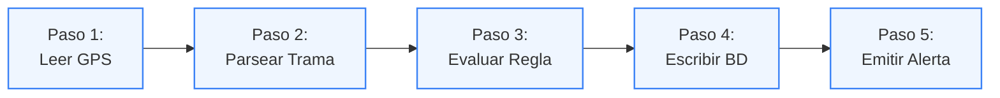
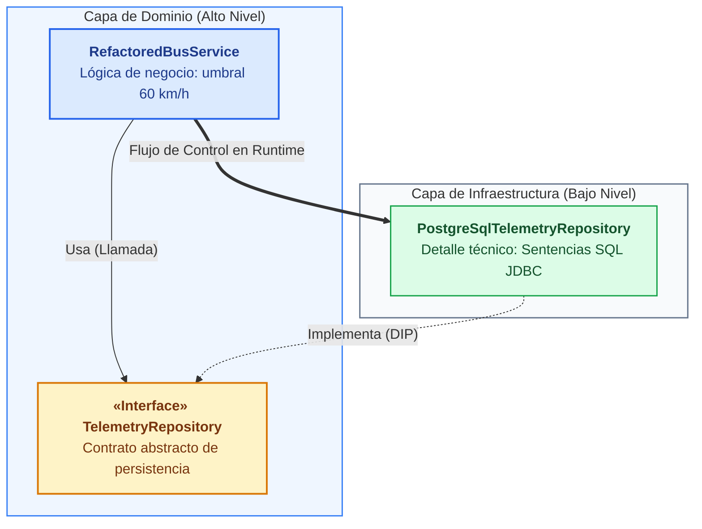
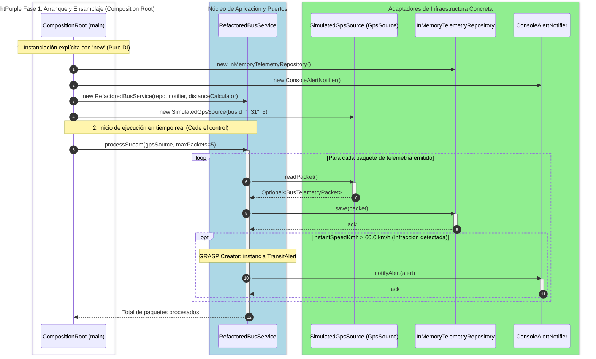

# Modularidad, Ocultamiento de Información e Inyección de Dependencias

El diseño de software es una disciplina deliberada de resolución de problemas bajo restricciones cuyo propósito es controlar la complejidad y garantizar la mantenibilidad a lo largo del tiempo. Cuando un sistema crece sin límites arquitectónicos explícitos, su estructura se degrada rápidamente, dificultando la incorporación de nuevas funcionalidades y multiplicando el costo de cada cambio.

Este documento proporciona los fundamentos teóricos y las técnicas prácticas de ingeniería para diseñar aplicaciones modulares, desacopladas y verificables mediante pruebas automatizadas. Todo el marco conceptual se desarrolla e ilustra a través del caso de estudio del curso en **Java 17+**: el sistema de ingestión, procesamiento y monitoreo de telemetría de la flota de autobuses **MetroCali MIO (UrbanTransit)**.

### Hoja de Ruta del Capítulo

Para comprender cómo se articulan estos principios arquitectónicos, seguiremos un recorrido progresivo:

1. **Síntomas de degradación del diseño:** Identificaremos las cuatro patologías estructurales de Robert C. Martin (rigidez, fragilidad, inmovilidad y viscosidad) contextualizadas en la operación de MetroCali.
2. **Descomposición modular y ocultamiento de información:** Analizaremos el criterio de David L. Parnas (1972) para dividir sistemas encapsulando secretos volátiles tras contratos abstractos estables.
3. **Inversión de dependencias y polimorfismo:** Exploraremos cómo el polimorfismo seguro permite invertir la dirección de las dependencias de código fuente respecto al flujo de control (Martin, DIP).
4. **Inyección de dependencias y Raíz de Composición:** Veremos cómo estructurar el ensamblaje de objetos mediante *Constructor Injection* y *Pure DI* (Mark Seemann), prescindiendo de dependencias mágicas de frameworks.
5. **Mapa arquitectónico y heurísticas GRASP:** Conectaremos la macroestructura del sistema con las heurísticas de Craig Larman (*Information Expert*, *Creator*, *Low Coupling*, *High Cohesion*, *Pure Fabrication*).
6. **Implementación y refactorización práctica:** Contrastaremos el código legado acoplado frente a la implementación modular final, sincronizada con el proyecto Maven del curso.
7. **Diagramas de interacción y dinámica de ejecución:** Analizaremos el grafo estático de clases y la dinámica de ejecución separando estrictamente la fase de arranque de la fase de procesamiento en tiempo real.

:::info[Proyecto Maven de Referencia para esta Guía]
El código fuente analizado en esta guía se encuentra implementado, testeado y verificado en el proyecto Maven **`urbantransit-telemetry`**, disponible en el repositorio de código del curso.

El proyecto está estructurado en los siguientes paquetes oficiales:
- `co.edu.icesi.urbantransit.model`: Tipos inmutables y objetos de valor (`GeoPoint`, `BusId`, `BusTelemetryPacket`, `TransitAlert`).
- `co.edu.icesi.urbantransit.demo.legacy`: Antipatrón monolítico con instanciación rígida (`LegacyBusService`).
- `co.edu.icesi.urbantransit.demo.refactored`: Arquitectura desacoplada con contratos, inyección por constructor y Raíz de Composición (`RefactoredBusService`, `CompositionRoot`).
- `co.edu.icesi.urbantransit.practice`: Laboratorio práctico de refactorización guiada para el estudiante (`SpeedAuditEngine`).

Puedes compilar el proyecto y ejecutar la suite completa de pruebas unitarias desde la raíz del proyecto ejecutando:
```bash
mvn clean test
```
:::

---

## 1. El Diseño de Software como Disciplina de Resolución de Problemas

### 1.1 Complejidad y Degradación Técnica del Software

En sistemas de software empresariales y de misión crítica, la mayor parte del costo total de propiedad no se concentra en la fase de desarrollo inicial, sino en la fase de mantenimiento y evolución. Cuando un equipo aborda el desarrollo acumulando código sin abstracciones intermedias, el software exhibe cuatro síntomas patológicos identificados por Robert C. Martin:

1. **Rigidez (*Rigidity*):** La tendencia del sistema a resistirse a cualquier modificación, dado que un cambio menor en una parte del código fuerza una cascada de cambios subsiguientes en módulos dependientes no relacionados.
   - *Manifestación en MetroCali:* Si el consorcio operador migra el hardware del bus y el sensor GPS cambia su protocolo de tramas de texto NMEA 0183 a paquetes binarios MQTT, un sistema rígido obliga a modificar también la lógica de cálculo de velocidad, las sentencias SQL de persistencia y la serialización de alertas.

   

2. **Fragilidad (*Fragility*):** La propensión del sistema a romperse en lugares que no tienen relación conceptual con la parte del código que fue modificada.
   - *Manifestación en MetroCali:* Ajustar el umbral de exceso de velocidad en corredores troncales de 60 km/h a 50 km/h provoca inesperadamente que el conector de base de datos agote su pool de conexiones o falle al dar formato a la marca temporal de auditoría.

   

3. **Inmovilidad (*Immobility*):** La incapacidad de reutilizar partes del sistema en otras aplicaciones o contextos debido a que se encuentran inseparablemente entrelazadas con detalles de infraestructura o dependencias concretas.
   - *Manifestación en MetroCali:* El algoritmo que valida si un autobús se encuentra dentro del polígono geográfico de Cali no puede reutilizarse en la aplicación móvil de los usuarios porque está fuertemente acoplado con el driver JDBC de PostgreSQL de los servidores centrales.

   

4. **Viscosidad (*Viscosity*):** La situación en la cual resulta más fácil y rápido aplicar un parche sucio (un "hack") que seguir las prácticas arquitectónicas correctas, degradando progresivamente el diseño.
   - *Manifestación en MetroCali:* Para evitar configurar una base de datos real durante pruebas locales, el desarrollador introduce condicionales como `if (!isTesting) database.insert(...)` directamente dentro de las reglas de negocio, ensuciando permanentemente el código.

   

### 1.2 El Caso de Estudio: MetroCali MIO (UrbanTransit)

Para anclar estos conceptos en un contexto de ingeniería riguroso, utilizaremos el sistema de telemetría y control de flota de **MetroCali MIO** (*UrbanTransit*).

- **Dominio:** Una flota de más de 900 autobuses (articulados, padrones y alimentadores) que recorren la infraestructura vial de Santiago de Cali.
- **Flujo de datos:** Cada autobús cuenta con una Unidad Lógica a Bordo (OBU) equipada con sensor GPS y módem de comunicaciones, la cual transmite paquetes periódicos de telemetría: identificador del autobús (`BusId`), ruta asignada, coordenadas geográficas (`GeoPoint`), marca de tiempo y velocidad instantánea.
- **Políticas de negocio operacionales:**
  - Validar que las coordenadas pertenezcan al área metropolitana de Cali (latitud 3.2500 a 3.5500, longitud -76.6000 a -76.4500).
  - Detectar excesos de velocidad sobre el límite reglamentario de 60 km/h en corredores troncales exclusivos del MIO.
  - Registrar de forma persistente cada paquete de telemetría para auditoría e históricos de cumplimiento.
  - Si se detecta una infracción de velocidad, generar inmediatamente una alerta (`TransitAlert`) y notificarla al centro de control.

### 1.3 Conexión con Drivers de Arquitectura (ASRs)

Tal como expone Michael Keeling en *Design It!*, los requerimientos que moldean la macroestructura del software se denominan **Requerimientos Arquitectónicamente Significativos (ASRs)**. En este sistema, la modularidad y la inyección de dependencias no son fines estéticos, sino **tácticas arquitectónicas** para satisfacer dos atributos de calidad no negociables:

1. **Modificabilidad (*Modifiability*):** Si MetroCali decide migrar de PostgreSQL a TimescaleDB o reemplazar las alertas por Slack con Apache Kafka, el núcleo de reglas de negocio no debe modificarse, recompilarse ni redesplegarse.
2. **Testabilidad (*Testability*):** La suite de pruebas unitarias que valida las reglas de velocidad y geocercas debe ejecutarse en milisegundos en el pipeline de CI/CD sin requerir bases de datos reales ni hardware conectado.

---

## 2. Descomposición Modular y Ocultamiento de Información

En su trabajo fundacional *"On the Criteria To Be Used in Decomposing Systems into Modules"* (CACM, 1972), David L. Parnas contrastó dos metodologías para dividir un sistema de software.

### 2.1 Descomposición Convencional frente a Ocultamiento de Secretos

La mayoría de desarrolladores tienden a descomponer los sistemas siguiendo el **diagrama de flujo o la secuencia temporal** de las operaciones:



En este enfoque cronológico, cada función o paso representa una etapa del procesamiento. Sin embargo, todas las etapas suelen compartir y depender directamente de los mismos formatos de datos y estructuras internas. Si el formato de la trama de entrada cambia o el motor de base de datos se actualiza, **todos los módulos deben modificarse**.

Frente a esta aproximación, Parnas propuso un criterio radicalmente diferente: **el Ocultamiento de Información (*Information Hiding*)**.

> *"Proponemos que se comience con una lista de decisiones de diseño difíciles o de decisiones de diseño que son susceptibles al cambio. Cada módulo se diseña entonces para ocultar dicha decisión del resto del sistema. La interfaz de un módulo se define para revelar lo menos posible sobre su funcionamiento interno."*  
> — David L. Parnas (1972)

Bajo el criterio de Parnas:
1. Cada módulo está caracterizado por su conocimiento de un **secreto de diseño**.
2. Los demás módulos únicamente interactúan con él a través de una interfaz abstracta que no revela la representación interna de los datos ni los algoritmos específicos utilizados.
3. El cambio en una decisión de diseño queda estrictamente confinado dentro del módulo que encapsula dicho secreto, eliminando el efecto dominó.

### 2.2 Comparativa de Enfoques de Modularización

| Criterio de Evaluación | Descomposición por Flujo Temporal (Convencional) | Descomposición por Ocultamiento de Secretos (Parnas) |
| :--- | :--- | :--- |
| **Eje de división** | Pasos secuenciales en el tiempo (Input -> Process -> Output). | Decisiones de diseño volátiles o difíciles de cambiar. |
| **Acoplamiento de datos** | Alto: Módulos comparten estructuras de datos globales o formatos físicos. | Bajo: Módulos sólo comparten contratos e interfaces abstractas. |
| **Fragilidad ante el cambio** | **Alta:** Cualquier modificación en un formato físico desencadena un efecto dominó en toda la cadena. | **Baja:** Los cambios quedan estrictamente confinados dentro del módulo que oculta la decisión. |
| **Facilidad de evolución** | **Baja:** Modificar un formato o componente requiere reescribir y recompilar múltiples etapas. | **Alta:** Se modifica únicamente el módulo responsable del secreto sin afectar al resto del sistema. |
| **Desarrollo paralelo** | Difícil: Los equipos requieren conocer detalles de implementación de otros pasos. | Óptimo: Cada equipo implementa contra una interfaz sin conocer los secretos ajenos. |
| **Facilidad de prueba** | Requiere integrar la secuencia completa para verificar un paso. | Permite probar cada módulo de forma aislada sustituyendo sus colaboradores con dobles de prueba (*mocks/stubs*). |

### 2.3 Identificación de los Secretos de Parnas en MetroCali MIO

Al diseñar el sistema de telemetría bajo las heurísticas de Parnas, identificamos cuatro secretos fundamentales de diseño:

1. **Secreto del hardware y protocolo de entrada:** El mecanismo físico mediante el cual se adquieren las tramas del vehículo (¿puerto serial RS-232, tramas NMEA 0183, broker MQTT o un simulador sintético para desarrollo local?).  
   *Contrato público (Puerto):* Interfaz `GpsSource`.
2. **Secreto del motor de persistencia:** El sistema de almacenamiento físico donde se guardan los paquetes (¿PostgreSQL con PostGIS, TimescaleDB para series de tiempo o una lista en memoria durante pruebas unitarias?).  
   *Contrato público (Puerto):* Interfaz `TelemetryRepository`.
3. **Secreto del canal de notificación:** La infraestructura técnica para emitir alertas operacionales (¿llamada HTTP a un webhook de Slack, cola AMQP en RabbitMQ o mensajes formateados por consola?).  
   *Contrato público (Puerto):* Interfaz `AlertNotifier`.
4. **Secreto del modelo geodésico:** El algoritmo matemático empleado para calcular distancias entre coordenadas sobre la curvatura de la Tierra (¿fórmula trigonométrica de Haversine o elipsoide de Vincenty?).  
   *Contrato público:* Método `distanceToInMeters()` encapsulado en `GeoPoint` (*Information Expert*) o la interfaz `GeoDistanceCalculator` (*Pure Fabrication*).

:::tip[Pausa de Reflexión: Secretos vs. Entidades]
¿Por qué el modelo de datos de la base de datos (tablas, columnas, tipos SQL) debe ser un secreto para la lógica de negocio?  
Si el servicio de negocio conociera las columnas de la tabla `bus_telemetry`, cualquier cambio en la estructura de almacenamiento obligaría a recompilar la regla de velocidad de 60 km/h. Al ocultar la persistencia tras el contrato `TelemetryRepository.save(packet)`, el negocio solo conoce su propio objeto de dominio `BusTelemetryPacket`.
:::

---

## 3. Inversión de Dependencias y Polimorfismo

### 3.1 Polimorfismo y Dirección del Flujo de Dependencias

Antes de examinar la inversión de dependencias, es indispensable clarificar el concepto central que la hace posible: **el polimorfismo**.

#### ¿Qué es el Polimorfismo?
En programación orientada a objetos, el **polimorfismo** es la capacidad de invocar operaciones definidas en un contrato o interfaz abstracta común, delegando su ejecución en tiempo de ejecución (*runtime*) a distintas implementaciones concretas especializadas. El componente invocador permanece completamente agnóstico sobre qué clase concreta ejecuta la acción; sólo conoce y confía en el contrato acordado.


*Figura: Despacho dinámico polimórfico en tiempo de ejecución desacoplado del invocador.*

#### El Contraste Arquitectónico: Flujo de Control vs. Dependencias de Código Fuente
Para comprender cómo el polimorfismo transforma la arquitectura del software, debemos distinguir dos conceptos que frecuentemente se confunden:

1. **Flujo de Control en Tiempo de Ejecución (*Runtime Flow of Control*):** Es el orden cronológico en el que el procesador ejecuta las instrucciones. Cuando el sistema procesa un autobús, el servicio de negocio toma una decisión y luego le ordena a la base de datos almacenar el registro. Por lo tanto, el flujo de ejecución viaja naturalmente **desde el negocio hacia la base de datos** (de alto nivel hacia bajo nivel).
2. **Dependencias de Código Fuente en Tiempo de Compilación (*Compile-Time Source Code Dependencies*):** Es la dirección de las referencias e importaciones (`import` en Java, `#include` en C++) que el compilador exige para validar los tipos.

En la programación procedural tradicional, la invocación de funciones requería que el módulo llamador importara directamente al módulo llamado. En consecuencia, las dependencias de código fuente seguían inexorablemente la misma dirección del flujo de control:


*Figura 5.1: Dependencias de código fuente siguiendo el flujo de control en la programación tradicional (Martin, 2017).*

En este esquema tradicional, para que la función de alto nivel `HL1` invoque a `ML1`, debe incluir una sentencia que apunte directamente a `ML1`. Si `ML1` cambia (por ejemplo, al cambiar de motor de base de datos), `HL1` se ve forzada a recompilarse y redesplegarse.

Sin embargo, la llegada del polimorfismo seguro mediante interfaces orientadas a objetos cambió radicalmente esta regla:


*Figura 5.2: Inversión de dependencias de código fuente frente al flujo de control mediante polimorfismo e interfaces (Martin, 2017).*

En la Figura 5.2, el módulo `HL1` invoca el método a través de una interfaz abstracta `I`. En tiempo de ejecución, el flujo de control continúa viajando desde `HL1` hacia `ML1`. No obstante, la **dependencia de código fuente** (la relación de implementación entre `ML1` e `I`) apunta en la **dirección exactamente opuesta al flujo de control**.

Aterricemos este contraste directamente sobre los componentes de MetroCali:



Robert C. Martin resume el impacto arquitectónico de esta técnica:

> *"El hecho de que los lenguajes OO proporcionen polimorfismo seguro significa que cualquier dependencia de código fuente, sin importar dónde se encuentre, puede invertirse (...). Los arquitectos de software tienen control absoluto sobre la dirección de todas las dependencias de código fuente en el sistema."*  
> — Robert C. Martin (2017)

Gracias al polimorfismo, los detalles de infraestructura técnica (motores SQL, puertos seriales, clientes HTTP) dejan de ser los cimientos sobre los cuales se construye el negocio y pasan a ser **plugins intercambiables** que dependen de las interfaces del dominio:


*Figura 5.3: La interfaz de usuario y la base de datos convertidas en plugins de las reglas de negocio (Martin, 2017).*

Este desacoplamiento confiere dos ventajas decisivas:
- **Desplegabilidad Independiente (*Independent Deployability*):** Si se migra el esquema de PostgreSQL o el cliente de alertas, sólo se recompila y despliega el adaptador de infraestructura. La lógica de negocio permanece intacta.
- **Desarrollabilidad Independiente (*Independent Developability*):** Los ingenieros pueden avanzar en el desarrollo y las pruebas de las reglas de validación sin esperar a que el hardware o la base de datos real estén aprovisionados.

---

### 3.2 Abstracciones Estables frente a Detalles Volátiles

El **Principio de Inversión de Dependencias (DIP)** formaliza este diseño a través de dos reglas canónicas:

1. **Los módulos de alto nivel no deben depender de los módulos de bajo nivel.** Ambos deben depender de abstracciones (interfaces o clases abstractas).
2. **Las abstracciones no deben depender de los detalles.** Los detalles concretos deben depender de las abstracciones.

¿Significa esto que jamás debemos importar una clase concreta en Java? No. Las clases de la biblioteca estándar de Java como `java.lang.String` o `java.time.Instant` son concretas, pero son **extremadamente estables**: su probabilidad de sufrir cambios que rompan el código de negocio es prácticamente nula.

El principio se enfoca estrictamente en las **concreciones volátiles**: aquellas clases y módulos que están bajo desarrollo activo y que sufren modificaciones constantes (clientes HTTP, repositorios SQL, conectores a hardware, parsers de mensajes).

Para gestionar estas dependencias volátiles, aplicamos cuatro reglas prácticas de codificación:

1. **No referenciar clases concretas y volátiles:** Declarar variables, campos y parámetros utilizando contratos de interfaz (`TelemetryRepository`, `GpsSource`).
2. **No derivar de clases concretas y volátiles:** La herencia en lenguajes de tipado estático representa el vínculo de código fuente más rígido posible. Se debe preferir la implementación de interfaces o composición.
3. **No sobrescribir métodos concretos:** Si un método concreto ya tiene implementación en una clase base, sobrescribirlo acarrea las dependencias de dicha clase base. Convierta el método en abstracto y genere implementaciones independientes.
4. **Nunca mencionar el nombre de nada concreto y volátil:** En el núcleo de negocio, no deben figurar nombres de clases de drivers, bibliotecas externas o motores de persistencia.

---

## 4. Inyección de Dependencias: Constructor Injection y Pure DI

### 4.1 Desmitificando DI: Concepto frente a Frameworks

Existe una confusión generalizada en la industria: suponer que la Inyección de Dependencias es sinónimo de un framework o contenedor específico (como Spring Boot, Guice o Quarkus).

Mark Seemann y Steven van Deursen (2019) aclaran esta distinción en tres niveles:

- **Inversión de Control (IoC):** Principio general de ingeniería en el que el control del flujo del programa se transfiere a un componente externo (el *"Principio de Hollywood: no nos llames, nosotros te llamaremos"*).
- **Inyección de Dependencias (DI):** Es un conjunto de patrones y principios de diseño orientado a objetos cuyo propósito es desacoplar clases de sus dependencias, permitiendo que dichas dependencias sean suministradas desde el exterior en lugar de ser construidas internamente.
- **Contenedor de DI (DI Container):** Una herramienta de software opcional (como Spring `ApplicationContext`) que automatiza la resolución y el ciclo de vida del grafo de objetos mediante metadatos o reflexión.

La Inyección de Dependencias debe comprenderse y aplicarse **primero sin frameworks mágicos**.

### 4.2 Constructor Injection (Inyección por Constructor)

El patrón canónico para implementar DI es **Constructor Injection**.

> *"Constructor Injection es el acto de definir estáticamente la lista de dependencias requeridas especificándolas como parámetros en el constructor de la clase."*  
> — Mark Seemann & Steven van Deursen (2019)

Observe cómo se aplica en la clase de negocio `RefactoredBusService`:

```java
package co.edu.icesi.urbantransit.demo.refactored.service;

import co.edu.icesi.urbantransit.demo.refactored.port.AlertNotifier;
import co.edu.icesi.urbantransit.demo.refactored.port.GeoDistanceCalculator;
import co.edu.icesi.urbantransit.demo.refactored.port.TelemetryRepository;
import java.util.Objects;

public class RefactoredBusService {

    private final TelemetryRepository repository;
    private final AlertNotifier alertNotifier;
    private final GeoDistanceCalculator distanceCalculator;

    /**
     * Inyección estricta por constructor con validación de nulidad (Fast-Fail).
     */
    public RefactoredBusService(
            TelemetryRepository repository,
            AlertNotifier alertNotifier,
            GeoDistanceCalculator distanceCalculator
    ) {
        this.repository = Objects.requireNonNull(repository, "repository no puede ser null");
        this.alertNotifier = Objects.requireNonNull(alertNotifier, "alertNotifier no puede ser null");
        this.distanceCalculator = Objects.requireNonNull(distanceCalculator, "distanceCalculator no puede ser null");
    }
    // ...
}
```

Ventajas de Constructor Injection frente a alternativas como Field Injection (`@Autowired` directo sobre campos privados):
- **Garantía de Invariante de Inicialización:** El objeto nunca puede existir en un estado inconsistente o parcialmente construido. Si falta una dependencia, el constructor rechaza la instanciación de inmediato.
- **Inmutabilidad:** Los campos que almacenan las dependencias se declaran como `final`.
- **Transparencia en Tiempo de Compilación:** La firma del constructor documenta de forma explícita qué colaboradores necesita la clase para operar.
- **Prevención de Acoplamiento Temporal (*Temporal Coupling*):** Se evita el error de invocar un método de negocio antes de haber configurado un setter indispensable.

### 4.3 Pure DI: Inyección Pura sin Frameworks

**Pure DI** (denominada en la literatura temprana como *Poor Man's DI*) es la práctica de aplicar Inyección de Dependencias utilizando el propio lenguaje de programación (Java puro con la palabra clave `new`), sin la intermediación de ningún contenedor o biblioteca externa.

#### Ejemplo de Pure DI en Java
Observe cómo se compone manualmente el grafo de objetos en Java puro:

```java
// 1. Instanciación explícita de los adaptadores de infraestructura
TelemetryRepository repository = new InMemoryTelemetryRepository();
AlertNotifier notifier = new ConsoleAlertNotifier();
GeoDistanceCalculator distanceCalculator = new HaversineDistanceCalculator();

// 2. Inyección manual por constructor en el servicio de negocio
RefactoredBusService busService = new RefactoredBusService(
        repository,
        notifier,
        distanceCalculator
);

// 3. El servicio ya está 100% listo y validado para su ejecución
busService.processPacket(samplePacket);
```

Ventajas directas de Pure DI:
1. **Seguridad estricta por el compilador:** Si una dependencia cambia de tipo o falta en el ensamblaje, el compilador de Java emite un error inmediato. No existen fallas silenciosas en tiempo de ejecución causadas por anotaciones incorrectas.
2. **Máximo rendimiento:** Tiempo de arranque prácticamente instantáneo (microsegundos), sin sobrecarga de escaneo de classpath ni generación dinámica de proxies reflexivos en memoria.
3. **Claridad y depuración:** El flujo de instanciación puede seguirse paso a paso con el depurador estándar del IDE, sin saltos a través de capas internas del framework.

:::note[¿Cuándo tiene sentido un Contenedor IoC en la industria?]
Pure DI es la forma ideal de aprender diseño y es excelente para microservicios y aplicaciones de tamaño moderado. En sistemas empresariales masivos con cientos de servicios y ciclos de vida complejos por petición HTTP (*request-scoped*), un contenedor IoC (como Spring o Quarkus) aporta valor automatizando el cableado repetitivo, **siempre y cuando se continúe usando Constructor Injection** y se mantenga el dominio limpio de anotaciones del framework.
:::

---

### 4.4 La Raíz de Composición (Composition Root) frente al Antipatrón Service Locator

Cuando todas las clases de negocio delegan la creación de sus dependencias hacia arriba a través de sus constructores, surge una pregunta arquitectónica inevitable: **¿En qué lugar del sistema se instancian finalmente los objetos concretos?**

Ante esta necesidad, muchos desarrolladores recurren a una falsa solución: el **antipatrón Service Locator**.

#### El Antipatrón Service Locator: Por qué evitarlo
El antipatrón consiste en introducir un registro global accesible estáticamente al que las clases de negocio acuden para "pedir" lo que necesitan en tiempo de ejecución:

```java
// ANTIPATRÓN Service Locator: Oculta dependencias y destruye la testabilidad
public class BrokenBusService {
    public void processPacket(BusTelemetryPacket packet) {
        // La clase depende de un localizador global ocultando lo que realmente necesita
        TelemetryRepository repo = ServiceLocator.getInstance().get(TelemetryRepository.class);
        repo.save(packet);
    }
}
```

El patrón *Service Locator* es perjudicial porque:
- **Oculta dependencias:** La firma del constructor no declara qué necesita la clase. Para saber que requiere un `TelemetryRepository`, el desarrollador debe inspeccionar cada línea del método.
- **Dificulta el mantenimiento y las pruebas:** Para escribir una prueba unitaria, es necesario preconfigurar un estado global estático, arriesgando interferencias entre tests concurrentes.
- **Rompe la encapsulación:** La clase de negocio adquiere una dependencia indeseada hacia la API del localizador global.

#### La Solución Arquitectónica: Composition Root (Raíz de Composición)
En lugar de pasar un localizador o ensuciar el dominio con `new`, la arquitectura define una ubicación única y centralizada:

> *"Una Raíz de Composición es una ubicación lógica única en una aplicación donde los módulos se componen y ensamblan juntos. Debe situarse lo más cerca posible del punto de entrada de la aplicación (el método main)."*  
> — Mark Seemann & Steven van Deursen (2019)

En una aplicación de consola, un microservicio o un proceso batch, la Raíz de Composición es la clase `CompositionRoot` en el paquete raíz del sistema. Es el único componente que tiene permiso explícito para conocer tanto el dominio como la infraestructura y ensamblar el grafo de objetos mediante `new` explícito.

---

## 5. De la Teoría al Código: Mapa Arquitectónico del MIO

Antes de examinar la implementación en código fuente, analicemos el mapa de navegación mental de la arquitectura desacoplada de MetroCali:

```mermaid
flowchart TD
    subgraph Entrada ["1. Punto de Arranque (Composition Root)"]
        CR["<b>CompositionRoot (main)</b><br/>co.edu.icesi.urbantransit.demo.refactored<br/>Única clase con permiso para usar 'new'<br/>Ensambla el grafo completo al iniciar"]
    end

    subgraph Dominio ["2. Núcleo de Aplicación (Lógica Pura del MIO)"]
        direction TB
        Service["<b>RefactoredBusService</b><br/>Lógica operacional: evalúa límite de 60 km/h<br/>Solo conoce contratos (puertos)"]
        
        subgraph Puertos ["Puertos de Salida y Entrada (Secretos de Parnas)"]
            RepoPort["<b>«Interface» TelemetryRepository</b><br/>Oculta la tecnología de almacenamiento"]
            AlertPort["<b>«Interface» AlertNotifier</b><br/>Oculta el canal de mensajería"]
            GeoPort["<b>«Interface» GeoDistanceCalculator</b><br/>Pure Fabrication: Oculta la trigonometría"]
        end
    end

    subgraph Infraestructura ["3. Infraestructura Concreta (Adaptadores Intercambiables)"]
        direction TB
        subgraph Almacenamiento ["Adaptadores de Persistencia"]
            Postgres["<b>PostgreSqlTelemetryRepository</b><br/>Producción: Sentencias JDBC"]
            InMemory["<b>InMemoryTelemetryRepository</b><br/>Pruebas / Local: Lista en memoria"]
        end
        subgraph Notificaciones ["Adaptadores de Notificación"]
            Slack["<b>SlackAlertNotifier</b><br/>Producción: Webhook HTTPS"]
            Console["<b>ConsoleAlertNotifier</b><br/>Desarrollo local: Mensajes por consola"]
        end
    end

    %% Relaciones de Ensamblaje en el Arranque
    CR ==>|"1. Ensambla e inyecta colaboradores"| Service
    CR -->|"1. Instancia"| InMemory
    CR -->|"1. Instancia"| Console

    %% Dependencias de Código Fuente en el Dominio
    Service -->|"2. Invoca"| RepoPort
    Service -->|"2. Invoca"| AlertPort
    Service -->|"2. Invoca"| GeoPort

    %% Inversión de Dependencias (DIP)
    Postgres -.->|"3. Implementa contrato (DIP)"| RepoPort
    InMemory -.->|"3. Implementa contrato (DIP)"| RepoPort
    Slack -.->|"3. Implementa contrato (DIP)"| AlertPort
    Console -.->|"3. Implementa contrato (DIP)"| AlertPort

    %% Estilos visuales
    style Entrada fill:#faf5ff,stroke:#8b5cf6,stroke-width:1.5px
    style CR fill:#f3e8ff,stroke:#7c3aed,stroke-width:2px,color:#4c1d95

    style Dominio fill:#eff6ff,stroke:#3b82f6,stroke-width:1.5px
    style Service fill:#dbeafe,stroke:#2563eb,stroke-width:2px,color:#1e3a8a
    style Puertos fill:#fffbeb,stroke:#f59e0b,stroke-width:1.5px
    style RepoPort fill:#fef3c7,stroke:#d97706,stroke-width:1.5px,color:#78350f
    style AlertPort fill:#fef3c7,stroke:#d97706,stroke-width:1.5px,color:#78350f
    style GeoPort fill:#fef3c7,stroke:#d97706,stroke-width:1.5px,color:#78350f

    style Infraestructura fill:#f8fafc,stroke:#64748b,stroke-width:1.5px
    style Almacenamiento fill:#f0fdf4,stroke:#10b981,stroke-width:1px
    style Notificaciones fill:#f0fdf4,stroke:#10b981,stroke-width:1px
    style Postgres fill:#dcfce7,stroke:#16a34a,stroke-width:1.5px,color:#14532d
    style InMemory fill:#dcfce7,stroke:#16a34a,stroke-width:1.5px,color:#14532d
    style Slack fill:#dcfce7,stroke:#16a34a,stroke-width:1.5px,color:#14532d
    style Console fill:#dcfce7,stroke:#16a34a,stroke-width:1.5px,color:#14532d
```



### Articulación con las Heurísticas GRASP de Craig Larman

La estructura anterior aplica metódicamente los patrones de asignación de responsabilidades estudiados en Larman (Cap. 17):

1. **Information Expert (Experto en Información):**
   - `GeoPoint` posee la latitud y la longitud; por lo tanto, es el experto que valida si la posición cae dentro del perímetro de Cali y calcula la distancia geodésica básica.
2. **Creator (Creador):**
   - `RefactoredBusService` tiene la responsabilidad de crear la instancia de `TransitAlert` cuando detecta una infracción, porque posee toda la información de contexto (el paquete recibido, la velocidad registrada y el límite operacional).
   - `CompositionRoot` actúa como el Creador global del grafo de adaptadores, relevando al dominio de conocer constructores concretos.
3. **Low Coupling (Bajo Acoplamiento):**
   - El servicio de negocio desconoce si las alertas van a la consola o a Slack. Su acoplamiento se restringe al contrato abstracto `AlertNotifier`.
4. **High Cohesion (Alta Cohesión):**
   - `RefactoredBusService` únicamente coordina la regla de velocidad de la flota. No gestiona pools JDBC ni protocolos de red.
5. **Pure Fabrication (Fabricación Pura):**
   - La interfaz `GeoDistanceCalculator` no representa un concepto del mundo real de autobuses, pero se crea como una abstracción artificial para independizar las fórmulas trigonométricas de las entidades del dominio.

---

## 6. Caso de Estudio MetroCali MIO: Implementación Práctica en Java 17+

A continuación, implementaremos el sistema siguiendo el código fuente oficial del proyecto `urbantransit-telemetry`.

### 6.1 Paso 1: Modelo de Dominio Inmutable con Records de Java 17+

Utilizamos los **Records** de Java 17+ para modelar objetos de valor (*Value Objects*) y eventos inmutables.

#### Identificador Tipado (`BusId.java`)
Evita el antipatrón de obsesión por tipos primitivos (*Primitive Obsession*), garantizando que ningún identificador de bus inválido circule por el sistema:

```java
package co.edu.icesi.urbantransit.model;

import java.util.Objects;

public record BusId(String value) {

    public BusId {
        Objects.requireNonNull(value, "El identificador de bus no puede ser nulo");
        String trimmed = value.trim();
        if (trimmed.isEmpty()) {
            throw new IllegalArgumentException("El identificador de bus no puede estar vacio");
        }
        if (!trimmed.matches("^(MC|BYN|GIT|MIO)-\\d{4}$")) {
            throw new IllegalArgumentException(
                "Formato de identificador invalido para MetroCali: " + value +
                " (Debe coincidir con prefijos MC, BYN, GIT o MIO seguido de 4 digitos, ej. MC-1042)"
            );
        }
    }

    @Override
    public String toString() {
        return value;
    }
}
```

#### Coordenada Geográfica (`GeoPoint.java`)
Aplica *Information Expert* al validar el polígono metropolitano de Cali y encapsular la fórmula de Haversine:

```java
package co.edu.icesi.urbantransit.model;

import java.time.Instant;
import java.util.Objects;

public record GeoPoint(double latitude, double longitude, Instant timestamp) {

    public static final double MIN_LAT = 3.2500;
    public static final double MAX_LAT = 3.5500;
    public static final double MIN_LON = -76.6000;
    public static final double MAX_LON = -76.4500;
    private static final double EARTH_RADIUS_METERS = 6371000.0;

    public GeoPoint {
        Objects.requireNonNull(timestamp, "timestamp no puede ser null");
        if (latitude < MIN_LAT || latitude > MAX_LAT || longitude < MIN_LON || longitude > MAX_LON) {
            throw new IllegalArgumentException(
                String.format("Coordenadas fuera del area metropolitana de Cali: [%f, %f]", latitude, longitude)
            );
        }
    }

    public double distanceToInMeters(GeoPoint other) {
        Objects.requireNonNull(other, "El punto de comparacion no puede ser null");

        double lat1Rad = Math.toRadians(this.latitude);
        double lat2Rad = Math.toRadians(other.latitude());
        double deltaLat = Math.toRadians(other.latitude() - this.latitude);
        double deltaLon = Math.toRadians(other.longitude() - this.longitude);

        double a = Math.sin(deltaLat / 2.0) * Math.sin(deltaLat / 2.0)
                + Math.cos(lat1Rad) * Math.cos(lat2Rad)
                * Math.sin(deltaLon / 2.0) * Math.sin(deltaLon / 2.0);

        double c = 2.0 * Math.atan2(Math.sqrt(a), Math.sqrt(1.0 - a));
        return EARTH_RADIUS_METERS * c;
    }
}
```

#### Paquete de Telemetría (`BusTelemetryPacket.java`)
```java
package co.edu.icesi.urbantransit.model;

import java.util.Objects;

public record BusTelemetryPacket(
        BusId busId,
        String routeId,
        GeoPoint location,
        double instantSpeedKmh
) {
    public BusTelemetryPacket {
        Objects.requireNonNull(busId, "busId no puede ser null");
        Objects.requireNonNull(routeId, "routeId no puede ser null");
        Objects.requireNonNull(location, "location no puede ser null");
        if (instantSpeedKmh < 0.0 || instantSpeedKmh > 160.0) {
            throw new IllegalArgumentException("Velocidad instantanea inverosimil: " + instantSpeedKmh + " km/h");
        }
    }
}
```

#### Alerta Operacional (`TransitAlert.java`)
```java
package co.edu.icesi.urbantransit.model;

import java.time.Instant;
import java.util.Objects;
import java.util.UUID;

public record TransitAlert(
        UUID alertId,
        BusId busId,
        String routeId,
        AlertType alertType,
        AlertSeverity severity,
        String message,
        GeoPoint location,
        Instant occurredAt
) {
    public enum AlertType { SPEEDING, GEOFENCE_VIOLATION, HEADWAY_GAP, EXCESSIVE_IDLE }
    public enum AlertSeverity { INFO, WARNING, CRITICAL }

    public TransitAlert {
        Objects.requireNonNull(alertId, "alertId requerido");
        Objects.requireNonNull(busId, "busId requerido");
        Objects.requireNonNull(routeId, "routeId requerido");
        Objects.requireNonNull(alertType, "alertType requerido");
        Objects.requireNonNull(severity, "severity requerida");
        Objects.requireNonNull(message, "message requerido");
        Objects.requireNonNull(location, "location requerida");
        Objects.requireNonNull(occurredAt, "occurredAt requerido");
    }
}
```

---

### 6.2 Paso 2: El Antipatrón de Acoplamiento Rígido (`LegacyBusService.java`)

Examinemos el código que con frecuencia se encuentra en proyectos que carecen de diseño arquitectónico. Observe cómo la lógica de negocio, la lectura de hardware serial, la conexión SQL y la notificación a Slack están soldadas en una única clase mediante `new`:

```java
package co.edu.icesi.urbantransit.demo.legacy;

import co.edu.icesi.urbantransit.model.BusTelemetryPacket;

public class LegacyBusService {

    // Dependencias duras soldadas en la clase
    private final LegacyGpsSerialReader serialReader;
    private final LegacyPostgreSqlDatabase database;
    private final LegacySlackNotifier slackNotifier;

    public LegacyBusService() {
        // ANTIPATRÓN: Instanciación con 'new' dentro del constructor
        this.serialReader = new LegacyGpsSerialReader("/dev/ttyUSB0", 9600);
        this.database = new LegacyPostgreSqlDatabase("jdbc:postgresql://db.metrocali.gov.co:5432/mio_prod");
        this.slackNotifier = new LegacySlackNotifier("https://hooks.slack.com/services/T00/B00/X00");
    }

    public void processNextTelemetryCycle() {
        // 1. Lectura directa de hardware
        BusTelemetryPacket packet = serialReader.readRawPacket();
        if (packet == null) return;

        // 2. Persistencia obligatoria en PostgreSQL
        database.insertTelemetry(
                packet.busId().value(),
                packet.routeId(),
                packet.location().latitude(),
                packet.location().longitude(),
                packet.instantSpeedKmh()
        );

        // 3. Regla de negocio operacional: límite de velocidad en troncal MIO (60 km/h)
        if (packet.instantSpeedKmh() > 60.0) {
            String message = String.format(java.util.Locale.US,
                    "ALERTA MIO: Bus %s en ruta %s registro exceso de velocidad: %.1f km/h",
                    packet.busId().value(), packet.routeId(), packet.instantSpeedKmh());

            // 4. Envío a Slack
            slackNotifier.sendAlert(message);
        }
    }
}
```

#### ¿Por qué este diseño colapsa?
- **Falta total de testabilidad:** Para verificar si la condición `packet.instantSpeedKmh() > 60.0` emite una alerta, la prueba automatizada intentará conectarse a la base de datos de producción y abrir un puerto `/dev/ttyUSB0`. Si la base de datos no está disponible, la prueba fallará.
- **Rigidez al cambio:** Si MetroCali migra a telemetría MQTT o cambia PostgreSQL por TimescaleDB, esta clase de negocio debe reescribirse, poniendo en riesgo la lógica validada.

---

### 6.3 Paso 3: Diseño de Contratos de Interfaz (Puertos)

Aplicando el criterio de Parnas y el DIP de Martin, extraemos los contratos de interfaz que encapsulan los secretos volátiles en el paquete `co.edu.icesi.urbantransit.demo.refactored.port`:

#### Puerto de Entrada de Telemetría (`GpsSource.java`)
```java
package co.edu.icesi.urbantransit.demo.refactored.port;

import co.edu.icesi.urbantransit.model.BusTelemetryPacket;
import java.util.Optional;

public interface GpsSource {
    Optional<BusTelemetryPacket> readPacket();
}
```

#### Puerto de Salida de Persistencia (`TelemetryRepository.java`)
```java
package co.edu.icesi.urbantransit.demo.refactored.port;

import co.edu.icesi.urbantransit.model.BusTelemetryPacket;
import java.util.List;

public interface TelemetryRepository {
    void save(BusTelemetryPacket packet);
    List<BusTelemetryPacket> findAll();
    long count();
}
```

#### Puerto de Salida de Notificaciones (`AlertNotifier.java`)
```java
package co.edu.icesi.urbantransit.demo.refactored.port;

import co.edu.icesi.urbantransit.model.TransitAlert;

@FunctionalInterface
public interface AlertNotifier {
    void notifyAlert(TransitAlert alert);
}
```

#### Puerto de Cálculo Geodésico (`GeoDistanceCalculator.java`)
```java
package co.edu.icesi.urbantransit.demo.refactored.port;

import co.edu.icesi.urbantransit.model.GeoPoint;

@FunctionalInterface
public interface GeoDistanceCalculator {
    double calculateDistanceMeters(GeoPoint from, GeoPoint to);
}
```

---

### 6.4 Paso 4: Servicio de Dominio con Constructor Injection (`RefactoredBusService.java`)

Reescribimos el servicio de procesamiento. Note que la clase **no importa ninguna librería externa ni driver concreto**. Solo conoce sus propios modelos y los contratos abstractos:

```java
package co.edu.icesi.urbantransit.demo.refactored.service;

import co.edu.icesi.urbantransit.demo.refactored.port.AlertNotifier;
import co.edu.icesi.urbantransit.demo.refactored.port.GeoDistanceCalculator;
import co.edu.icesi.urbantransit.demo.refactored.port.GpsSource;
import co.edu.icesi.urbantransit.demo.refactored.port.TelemetryRepository;
import co.edu.icesi.urbantransit.model.BusTelemetryPacket;
import co.edu.icesi.urbantransit.model.TransitAlert;

import java.time.Instant;
import java.util.Locale;
import java.util.Objects;
import java.util.Optional;
import java.util.UUID;

public class RefactoredBusService {

    public static final double MAX_TRONCAL_SPEED_KMH = 60.0;

    private final TelemetryRepository repository;
    private final AlertNotifier alertNotifier;
    private final GeoDistanceCalculator distanceCalculator;

    /**
     * Inyección estricta por constructor. Campos final e inmutables.
     */
    public RefactoredBusService(
            TelemetryRepository repository,
            AlertNotifier alertNotifier,
            GeoDistanceCalculator distanceCalculator
    ) {
        this.repository = Objects.requireNonNull(repository, "repository no puede ser null");
        this.alertNotifier = Objects.requireNonNull(alertNotifier, "alertNotifier no puede ser null");
        this.distanceCalculator = Objects.requireNonNull(distanceCalculator, "distanceCalculator no puede ser null");
    }

    /**
     * Procesa un paquete individual de telemetría aplicando políticas operacionales.
     */
    public void processPacket(BusTelemetryPacket packet) {
        Objects.requireNonNull(packet, "El paquete de telemetria no puede ser null");

        // 1. Persistencia a través de la abstracción (DIP)
        repository.save(packet);

        // 2. Evaluación de política de velocidad en corredor troncal
        if (packet.instantSpeedKmh() > MAX_TRONCAL_SPEED_KMH) {
            // GRASP Creator: El servicio compone la alerta con la información del incidente
            TransitAlert alert = new TransitAlert(
                    UUID.randomUUID(),
                    packet.busId(),
                    packet.routeId(),
                    TransitAlert.AlertType.SPEEDING,
                    TransitAlert.AlertSeverity.WARNING,
                    String.format(Locale.US,
                            "Bus %s supero el limite troncal en ruta %s: %.1f km/h (Limite: %.1f km/h)",
                            packet.busId().value(), packet.routeId(), packet.instantSpeedKmh(), MAX_TRONCAL_SPEED_KMH),
                    packet.location(),
                    Instant.now()
            );

            // 3. Emisión a través de la abstracción (DIP)
            alertNotifier.notifyAlert(alert);
        }
    }

    /**
     * Procesa una secuencia de paquetes desde una fuente de entrada abstracta.
     */
    public int processStream(GpsSource source, int maxPackets) {
        Objects.requireNonNull(source, "La fuente de telemetria no puede ser null");
        int processedCount = 0;

        for (int i = 0; i < maxPackets; i++) {
            Optional<BusTelemetryPacket> packetOpt = source.readPacket();
            if (packetOpt.isEmpty()) {
                break;
            }
            processPacket(packetOpt.get());
            processedCount++;
        }

        return processedCount;
    }

    public GeoDistanceCalculator getDistanceCalculator() {
        return distanceCalculator;
    }
}
```

---

### 6.5 Paso 5: Adaptadores Concretos de Infraestructura

Implementamos los plugins de infraestructura que satisfacen las interfaces del dominio en `co.edu.icesi.urbantransit.demo.refactored.infra`:

#### Adaptador en Memoria (`InMemoryTelemetryRepository.java`)
```java
package co.edu.icesi.urbantransit.demo.refactored.infra;

import co.edu.icesi.urbantransit.demo.refactored.port.TelemetryRepository;
import co.edu.icesi.urbantransit.model.BusTelemetryPacket;

import java.util.ArrayList;
import java.util.Collections;
import java.util.List;
import java.util.Objects;

public class InMemoryTelemetryRepository implements TelemetryRepository {

    private final List<BusTelemetryPacket> storage = new ArrayList<>();

    @Override
    public synchronized void save(BusTelemetryPacket packet) {
        Objects.requireNonNull(packet, "El paquete a guardar no puede ser null");
        storage.add(packet);
    }

    @Override
    public synchronized List<BusTelemetryPacket> findAll() {
        return Collections.unmodifiableList(new ArrayList<>(storage));
    }

    @Override
    public synchronized long count() {
        return storage.size();
    }
}
```

#### Adaptador de Consola (`ConsoleAlertNotifier.java`)
```java
package co.edu.icesi.urbantransit.demo.refactored.infra;

import co.edu.icesi.urbantransit.demo.refactored.port.AlertNotifier;
import co.edu.icesi.urbantransit.model.TransitAlert;

import java.util.ArrayList;
import java.util.Collections;
import java.util.List;
import java.util.Objects;

public class ConsoleAlertNotifier implements AlertNotifier {

    private final List<TransitAlert> notifications = new ArrayList<>();

    @Override
    public synchronized void notifyAlert(TransitAlert alert) {
        Objects.requireNonNull(alert, "alert no puede ser null");
        notifications.add(alert);
        System.out.printf("[ALERTA OPERACIONAL - %s] Bus: %s | Ruta: %s | %s%n",
                alert.severity(), alert.busId().value(), alert.routeId(), alert.message());
    }

    public synchronized List<TransitAlert> getEmittedAlerts() {
        return Collections.unmodifiableList(new ArrayList<>(notifications));
    }
}
```

#### Adaptador de Cálculo Haversine (`HaversineDistanceCalculator.java`)
```java
package co.edu.icesi.urbantransit.demo.refactored.service;

import co.edu.icesi.urbantransit.demo.refactored.port.GeoDistanceCalculator;
import co.edu.icesi.urbantransit.model.GeoPoint;
import java.util.Objects;

public class HaversineDistanceCalculator implements GeoDistanceCalculator {

    @Override
    public double calculateDistanceMeters(GeoPoint from, GeoPoint to) {
        Objects.requireNonNull(from, "from no puede ser null");
        Objects.requireNonNull(to, "to no puede ser null");
        return from.distanceToInMeters(to);
    }
}
```

---

### 6.6 Paso 6: Ensamblaje en la Raíz de Composición (`CompositionRoot.java`)

La clase `CompositionRoot` es el único punto del sistema con permiso explícito para conocer las implementaciones concretas y ensamblarlas mediante Java puro:

```java
package co.edu.icesi.urbantransit.demo.refactored;

import co.edu.icesi.urbantransit.demo.refactored.infra.ConsoleAlertNotifier;
import co.edu.icesi.urbantransit.demo.refactored.infra.InMemoryTelemetryRepository;
import co.edu.icesi.urbantransit.demo.refactored.infra.SimulatedGpsSource;
import co.edu.icesi.urbantransit.demo.refactored.port.AlertNotifier;
import co.edu.icesi.urbantransit.demo.refactored.port.GeoDistanceCalculator;
import co.edu.icesi.urbantransit.demo.refactored.port.GpsSource;
import co.edu.icesi.urbantransit.demo.refactored.port.TelemetryRepository;
import co.edu.icesi.urbantransit.demo.refactored.service.HaversineDistanceCalculator;
import co.edu.icesi.urbantransit.demo.refactored.service.RefactoredBusService;
import co.edu.icesi.urbantransit.model.BusId;

public class CompositionRoot {

    public static void main(String[] args) {
        System.out.println("=== Arrancando UrbanTransit Telemetry (Pure DI) ===");
        CompositionRoot app = new CompositionRoot();
        app.runDemo();
    }

    public void runDemo() {
        // 1. Instanciación explícita de adaptadores de infraestructura
        TelemetryRepository repository = new InMemoryTelemetryRepository();
        AlertNotifier notifier = new ConsoleAlertNotifier();
        GeoDistanceCalculator distanceCalculator = new HaversineDistanceCalculator();

        // 2. Inyección por constructor en el servicio de aplicación
        RefactoredBusService busService = new RefactoredBusService(
                repository,
                notifier,
                distanceCalculator
        );

        // 3. Fuente de telemetría simulada para el bus MC-1042 en ruta T31
        GpsSource gpsSource = new SimulatedGpsSource(
                new BusId("MC-1042"),
                "T31",
                5 // Simula 5 paquetes de telemetría
        );

        System.out.println("[COMPOSITION ROOT] Grafo de objetos ensamblado con exito.");
        System.out.println("[COMPOSITION ROOT] Iniciando procesamiento de flujo...\n");

        // 4. Ejecución del procesamiento
        int packetsProcessed = busService.processStream(gpsSource, 5);

        System.out.println("\nResumen de Ejecucion:");
        System.out.println(" - Paquetes recibidos y procesados: " + packetsProcessed);
        System.out.println(" - Registros almacenados en repositorio: " + repository.count());
    }
}
```

---

### 6.7 Verificación Inmediata: Pruebas Unitarias Aisladas (`RefactoredBusServiceTest.java`)

Observe cómo la refactorización hace que probar la lógica operacional sea instantáneo, limpio y libre de servidores externos:

```java
package co.edu.icesi.urbantransit.demo;

import co.edu.icesi.urbantransit.demo.refactored.infra.InMemoryTelemetryRepository;
import co.edu.icesi.urbantransit.demo.refactored.port.AlertNotifier;
import co.edu.icesi.urbantransit.demo.refactored.port.GeoDistanceCalculator;
import co.edu.icesi.urbantransit.demo.refactored.service.HaversineDistanceCalculator;
import co.edu.icesi.urbantransit.demo.refactored.service.RefactoredBusService;
import co.edu.icesi.urbantransit.model.BusId;
import co.edu.icesi.urbantransit.model.BusTelemetryPacket;
import co.edu.icesi.urbantransit.model.GeoPoint;
import co.edu.icesi.urbantransit.model.TransitAlert;
import org.junit.jupiter.api.BeforeEach;
import org.junit.jupiter.api.DisplayName;
import org.junit.jupiter.api.Test;

import java.time.Instant;
import java.util.ArrayList;
import java.util.List;

import static org.assertj.core.api.Assertions.assertThat;

class RefactoredBusServiceTest {

    private InMemoryTelemetryRepository repository;
    private List<TransitAlert> capturedAlerts;
    private RefactoredBusService busService;

    @BeforeEach
    void setUp() {
        repository = new InMemoryTelemetryRepository();
        capturedAlerts = new ArrayList<>();
        AlertNotifier alertNotifier = capturedAlerts::add; // Doble de prueba (Spy con lambda)
        GeoDistanceCalculator distanceCalculator = new HaversineDistanceCalculator();

        // Ensamblaje local puro en la prueba
        busService = new RefactoredBusService(repository, alertNotifier, distanceCalculator);
    }

    @Test
    @DisplayName("Debe emitir alerta SPEEDING y persistir el paquete cuando la velocidad supera 60 km/h")
    void shouldEmitAlertAndPersistWhenSpeedExceedsTroncalLimit() {
        // Arrange
        BusId busId = new BusId("MC-1042");
        GeoPoint location = new GeoPoint(3.4350, -76.5300, Instant.now());
        BusTelemetryPacket packet = new BusTelemetryPacket(busId, "T31", location, 68.5);

        // Act
        busService.processPacket(packet);

        // Assert: 1. Paquete guardado
        assertThat(repository.count()).isEqualTo(1);
        assertThat(repository.findAll()).containsExactly(packet);

        // Assert: 2. Alerta generada y emitida
        assertThat(capturedAlerts).hasSize(1);
        TransitAlert alert = capturedAlerts.get(0);
        assertThat(alert.busId()).isEqualTo(busId);
        assertThat(alert.alertType()).isEqualTo(TransitAlert.AlertType.SPEEDING);
    }

    @Test
    @DisplayName("No debe emitir alerta cuando la velocidad no supera el limite reglamentario")
    void shouldNotEmitAlertWhenSpeedIsWithinLimit() {
        // Arrange
        BusId busId = new BusId("MC-2005");
        GeoPoint location = new GeoPoint(3.4350, -76.5300, Instant.now());
        BusTelemetryPacket packet = new BusTelemetryPacket(busId, "P21A", location, 55.0);

        // Act
        busService.processPacket(packet);

        // Assert
        assertThat(repository.count()).isEqualTo(1);
        assertThat(capturedAlerts).isEmpty();
    }
}
```

---

## 7. Diagramas de Diseño y Dinámica de Ejecución

### 7.1 Diagrama de Contratos y Fronteras (Mermaid Class Diagram)

El siguiente diagrama expone cómo el núcleo de aplicación depende exclusivamente de contratos abstractos y cómo los adaptadores de infraestructura convergen hacia el dominio:

```mermaid
classDiagram
    direction TB

    namespace Model {
        class BusId {
            +String value
            +BusId(String)
        }
        class GeoPoint {
            +double latitude
            +double longitude
            +Instant timestamp
            +distanceToInMeters(GeoPoint) double
        }
        class BusTelemetryPacket {
            +BusId busId
            +String routeId
            +GeoPoint location
            +double instantSpeedKmh
        }
        class TransitAlert {
            +UUID alertId
            +BusId busId
            +String routeId
            +AlertType alertType
            +AlertSeverity severity
            +String message
            +GeoPoint location
            +Instant occurredAt
        }
    }

    namespace Ports {
        class TelemetryRepository {
            <<Interface>>
            +save(BusTelemetryPacket) void
            +findAll() List~BusTelemetryPacket~
            +count() long
        }
        class AlertNotifier {
            <<Interface>>
            +notifyAlert(TransitAlert) void
        }
        class GpsSource {
            <<Interface>>
            +readPacket() Optional~BusTelemetryPacket~
        }
        class GeoDistanceCalculator {
            <<Interface>>
            +calculateDistanceMeters(GeoPoint, GeoPoint) double
        }
    }

    namespace Service {
        class RefactoredBusService {
            -TelemetryRepository repository
            -AlertNotifier alertNotifier
            -GeoDistanceCalculator distanceCalculator
            +RefactoredBusService(TelemetryRepository, AlertNotifier, GeoDistanceCalculator)
            +processPacket(BusTelemetryPacket) void
            +processStream(GpsSource, int) int
        }
    }

    namespace Infrastructure {
        class InMemoryTelemetryRepository {
            -List storage
            +save(BusTelemetryPacket) void
            +findAll() List~BusTelemetryPacket~
            +count() long
        }
        class ConsoleAlertNotifier {
            -List notifications
            +notifyAlert(TransitAlert) void
        }
        class SimulatedGpsSource {
            -BusId busId
            -String routeId
            +readPacket() Optional~BusTelemetryPacket~
        }
        class HaversineDistanceCalculator {
            +calculateDistanceMeters(GeoPoint, GeoPoint) double
        }
    }

    namespace Bootstrap {
        class CompositionRoot {
            +main(String[] args)$ void
            +runDemo() void
        }
    }

    %% Relaciones del Servicio con Puertos
    RefactoredBusService --> TelemetryRepository : Invoca contrato
    RefactoredBusService --> AlertNotifier : Invoca contrato
    RefactoredBusService --> GeoDistanceCalculator : Invoca contrato
    RefactoredBusService ..> BusTelemetryPacket : Procesa
    RefactoredBusService ..> TransitAlert : Crea (Creator)

    %% Inversión de Dependencias (DIP)
    InMemoryTelemetryRepository ..|> TelemetryRepository : Implementa (DIP)
    ConsoleAlertNotifier ..|> AlertNotifier : Implementa (DIP)
    SimulatedGpsSource ..|> GpsSource : Implementa (DIP)
    HaversineDistanceCalculator ..|> GeoDistanceCalculator : Implementa (DIP)

    %% Raíz de Composición cablea el grafo
    CompositionRoot ..> InMemoryTelemetryRepository : Instancia
    CompositionRoot ..> ConsoleAlertNotifier : Instancia
    CompositionRoot ..> HaversineDistanceCalculator : Instancia
    CompositionRoot ..> SimulatedGpsSource : Instancia
    CompositionRoot ..> RefactoredBusService : Ensambla e Inyecta
```



### 7.2 Diagrama de Secuencia: Dinámica de Arranque vs. Procesamiento en Tiempo Real

El siguiente diagrama clarifica la separación estricta entre la **Fase 1 (Arranque / Bootstrap)** en la Raíz de Composición y la **Fase 2 (Tiempo Real / Runtime)** durante la cual el servicio consume datos del puerto de entrada y delega a los adaptadores:



---

## 8. Matriz Comparativa de Estrategias de Composición

| Dimensión de Análisis | Instanciación Directa (`new` local) | Service Locator Global | Inyección de Dependencias Pura (Pure DI) | Contenedor IoC (Spring / Quarkus) |
| :--- | :--- | :--- | :--- | :--- |
| **Punto de ensamblaje** | Disperso en cada clase de negocio. | Disperso; invocado internamente. | Centralizado en la Raíz de Composición. | Centralizado en el contenedor IoC. |
| **Detección de errores** | Tiempo de compilación (pero rígido). | Tiempo de ejecución (fallas silenciosas). | **Tiempo de compilación estricto**. | Tiempo de arranque (*runtime bootstrap*). |
| **Acoplamiento** | Máximo acoplamiento a concreciones. | Acoplamiento al localizador global. | **Mínimo: sólo a abstracciones**. | Mínimo: sólo a abstracciones. |
| **Velocidad de arranque** | Instantánea. | Rápida. | **Instantánea (microsegundos)**. | Lenta a moderada (escaneo reflectivo). |
| **Transparencia de dependencias** | Nula (ocultas en el código). | Nula (ocultas tras la llamada al locator). | **Total: explícitas en el constructor**. | Explícita si se usa constructor. |
| **Idoneidad recomendada** | Sólo para objetos de valor inmutables. | **Antipatrón: evitar en diseño moderno**. | **Ideal para arquitecturas limpias y microservicios**. | Adecuado en aplicaciones corporativas masivas. |

---

## 9. Checklist de Revisión Arquitectónica (Code Review)

Al revisar código en el contexto de diseño de software y Pull Requests, verifique los siguientes puntos de control:

1. **Ausencia de `new` de infraestructura en el dominio:** ¿Existe alguna sentencia `new` que instancie clientes HTTP, conexiones JDBC o drivers de hardware dentro de las clases de dominio o aplicación? Si existe, rechace el PR y exija inyección por constructor.
2. **Dependencias explícitas en constructores:** ¿Declara la clase todas sus dependencias como argumentos `final` en su constructor público con validación de nulidad (`Objects.requireNonNull`)?
3. **Contratos en manos del consumidor:** ¿Las interfaces (`TelemetryRepository`, `AlertNotifier`) residen en el paquete del dominio/aplicación que las consume, y no en el paquete de los adaptadores que las implementan?
4. **Confinamiento de la Raíz de Composición:** ¿El ensamblaje de implementaciones concretas está estrictamente encapsulado en la capa de arranque (`CompositionRoot`), sin filtrarse hacia las capas internas?
5. **Testeabilidad sin magia:** ¿Es posible escribir una prueba unitaria para la lógica de negocio instanciando la clase con `new` y pasándole dobles de prueba simples (como `InMemoryTelemetryRepository`) en menos de cinco líneas de código?
