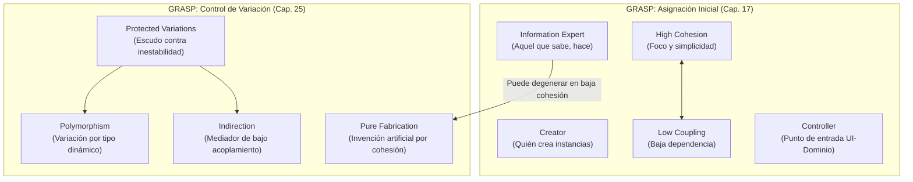
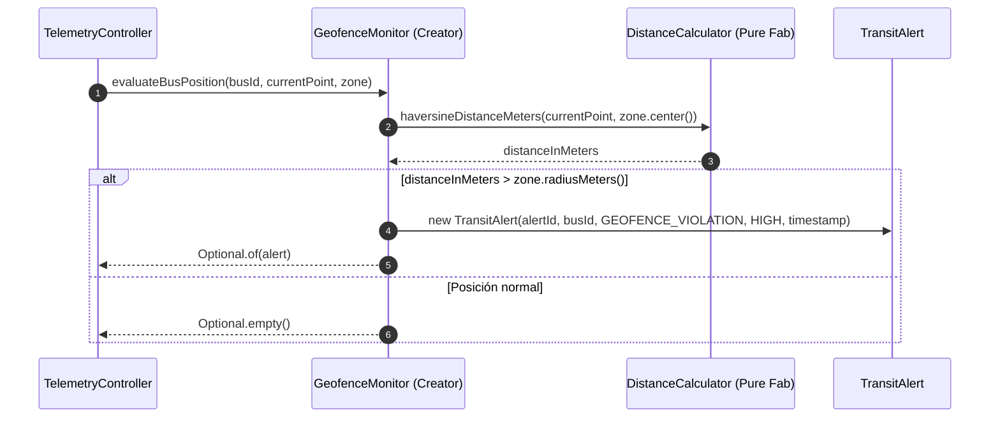
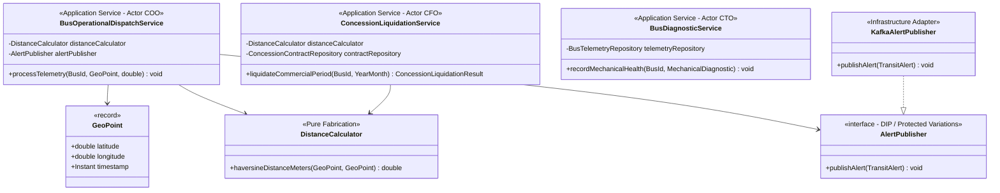

# Heurísticas de Diseño Orientado a Objetos: GRASP vs. SOLID

## 1. Encuadre Pedagógico y Resultados de Aprendizaje

El diseño de software orientado a objetos no consiste únicamente en modelar clases que reflejen sustantivos del mundo real, sino en tomar decisiones metodológicas sobre **dónde reside cada responsabilidad** y **cómo se protegen las fronteras del sistema frente al cambio inevitable**. En el marco de la Especialización en AI-Powered Software Engineering (AIPSE) de la Universidad Icesi, este módulo desarrolla las siguientes competencias:

- **RAA 1:** Analizar problemas de diseño de software según requerimientos, restricciones, dependencias y atributos de calidad del contexto.
- **RAA 2:** Aplicar patrones de diseño en soluciones de alcance acotado con criterios de cohesión, acoplamiento, extensibilidad y mantenibilidad.
- **Lineamiento de Inteligencia Artificial Generativa:** Nivel 3 (Colaboración con verificación crítica humana). Las herramientas de IA pueden asistir en la identificación de violaciones a heurísticas de diseño o en la generación preliminar de refactorizaciones; no obstante, el ingeniero de software debe validar rigurosamente la preservación de invariantes, la no duplicación de lógica entre actores y la coherencia de los límites modulares.

El dominio técnico articulador de esta guía es el sistema de control y monitoreo de transporte masivo **MetroCali MIO (UrbanTransit)**, un entorno distribuido de alta exigencia donde interactúan telemetría GPS en tiempo real, validación de geocercas, despacho operativo de flota y liquidación de contratos de concesión comercial.

A continuación se presenta la matriz de articulación pedagógica que sintetiza la complementariedad entre ambos enfoques:


---

## 2. Cohesión y Acoplamiento: Las Fuerzas Fundamentales del Diseño

Antes de formalizar cualquier catálogo de patrones o principios, es indispensable entender las dos fuerzas métricas fundacionales identificadas por Larry Constantine (1968, 1974) y retomadas por Grady Booch (1994):

### 2.1. Cohesión Funcional

La **cohesión** mide el grado en que los elementos internos de un módulo (métodos, atributos, estructuras de datos) colaboran estrechamente para cumplir un propósito conceptual único y bien delimitado.

- **Alta cohesión:** Una clase tiene una cantidad moderada de métodos con responsabilidades fuertemente vinculadas, no ejecuta tareas dispares y delega subtareas a colaboradores especializados.
- **Baja cohesión:** Una clase mezcla múltiples áreas conceptuales independientes (por ejemplo, cálculo de nómina, persistencia relacional SQL y serialización JSON). Estas clases resultan difíciles de comprender, imposibles de reutilizar de manera aislada y extremadamente frágiles ante modificaciones.

### 2.2. Acoplamiento

El **acoplamiento** cuantifica la intensidad de la dependencia o conocimiento que una entidad de software tiene sobre otra. En lenguajes de tipado estático como Java, el acoplamiento se manifiesta mediante:

1. Atributos de tipo `ClassB` dentro de `ClassA`.
2. Parámetros o tipos de retorno en firmas de métodos.
3. Variables locales e instanciación directa (`new ClassB()`).
4. Herencia de clases (`class A extends B`), que constituye la forma más rígida e intrusiva de acoplamiento.
5. Implementación de contratos (`class A implements InterfaceB`).

> **Criterio de ingeniería:** El objetivo del diseño no es alcanzar "acoplamiento cero". Un sistema sin acoplamiento no realiza trabajo útil, pues los objetos no podrían colaborar. La meta es mantener un **acoplamiento bajo, intencionado y orientado hacia abstracciones estables**, minimizando el acoplamiento hacia elementos volátiles o detalles de infraestructura técnica.

---

## 3. Patrones GRASP de Craig Larman: Asignación de Responsabilidades

Los patrones **GRASP (General Responsibility Assignment Software Patterns)**, formulados por Craig Larman en *Applying UML and Patterns*, no son plantillas de estructuras complejas (como los patrones GoF), sino principios mentales para responder una pregunta fundamental durante la elaboración de diagramas de interacción:

> *"¿Qué clase de software debe albergar esta responsabilidad y contener este método?"*

Larman clasifica los patrones GRASP en patrones fundamentales de asignación inicial (Capítulo 17) y patrones avanzados de variación y desacoplamiento (Capítulo 25).



### 3.1. Information Expert (Experto en Información)

- **Problema:** ¿Cuál es el criterio general para asignar una responsabilidad a una clase?
- **Solución:** Asignar la responsabilidad a la clase que posee la información necesaria para cumplirla (*"That which knows, does"* o principio *"Do It Myself"*).
- **Ejemplo en MetroCali MIO:** ¿Quién debe validar si un punto geográfico se encuentra dentro del rango de velocidad permitido? Una entidad `RouteSegment` conoce su velocidad máxima reglamentaria y su trazado; por tanto, es la experta para validar si la velocidad reportada por un vehículo excede el límite del tramo.

#### La Contraindicación de Information Expert

Information Expert puede sugerir decisiones perjudiciales si se aplica de forma aislada. Consideremos el cálculo de la distancia geodésica entre dos coordenadas GPS de un bus del MIO. Una lectura simplista sugeriría colocar el cálculo matemático de Haversine dentro de la clase `GeoPoint`, dado que contiene `latitude` y `longitude`:

```java
// Antipatrón: Sobrecargar GeoPoint con lógica geodésica avanzada
public class GeoPoint {
    private final double latitude;
    private final double longitude;

    public GeoPoint(double latitude, double longitude) {
        this.latitude = latitude;
        this.longitude = longitude;
    }

    // Sobrecarga conceptual: GeoPoint ahora depende de algoritmos de proyección elipsoidal
    public double calculateHaversineDistance(GeoPoint other) {
        double earthRadiusKm = 6371.0;
        double dLat = Math.toRadians(other.latitude - this.latitude);
        double dLon = Math.toRadians(other.longitude - this.longitude);
        double a = Math.sin(dLat / 2) * Math.sin(dLat / 2) +
                   Math.cos(Math.toRadians(this.latitude)) * Math.cos(Math.toRadians(other.latitude)) *
                   Math.sin(dLon / 2) * Math.sin(dLon / 2);
        double c = 2 * Math.atan2(Math.sqrt(a), Math.sqrt(1 - a));
        return earthRadiusKm * c;
    }
}
```

Si posteriormente el sistema requiere migrar a cálculos según el elipsoide WGS84, proyecciones UTM locales de Cali o cómputo sobre mallas espaciales espaciales indexadas (como Uber H3 o S2 Geometry), la clase básica `GeoPoint` se contamina con librerías matemáticas complejas, perdiendo su naturaleza de objeto de valor (*Value Object*). Aquí es donde entra en juego la **Fabricación Pura**.

### 3.2. Pure Fabrication (Fabricación Pura)

- **Problema:** ¿Qué objeto debe asumir la responsabilidad cuando asignar la tarea al Experto en Información violaría la Alta Cohesión, el Bajo Acoplamiento o la reusabilidad?
- **Solución:** Asignar un conjunto cohesivo de responsabilidades a una clase artificial o de conveniencia que no existe en el modelo del dominio conceptual del mundo real, pero que apoya un diseño limpio y mantenible.

En nuestro caso, creamos un servicio puro y sin estado: `DistanceCalculator` o `GeodesicDistanceService`.

```java
package co.edu.icesi.metrocali.domain.service;

import co.edu.icesi.metrocali.domain.model.GeoPoint;

/**
 * Pure Fabrication: Abstracción matemática desacoplada del modelo de dominio.
 * Permite cambiar la precisión geodésica sin alterar GeoPoint ni Route.
 */
public final class DistanceCalculator {

    private static final double EARTH_RADIUS_METERS = 6_371_000.0;

    private DistanceCalculator() {
        // Constructor privado para clase utilitaria inmutable
    }

    public static double haversineDistanceMeters(GeoPoint origin, GeoPoint destination) {
        if (origin == null || destination == null) {
            throw new IllegalArgumentException("Los puntos de origen y destino no pueden ser nulos");
        }

        double latDistance = Math.toRadians(destination.latitude() - origin.latitude());
        double lonDistance = Math.toRadians(destination.longitude() - origin.longitude());

        double a = Math.sin(latDistance / 2) * Math.sin(latDistance / 2)
                + Math.cos(Math.toRadians(origin.latitude()))
                * Math.cos(Math.toRadians(destination.latitude()))
                * Math.sin(lonDistance / 2) * Math.sin(lonDistance / 2);

        double c = 2 * Math.atan2(Math.sqrt(a), Math.sqrt(1 - a));
        return EARTH_RADIUS_METERS * c;
    }
}
```

`GeoPoint` en Java 17+ se define limpiamente como un `record`, cumpliendo estrictamente con ser un objeto portador de datos inmutable:

```java
package co.edu.icesi.metrocali.domain.model;

import java.time.Instant;

public record GeoPoint(double latitude, double longitude, Instant timestamp) {
    public GeoPoint {
        if (latitude < -90.0 || latitude > 90.0) {
            throw new IllegalArgumentException("Latitud fuera de rango [-90, 90]: " + latitude);
        }
        if (longitude < -180.0 || longitude > 180.0) {
            throw new IllegalArgumentException("Longitud fuera de rango [-180, 180]: " + longitude);
        }
    }
}
```

### 3.3. Creator (Creador)

- **Problema:** ¿Quién debe ser responsable de crear una nueva instancia de alguna clase?
- **Solución:** Asignar a la clase `B` la responsabilidad de crear una instancia de la clase `A` si se cumple alguna de las siguientes condiciones (a mayor número de coincidencias, mayor idoneidad):
  1. `B` compone o agrega de forma compuesta a `A`.
  2. `B` registra o almacena instancias de `A`.
  3. `B` usa de manera muy cercana a `A`.
  4. `B` tiene los datos de inicialización de `A` que se le pasarán al crearlo (es un Experto con respecto a su creación).

#### Aplicación en MetroCali MIO: Creación de `TransitAlert`

En el sistema MetroCali MIO se generan alertas operativas como `SPEEDING` (exceso de velocidad) o `GEOFENCE_VIOLATION` (salida del corredor asignado). ¿Quién debe instanciar `TransitAlert`?

- ¿Debe ser la entidad `Bus`? No. El bus físico es monitoreado; no registra ni administra el catálogo de alertas del centro de control.
- ¿Debe ser el controlador REST web? No. La lógica de detección y umbrales pertenece al dominio.
- El candidato ideal es `GeofenceMonitor` o `TelemetryEvaluationEngine`:
  - Posee la telemetría entrante y las coordenadas de la `GeofenceZone`.
  - Conoce los datos de inicialización de la alerta (identificador del bus, severidad, instante temporal, zona violada).
  - Registra temporalmente las alertas para su despacho inmediato.



### 3.4. Low Coupling (Bajo Acoplamiento) y High Cohesion (Alta Cohesión)

Larman designa a estos dos patrones como **principios evaluativos subyacentes**. Cada vez que se considera una alternativa de diseño, se debe sopesar:
- ¿Esta asignación incrementa innecesariamente las dependencias de mi clase? (Low Coupling).
- ¿Esta asignación obliga a mi clase a asumir responsabilidades no relacionadas con su foco primordial? (High Cohesion).

### 3.5. Controller (Controlador)

- **Problema:** ¿Cuál es el primer objeto más allá de la capa de interfaz de usuario (UI / API REST) que recibe y coordina un mensaje de operación del sistema?
- **Solución:** Asignar la responsabilidad a una clase que represente:
  - El sistema global, dispositivo o raíz del subsistema (*Facade Controller*, ej. `MetroCaliSystem`).
  - El escenario del caso de uso dentro del cual ocurre el evento (*Use Case Controller*, ej. `IngestTelemetryUseCaseHandler`).

> **Regla de oro de Larman:** La capa de presentación (controladores Spring MVC, endpoints gRPC, vistas JavaFX) **nunca** debe ejecutar lógica de negocio. Debe delegar inmediatamente al Controlador de Dominio o Caso de Uso.
>
> **Síntoma de Bloated Controller (Controlador Hinchado):** Un controlador que procesa directamente la lógica en lugar de coordinar a los objetos del dominio, convirtiéndose en un monolito incomprensible con baja cohesión.

### 3.6. Indirection (Indirección) y Protected Variations (Variaciones Protegidas)

- **Indirection:** Asignar una responsabilidad a un objeto intermediario para mediar entre otros componentes, desacoplándolos directamente (ej. un bus de eventos o un publicador de notificaciones).
- **Protected Variations:** El principio raíz de toda la arquitectura de software. Identificar puntos de inestabilidad o variación previsible y envolverlos mediante interfaces estables y contratos explícitos.
  - Como documenta Larman (Capítulo 25), Protected Variations formaliza el principio de *Information Hiding* de David Parnas (1972) y es la motivación teórica directa de principios como el OCP y el LSP de SOLID.

---

## 4. Principios SOLID de Robert C. Martin: Resiliencia Arquitectónica

Mientras GRASP se concentra en la asignación de métodos y colaboraciones en tiempo de micro-diseño, los principios **SOLID**, consolidados por Robert C. Martin (*Uncle Bob*) en *Clean Architecture*, abordan la **mantenibilidad, el aislamiento de actores de negocio y la evolución a largo plazo del código fuente**.


---

### 4.1. SRP: The Single Responsibility Principle (Principio de Responsabilidad Única)

En el Capítulo 7 de *Clean Architecture*, Martin enfatiza que el SRP es el principio peor comprendido de toda la suite SOLID debido a su nombre:

> *"El principio no significa que cada función deba hacer una sola cosa. Esa es una regla de bajo nivel para refactorizar funciones largas. El SRP histórico decía: 'Un módulo debe tener una, y solo una, razón para cambiar'. Dado que las razones para cambiar provienen de las solicitudes de usuarios y grupos de interés, la definición rigurosa es:*
>
> **Un módulo debe ser responsable ante uno, y solo uno, actor de negocio.**"

Un **actor** es una persona o grupo de personas cohesivo (un departamento, un rol organizativo) que requiere que el sistema cambie de una forma determinada.

#### Las Figuras Canónicas de Martin

En su texto canónico, Martin ilustra el peligro de violar el SRP a través de dos diagramas estructurales:


*Figura 7.1 de Clean Architecture:* La clase `Employee` responde simultáneamente a tres actores distintos:
1. `calculatePay()`: Definido por el departamento de contabilidad que reporta al Director Financiero (CFO).
2. `reportHours()`: Definido por recursos humanos que reporta al Director de Operaciones (COO).
3. `save()`: Definido por los administradores de bases de datos que reportan al Director de Tecnología (CTO).


*Figura 7.2 de Clean Architecture:* El síntoma de **duplicación accidental**. Para no duplicar código, los desarrolladores extrajeron un método privado compartido `regularHours()`. Cuando el equipo del CFO solicitó un cambio en el cómputo de horas regulares, el desarrollador modificó `regularHours()` y validó los reportes contables. Semanas después, el COO descubrió que los reportes de recursos humanos arrojaban cifras erróneas con pérdidas millonarias, porque nadie advirtió que el mismo método era compartido por dos actores con objetivos divergentes.

#### Síntomas Críticos de la Violación del SRP

1. **Duplicación Accidental:** Colocar en proximidad física código que sirve a distintos actores provoca que modificaciones solicitadas por un actor impacten silenciosamente la lógica operativa de otro.
2. **Conflictos de Merge (Merge Conflicts):** Cuando el equipo de bases de datos ajusta campos de persistencia y simultáneamente el equipo de operaciones ajusta reglas de validación en el mismo archivo fuente, se producen colisiones de control de versiones de alto riesgo.

---

### 4.2. OCP: The Open-Closed Principle (Principio de Abierto/Cerrado)

Acuñado por Bertrand Meyer en 1988:
> *"Un artefacto de software debe estar abierto para su extensión, pero cerrado para su modificación."*

El comportamiento de un sistema debe poder extenderse mediante la creación de nuevo código fuente, sin requerir la modificación de clases o componentes previamente existentes y certificados en producción. Se fundamenta en abstracciones e inversión de dependencias.

---

### 4.3. LSP: The Liskov Substitution Principle (Principio de Sustitución de Liskov)

Formalizado por Barbara Liskov en 1988:
> *"Si para cada objeto $o_1$ de tipo $S$ existe un objeto $o_2$ de tipo $T$ tal que para todo programa $P$ expresado en términos de $T$, el comportamiento de $P$ permanece inalterado cuando $o_1$ es sustituido por $o_2$, entonces $S$ es un subtipo de $T$."*

Reglas clave para preservar LSP en Java:
- **Precondiciones:** Una subclase no puede fortalecer las precondiciones (no puede exigir más de lo que exige el contrato base).
- **Postcondiciones:** Una subclase no puede debilitar las postcondiciones (debe garantizar como mínimo lo que garantiza la base).
- **Invariantes:** Los invariantes de la clase base deben preservarse en todas las subclases.
- **Excepciones:** Una subclase no debe arrojar excepciones no esperadas por los clientes de la abstracción (por ejemplo, lanzar `UnsupportedOperationException`).

---

### 4.4. ISP: The Interface Segregation Principle (Principio de Segregación de Interfaces)

Martin demuestra que en lenguajes de tipado estático como Java, cuando un cliente depende de una interfaz "gorda" con métodos que no necesita, cualquier cambio en esos métodos no utilizados fuerza la recompilación, reempaquetado y redespliegue de los clientes inocentes.

> *"Los clientes no deben ser forzados a depender de métodos que no consumen."*

La solución consiste en fraccionar interfaces monolíticas en interfaces pequeñas y altamente cohesivas, enfocadas en las necesidades específicas de cada consumidor.

---

### 4.5. DIP: The Dependency Inversion Principle (Principio de Inversión de Dependencias)

Formulado por Martin como la base de las arquitecturas flexibles:
1. *"Los módulos de alto nivel (políticas de negocio) no deben depender de los módulos de bajo nivel (detalles técnicos como SQL, Kafka o HTTP). Ambos deben depender de abstracciones."*
2. *"Las abstracciones no deben depender de los detalles. Los detalles deben depender de las abstracciones."*

En código fuente Java, esto exige que las directivas `import` de las clases del núcleo de negocio apunten únicamente a interfaces o tipos abstractos, nunca a implementaciones concretas volátiles.

---

## 5. Caso de Estudio MetroCali MIO: El Antipatrón Monolítico de `BusRecordService`

A continuación analizaremos un escenario real de ingeniería de software para ilustrar cómo el desconocimiento de GRASP y SOLID degrada rápidamente un sistema de transporte masivo.

### 5.1. Contexto Organizacional y Actores del Negocio en MetroCali MIO

En la operación del Sistema Integrado de Transporte Masivo de Cali (MIO), coexisten tres actores organizacionales fundamentales:

1. **Jefe de Despacho y Operaciones (Actor COO):**
   - Responsable de monitorear en tiempo real la flota activa, el cumplimiento de frecuencias (headways) y la ejecución de relevos de conductores en patios y estaciones (ej. Terminal Andrés Sanín, Estación Universidades).
2. **Director de Liquidación y Compensación Contractual (Actor CFO):**
   - Responsable de liquidar quincenalmente los pagos a los operadores privados de concesión (Blanco y Negro Masivo, GIT Masivo).
   - Su interés es computar los **kilómetros comerciales efectivamente rodados**, aplicando descuentos por recorridos en vacío (*deadhead* entre patio y ruta) y deduciendo penalizaciones contractuales por desvíos no autorizados.
3. **Ingeniero de Mantenimiento de Flota (Actor CTO):**
   - Responsable de la salud mecánica del vehículo: sensores de motor, desgaste de frenos, kilometraje acumulado de odómetro físico para programar cambios de repuestos preventivos, y persistencia en la base de datos relacional de flota.

### 5.2. El Código Problemático: Violación Múltiple de SRP, Low Coupling e Information Expert

Un equipo inexperto centralizó todas las operaciones asociadas a los buses en una única clase monolítica `BusRecordService`:

```java
package co.edu.icesi.metrocali.antipattern;

import java.sql.Connection;
import java.sql.DriverManager;
import java.sql.PreparedStatement;
import java.time.Instant;
import java.util.List;

/**
 * ANTIPATRÓN: Violación flagrante de SRP, High Cohesion, Low Coupling y DIP.
 * Esta clase responde simultáneamente al Jefe de Operaciones (COO),
 * al Director Financiero (CFO) y al Ingeniero de Mantenimiento (CTO).
 */
public class BusRecordService {

    // 1. Acoplamiento directo con infraestructura técnica JDBC (Violación de DIP y Pure Fabrication)
    private Connection obtainDatabaseConnection() throws Exception {
        return DriverManager.getConnection("jdbc:postgresql://db.metrocali.gov.co:5432/mio_telemetry", "postgres", "secret");
    }

    // 2. Método solicitado por el ACTOR COO (Operaciones y Despacho en tiempo real)
    public void processRealtimeTelemetry(String busId, double lat, double lon, double speedKmH) {
        System.out.println("Despacho COO: Verificando bus " + busId + " a velocidad " + speedKmH + " km/h");
        if (speedKmH > 60.0) {
            System.err.println("ALERTA OPERATIVA: Bus " + busId + " excedió el límite del carril solo-bus");
        }
        // Llamado a un algoritmo compartido de cálculo de distancia
        double distanceDelta = calculateOdometerDelta(lat, lon);
        System.out.println("Delta operativo calculado: " + distanceDelta + " km");
    }

    // 3. Método solicitado por el ACTOR CFO (Liquidación Financiera de Concesión)
    public double calculateMonthlyConcessionLiquidation(String busId, double tariffPerKm, List<Double[]> routePoints) {
        System.out.println("Finanzas CFO: Liquidando compensación por km para concesionario...");
        double totalKm = 0.0;
        for (Double[] point : routePoints) {
            // El CFO reutiliza el método "compartido" de odómetro
            totalKm += calculateOdometerDelta(point[0], point[1]);
        }
        // Supongamos que el CFO aplica una retención de ley del 4%
        return totalKm * tariffPerKm * 0.96;
    }

    // 4. ALGORITMO COMPARTIDO ACOPLADO (Síntoma de Duplicación Accidental - Clean Architecture Fig 7.2)
    // Inicialmente calculaba la distancia lineal entre lecturas sucesivas.
    private double calculateOdometerDelta(double currentLat, double currentLon) {
        // En una refactorización, el equipo del CFO solicitó restar un 10% por 'recorridos en vacío' (deadhead)
        // El desarrollador modificó este método común para complacer al CFO:
        double rawDelta = 0.85; // Simulación de distancia geodésica entre pings
        double factorLiquidacionCFO = 0.90; // Descuento de deadhead comercial
        return rawDelta * factorLiquidacionCFO; 
        // ¡CATASTROFE! Al alterar este método común, el sistema de Despacho (COO) ahora cree
        // que los buses han recorrido un 10% menos de distancia, descalibrando los relevos de conductores!
    }

    // 5. Método solicitado por el ACTOR CTO (Mantenimiento y Persistencia de Sensores)
    public void persistMaintenanceDiagnostic(String busId, int engineTemperature, double brakeWearPercentage) {
        System.out.println("Mantenimiento CTO: Guardando telemetría de motor...");
        try (Connection conn = obtainDatabaseConnection();
             PreparedStatement ps = conn.prepareStatement("INSERT INTO bus_diagnostics VALUES (?, ?, ?, ?)")) {
            ps.setString(1, busId);
            ps.setInt(2, engineTemperature);
            ps.setDouble(3, brakeWearPercentage);
            ps.setObject(4, Instant.now());
            ps.executeUpdate();
        } catch (Exception ex) {
            ex.printStackTrace();
        }
    }
}
```

### 5.3. Análisis de las Fallas del Antipatrón

| Aspecto | Diagnóstico Técnico | Impacto en MetroCali MIO |
| :--- | :--- | :--- |
| **Actor Responsable (SRP)** | Mezcla tres directores organizacionales: COO (Despacho), CFO (Liquidación) y CTO (Mantenimiento). | Conflictos de merge constantes cuando el equipo financiero y el operativo editan `BusRecordService.java`. |
| **Duplicación Accidental** | El método `calculateOdometerDelta()` comparte lógica aritmética entre el cálculo de liquidación comercial y la telemetría operativa de odómetro. | Alteraciones en la fórmula de penalización comercial descalibran la telemetría en tiempo real y el control de frecuencias de buses. |
| **Cohesión y Acoplamiento** | Baja cohesión (`Connection` JDBC mezclada con lógica de tarifas y validación de velocidad). Alto acoplamiento a librerías de infraestructura. | Imposibilidad de probar unitariamente las reglas de liquidación sin levantar un servidor de PostgreSQL. |
| **Violación de DIP** | La clase de lógica depende de detalles concretos (`DriverManager`, SQL crudo) en lugar de un repositorio abstracto. | Imposibilidad de cambiar el almacenamiento a una base de series de tiempo (ej. InfluxDB/TimescaleDB) sin romper la lógica de negocio. |

---

## 6. Refactorización Guiada en Java 17+: Aplicación Paso a Paso de GRASP y SOLID

A continuación rediseñamos la arquitectura del subsistema separando los actores, fabricando abstracciones puras e invirtiendo dependencias.



### 6.1. Definición del Modelo de Dominio Inmutable

Utilizamos `records` de Java 17 para definir entidades y objetos de valor inmutables, con validación de invariantes en constructores compactos.

```java
package co.edu.icesi.metrocali.domain.model;

import java.time.Instant;
import java.util.Objects;

public record BusId(String value) {
    public BusId {
        Objects.requireNonNull(value, "El identificador de bus no puede ser nulo");
        if (!value.matches("^(MC|BYN|GIT)-\\d{4}$")) {
            throw new IllegalArgumentException("Formato de placa/código inválido para MetroCali: " + value);
        }
    }
}
```

```java
package co.edu.icesi.metrocali.domain.model;

import java.time.Instant;
import java.util.UUID;

public record TransitAlert(
        UUID alertId,
        BusId busId,
        AlertType alertType,
        AlertSeverity severity,
        String message,
        Instant occurredAt
) {
    public enum AlertType { SPEEDING, GEOFENCE_VIOLATION, MECHANICAL_FAILURE }
    public enum AlertSeverity { INFO, WARNING, CRITICAL }

    public TransitAlert {
        Objects.requireNonNull(alertId, "alertId requerido");
        Objects.requireNonNull(busId, "busId requerido");
        Objects.requireNonNull(alertType, "alertType requerido");
        Objects.requireNonNull(severity, "severity requerida");
        Objects.requireNonNull(occurredAt, "occurredAt requerido");
    }
}
```

### 6.2. Abstracciones e Inversión de Dependencias (DIP & ISP)

Definimos interfaces segregadas para notificaciones y persistencia, garantizando que el dominio no dependa de infraestructura.

```java
package co.edu.icesi.metrocali.domain.port;

import co.edu.icesi.metrocali.domain.model.TransitAlert;

/**
 * DIP / Protected Variations: Puerto de salida para publicación de alertas.
 * Aísla al dominio de mecanismos concretos (Kafka, WebSockets, RabbitMQ).
 */
@FunctionalInterface
public interface AlertPublisher {
    void publish(TransitAlert alert);
}
```

```java
package co.edu.icesi.metrocali.domain.port;

import co.edu.icesi.metrocali.domain.model.BusId;
import java.time.YearMonth;

public interface ConcessionContractRepository {
    double getTariffPerCommercialKm(BusId busId, YearMonth period);
    double getContractualPenaltyRate(BusId busId);
}
```

### 6.3. Servicio del Actor COO: Despacho y Monitoreo Operativo en Tiempo Real

Esta clase tiene una **única razón para cambiar**: modificaciones en los protocolos operativos del Centro de Control de MetroCali.

```java
package co.edu.icesi.metrocali.application;

import co.edu.icesi.metrocali.domain.model.*;
import co.edu.icesi.metrocali.domain.port.AlertPublisher;
import co.edu.icesi.metrocali.domain.service.DistanceCalculator;

import java.time.Instant;
import java.util.Objects;
import java.util.UUID;

/**
 * Servicio enfocado exclusivamente en el ACTOR COO (Despacho y Operaciones).
 * Cumple con SRP, High Cohesion y utiliza Pure Fabrication para cálculos de distancia.
 */
public class BusOperationalDispatchService {

    private static final double MAX_TRUNK_SPEED_KMH = 60.0;
    private final AlertPublisher alertPublisher;

    public BusOperationalDispatchService(AlertPublisher alertPublisher) {
        this.alertPublisher = Objects.requireNonNull(alertPublisher, "AlertPublisher no puede ser nulo");
    }

    public void processTelemetryPing(BusId busId, GeoPoint currentPoint, GeoPoint previousPoint, double currentSpeedKmH) {
        Objects.requireNonNull(busId, "busId no puede ser nulo");
        Objects.requireNonNull(currentPoint, "currentPoint no puede ser nulo");

        // 1. Delegación a Pure Fabrication para distancia geodésica sin acoplamiento
        double deltaMeters = 0.0;
        if (previousPoint != null) {
            deltaMeters = DistanceCalculator.haversineDistanceMeters(previousPoint, currentPoint);
        }

        // 2. Evaluación de reglas operativas del COO
        if (currentSpeedKmH > MAX_TRUNK_SPEED_KMH) {
            // Aplicación del patrón Creator: Este servicio posee la información de inicialización completa
            TransitAlert alert = new TransitAlert(
                    UUID.randomUUID(),
                    busId,
                    TransitAlert.AlertType.SPEEDING,
                    TransitAlert.AlertSeverity.WARNING,
                    String.format("Bus %s excedió velocidad máxima en carril troncal: %.2f km/h", busId.value(), currentSpeedKmH),
                    Instant.now()
            );
            // Publicación a través del puerto desacoplado (DIP)
            alertPublisher.publish(alert);
        }
    }
}
```

### 6.4. Servicio del Actor CFO: Liquidación de Contratos de Concesión

Esta clase responde exclusivamente a las normas de auditoría y facturación de MetroCali S.A. No comparte código fuente ni dependencias con el servicio de despacho operativo.

```java
package co.edu.icesi.metrocali.application;

import co.edu.icesi.metrocali.domain.model.BusId;
import co.edu.icesi.metrocali.domain.model.GeoPoint;
import co.edu.icesi.metrocali.domain.port.ConcessionContractRepository;
import co.edu.icesi.metrocali.domain.service.DistanceCalculator;

import java.math.BigDecimal;
import java.math.RoundingMode;
import java.time.YearMonth;
import java.util.List;
import java.util.Objects;

/**
 * Servicio enfocado exclusivamente en el ACTOR CFO (Liquidación y Contratos).
 * Posee sus propias reglas de negocio para deducciones por vacío y penalizaciones.
 */
public class ConcessionLiquidationService {

    private final ConcessionContractRepository contractRepository;

    public ConcessionLiquidationService(ConcessionContractRepository contractRepository) {
        this.contractRepository = Objects.requireNonNull(contractRepository, "contractRepository no puede ser nulo");
    }

    public record LiquidationResult(
            BusId busId,
            YearMonth period,
            double grossKm,
            double commercialKm,
            BigDecimal netPayoutPesos
    ) {}

    public LiquidationResult liquidateBusPeriod(BusId busId, YearMonth period, List<GeoPoint> certifiedTelemetryPoints) {
        Objects.requireNonNull(busId, "busId no puede ser nulo");
        Objects.requireNonNull(period, "period no puede ser nulo");

        // 1. Cómputo de distancia bruta usando la Fabricación Pura sin dependencias de operaciones
        double totalGrossMeters = 0.0;
        for (int i = 0; i < certifiedTelemetryPoints.size() - 1; i++) {
            totalGrossMeters += DistanceCalculator.haversineDistanceMeters(
                    certifiedTelemetryPoints.get(i),
                    certifiedTelemetryPoints.get(i + 1)
            );
        }

        double grossKm = totalGrossMeters / 1000.0;

        // 2. Regla propia del CFO: Descuento contractual de recorridos no comerciales (Deadhead)
        // Esta regla NO afecta al equipo de operaciones porque está aislada en esta clase.
        double deadheadDiscountFactor = 0.92; // 8% deducible por tránsitos hacia patio
        double commercialKm = grossKm * deadheadDiscountFactor;

        double tariffPerKm = contractRepository.getTariffPerCommercialKm(busId, period);
        BigDecimal subtotal = BigDecimal.valueOf(commercialKm * tariffPerKm);

        // Deducción de retención de garantía contractual
        BigDecimal netPayout = subtotal.multiply(BigDecimal.valueOf(0.96)).setScale(2, RoundingMode.HALF_UP);

        return new LiquidationResult(busId, period, grossKm, commercialKm, netPayout);
    }
}
```

---

## 7. Matriz Comparativa Detallada: GRASP vs. SOLID

| Dimensión de Análisis | Heurísticas GRASP (Craig Larman) | Principios SOLID (Robert C. Martin) |
| :--- | :--- | :--- |
| **Nivel de Abstracción** | **Micro-diseño:** Asignación inicial de métodos, campos y colaboraciones entre objetos individuales. | **Meso/Macro-diseño:** Arquitectura de clases, fronteras de componentes y contratos entre módulos. |
| **Momento de Aplicación** | Durante la creación de modelos de diseño y diagramas de interacción (análisis preliminar de requerimientos). | Durante la evolución continua, mantenimiento preventivo y refactorización del código fuente. |
| **Pregunta Orientadora** | *"¿Quién debe tener la responsabilidad de ejecutar este comportamiento o crear este dato?"* | *"¿Qué actor solicita el cambio y cómo evito que una modificación propague efectos colaterales?"* |
| **Fuerza Primaria** | Asignación natural basada en conocimiento (*Information Expert*) y composición (*Creator*). | Separación de actores organizacionales (*SRP*) y desacoplamiento mediante interfaces estables (*DIP/ISP*). |
| **Manejo de Variación** | *Protected Variations* y *Pure Fabrication* (invención pragmática de objetos de soporte). | *Open-Closed Principle (OCP)* y *Liskov Substitution Principle (LSP)* (polimorfismo estricto). |
| **Riesgo Mitigado** | Clases anémicas o sobrecargadas; responsabilidades arbitrariamente distribuidas sin criterio. | Fragilidad del software, colisiones de merge, regresiones silenciosas y rigidez arquitectónica. |

---

## 8. Verificación Práctica y Pruebas Unitarias en Java 17+

Para asegurar que la refactorización preserva el comportamiento deseado y que los actores permanecen desacoplados, implementamos pruebas unitarias limpias utilizando JUnit 5 y mocks orientados a interfaces.

```java
package co.edu.icesi.metrocali.application;

import co.edu.icesi.metrocali.domain.model.BusId;
import co.edu.icesi.metrocali.domain.model.GeoPoint;
import co.edu.icesi.metrocali.domain.model.TransitAlert;
import co.edu.icesi.metrocali.domain.port.AlertPublisher;
import org.junit.jupiter.api.DisplayName;
import org.junit.jupiter.api.Test;

import java.time.Instant;
import java.util.ArrayList;
import java.util.List;

import static org.junit.jupiter.api.Assertions.*;

class BusOperationalDispatchServiceTest {

    @Test
    @DisplayName("Debe emitir alerta SPEEDING cuando la velocidad supera los 60 km/h en carril troncal")
    void shouldEmitAlertWhenSpeedExceedsLimit() {
        // Arrange
        List<TransitAlert> publishedAlerts = new ArrayList<>();
        AlertPublisher mockPublisher = publishedAlerts::add; // Implementación lambda del puerto funcional (DIP)

        BusOperationalDispatchService service = new BusOperationalDispatchService(mockPublisher);

        BusId busId = new BusId("MC-1042");
        GeoPoint p1 = new GeoPoint(3.4516, -76.5320, Instant.now());
        GeoPoint p2 = new GeoPoint(3.4520, -76.5322, Instant.now());
        double overspeedKmH = 68.5;

        // Act
        service.processTelemetryPing(busId, p2, p1, overspeedKmH);

        // Assert
        assertEquals(1, publishedAlerts.size(), "Debe haberse generado exactamente una alerta");
        TransitAlert alert = publishedAlerts.get(0);
        assertEquals(busId, alert.busId());
        assertEquals(TransitAlert.AlertType.SPEEDING, alert.alertType());
        assertEquals(TransitAlert.AlertSeverity.WARNING, alert.severity());
        assertTrue(alert.message().contains("68.50 km/h"));
    }

    @Test
    @DisplayName("No debe emitir alerta cuando la velocidad se mantiene en los límites permitidos")
    void shouldNotEmitAlertWhenSpeedIsWithinLimits() {
        // Arrange
        List<TransitAlert> publishedAlerts = new ArrayList<>();
        BusOperationalDispatchService service = new BusOperationalDispatchService(publishedAlerts::add);

        BusId busId = new BusId("GIT-2001");
        GeoPoint p1 = new GeoPoint(3.4300, -76.5200, Instant.now());
        GeoPoint p2 = new GeoPoint(3.4305, -76.5201, Instant.now());

        // Act
        service.processTelemetryPing(busId, p2, p1, 45.0);

        // Assert
        assertTrue(publishedAlerts.isEmpty(), "No deben emitirse alertas a velocidad reglamentaria");
    }
}
```

---

## 9. Preguntas de Autoevaluación y Criterios de Calidad

1. **Sobre SRP y Actores:** ¿Por qué la definición de Robert C. Martin de SRP centrada en "un solo actor de negocio" es más precisa para la arquitectura de software que la noción tradicional de "hacer una sola cosa"?
2. **Sobre GRASP y Pure Fabrication:** Si la entidad `Route` conoce todas sus estaciones intermedias, ¿por qué es aconsejable delegar el cálculo topológico y la estimación de tiempos de llegada a un servicio externo de Fabricación Pura en lugar de codificarlo dentro de `Route`?
3. **Sobre LSP y Contratos:** Si se diseña una jerarquía de vehículos donde `ElectricBus` hereda de `Bus`, pero `ElectricBus` arroja una excepción no comprobada al invocarse el método `getFuelLevelLiters()`, ¿qué regla del Principio de Sustitución de Liskov se está infringiendo y cómo debe refactorizarse mediante Segregación de Interfaces (ISP)?
4. **Sobre DIP y Frameworks:** ¿Por qué la inyección de dependencias (DI) mediante constructores explícitos en clases de dominio puro es superior a depender de anotaciones directas de frameworks (como `@Autowired` de Spring) dentro del núcleo de la lógica de negocio?

---

## 10. Referencias Bibliográficas Canónicas

- **Larman, C. (2004).** *Applying UML and Patterns: An Introduction to Object-Oriented Analysis and Design and Iterative Development* (3rd ed.). Prentice Hall.
  - Capítulo 17: GRASP: Designing Objects with Responsibilities (pp. 271-314).
  - Capítulo 25: GRASP: More Objects with Responsibilities (pp. 413-440).
- **Martin, R. C. (2017).** *Clean Architecture: A Craftsman's Guide to Software Structure and Design*. Prentice Hall.
  - Capítulo 7: SRP: The Single Responsibility Principle (pp. 61-68).
  - Capítulo 8: OCP: The Open-Closed Principle (pp. 69-74).
  - Capítulo 9: LSP: The Liskov Substitution Principle (pp. 75-82).
  - Capítulo 10: ISP: The Interface Segregation Principle (pp. 83-86).
  - Capítulo 11: DIP: The Dependency Inversion Principle (pp. 87-92).
- **Liskov, B. (1988).** *Data Abstraction and Hierarchy*. SIGPLAN Notices, 23(5), 17-34.
- **Meyer, B. (1988).** *Object-Oriented Software Construction*. Prentice Hall.
- **Constantine, L. L., & Yourdon, E. (1979).** *Structured Design: Fundamentals of a Discipline of Computer Program and Systems Design*. Prentice Hall.
