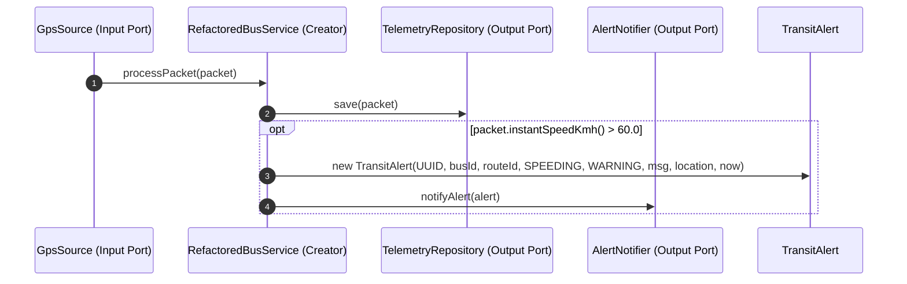
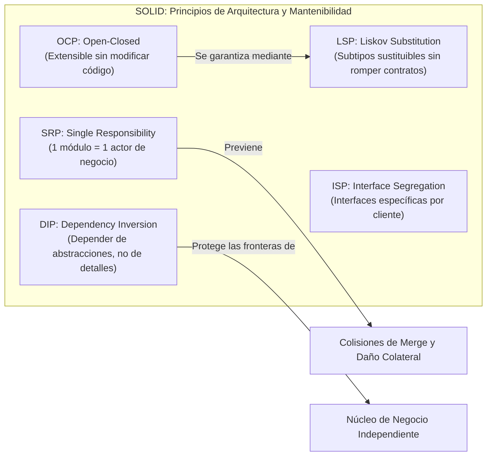
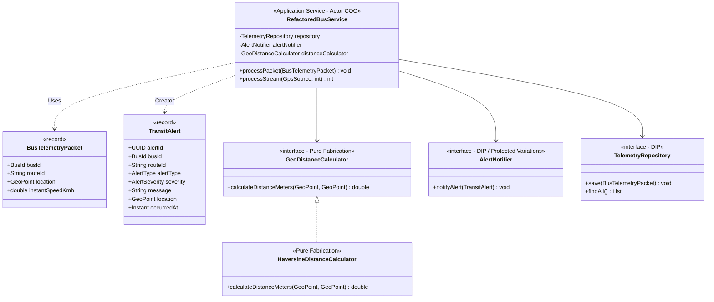

# Heurísticas de Diseño Orientado a Objetos: GRASP vs. SOLID

## 1. Introducción y Motivación

En el desarrollo de software orientado a objetos, los sistemas rara vez colapsan por limitaciones algorítmicas; colapsan por una **distribución caótica de responsabilidades**. Cuando una clase asume tareas dispares, conoce detalles íntimos de otros módulos o responde simultáneamente a múltiples departamentos organizacionales, cualquier cambio trivial desencadena regresiones imprevistas, colisiones en control de versiones y bloqueos operativos.

Este fenómeno, categorizado por Robert C. Martin como la *degradación del diseño*, ocurre cuando los equipos de ingeniería programan guiándose por la intuición inmediata en lugar de aplicar heurísticas formales de diseño. Para combatir esta entropía, la ingeniería de software cuenta con dos catálogos complementarios:

1. **Patrones GRASP (General Responsibility Assignment Software Patterns):** Formulados por Craig Larman, orientan el micro-diseño y la asignación inicial de responsabilidades durante la elaboración de diagramas de interacción (*"¿Qué clase debe contener este método o conocer este dato?"*).
2. **Principios SOLID:** Consolidados por Robert C. Martin (*Uncle Bob*), establecen las directrices de resiliencia arquitectónica para aislar a los actores de negocio y proteger las fronteras del software frente al cambio inevitable (*"¿Qué actor provoca la modificación de este módulo y cómo evitamos daños colaterales?"*).

:::info[Código Fuente del Proyecto de Referencia]
El código analizado y testeado a lo largo de esta guía se encuentra implementado y verificado en el proyecto didáctico del curso (`urbantransit-telemetry`).

Estructura modular del proyecto:
- `co.edu.icesi.urbantransit.model`: Tipos inmutables y objetos de valor (`GeoPoint`, `BusId`, `BusTelemetryPacket`, `TransitAlert`).
- `co.edu.icesi.urbantransit.demo.legacy`: Antipatrón monolítico con instanciación rígida y dependencias acopladas (`LegacyBusService`).
- `co.edu.icesi.urbantransit.demo.refactored`: Arquitectura desacoplada con puertos, inyección por constructor y Raíz de Composición (`RefactoredBusService`, `CompositionRoot`).
- `co.edu.icesi.urbantransit.practice`: Laboratorio práctico de refactorización guiada para el estudiante (`SpeedAuditEngine`, `AuditReport`).

Para compilar el proyecto y verificar la suite de pruebas unitarias:
```bash
mvn clean test
```
:::

### Mapa de Ruta del Capítulo

| Sección | Núcleo Temático | Pregunta Central de Ingeniería |
| :--- | :--- | :--- |
| **2. Cohesión y Acoplamiento** | Fuerzas fundamentales de Larry Constantine y Grady Booch | ¿Cómo medir la calidad estructural antes de refactorizar? |
| **3. Patrones GRASP** | Asignación de responsabilidades de Craig Larman | ¿A qué clase le corresponde ejecutar cada comportamiento? |
| **4. Principios SOLID** | Resiliencia arquitectónica de Robert C. Martin | ¿Cómo blindar el código frente a actores divergentes y cambios técnicos? |
| **5. Caso UrbanTransit** | Antipatrón en el motor de auditoría (`SpeedAuditEngine`) | ¿Qué daños colaterales genera mezclar telemetría, finanzas y reportes? |
| **6. Refactorización Java 17+** | Arquitectura desacoplada con registros y puertos | ¿Cómo aplicar Pure Fabrication y DIP en un dominio real? |
| **7. Matriz GRASP vs. SOLID** | Tabla analítica comparativa | ¿En qué nivel de abstracción y momento opera cada heurística? |
| **8. Verificación y Pruebas** | Suite de pruebas unitarias con JUnit 5 y AssertJ | ¿Cómo verificar el aislamiento de dependencias en milisegundos? |

A continuación se presenta la matriz de articulación conceptual entre las heurísticas GRASP y los principios SOLID:


---

## 2. Cohesión y Acoplamiento: Las Fuerzas Fundamentales del Diseño

Antes de formalizar cualquier catálogo de patrones o principios, es indispensable entender las dos fuerzas métricas fundacionales identificadas por Larry Constantine (1968, 1974) y retomadas por Grady Booch (1994):


### 2.1. Cohesión Funcional

La **cohesión** mide el grado en que los elementos internos de un módulo (métodos, atributos, estructuras de datos) colaboran estrechamente para cumplir un propósito conceptual único y bien delimitado.

- **Alta cohesión:** Una clase tiene una cantidad moderada de métodos con responsabilidades fuertemente vinculadas, no ejecuta tareas dispares y delega subtareas a colaboradores especializados.
- **Baja cohesión:** Una clase mezcla múltiples áreas conceptuales independientes (por ejemplo, telemetría GPS, cálculo de tarifas comerciales y persistencia JDBC). Estas clases resultan difíciles de comprender, imposibles de reutilizar de manera aislada y extremadamente frágiles ante modificaciones.

### 2.2. Acoplamiento

El **acoplamiento** cuantifica la intensidad de la dependencia o conocimiento que una entidad de software tiene sobre otra. En lenguajes de tipado estático como Java, el acoplamiento se manifiesta mediante:

1. Atributos de tipo `ClassB` dentro de `ClassA`.
2. Parámetros o tipos de retorno en firmas de métodos.
3. Variables locales e instanciación directa (`new ClassB()`).
4. Herencia de clases (`class A extends B`), que constituye la forma más rígida e intrusiva de acoplamiento.
5. Implementación de contratos (`class A implements InterfaceB`).

> **Criterio de ingeniería:** El objetivo del diseño no es alcanzar "acoplamiento cero". Un sistema sin acoplamiento no realiza trabajo útil, pues los objetos no podrían colaborar. La meta es mantener un **acoplamiento bajo, intencionado y orientado hacia abstracciones estables**, minimizando el acoplamiento hacia elementos volátiles o detalles de infraestructura técnica.

---

## 3. Patrones GRASP de Craig Larman: Asignación de Responsabilidades

Los patrones **GRASP (General Responsibility Assignment Software Patterns)**, formulados por Craig Larman en *Applying UML and Patterns*, no son plantillas de estructuras complejas (como los patrones GoF), sino principios mentales para responder una pregunta fundamental durante la elaboración de diagramas de interacción:

> *"¿Qué clase de software debe albergar esta responsabilidad y contener este método?"*

Larman clasifica los patrones GRASP en patrones fundamentales de asignación inicial (Capítulo 17) y patrones avanzados de variación y desacoplamiento (Capítulo 25).


### 3.1. Information Expert (Experto en Información)

- **Problema:** ¿Cuál es el criterio general para asignar una responsabilidad a una clase?
- **Solución:** Asignar la responsabilidad a la clase que posee la información necesaria para cumplirla (*"That which knows, does"* o principio *"Do It Myself"*).
- **Ejemplo en UrbanTransit:** La clase `GeoPoint` conoce su propia latitud y longitud. Por tanto, es la experta para validar si sus coordenadas caen dentro de los límites geográficos válidos del área metropolitana de Cali y para calcular la distancia lineal directa hacia otro punto:

```java
package co.edu.icesi.urbantransit.model;

import java.time.Instant;
import java.util.Objects;

/**
 * Coordenada geografica inmutable en el sistema geodesico WGS84.
 * Cumple con Information Expert al validar sus propios limites y operar sobre sus datos.
 */
public record GeoPoint(double latitude, double longitude, Instant timestamp) {

    public static final double MIN_LAT = 3.2500;
    public static final double MAX_LAT = 3.5500;
    public static final double MIN_LON = -76.6000;
    public static final double MAX_LON = -76.4500;

    public GeoPoint {
        Objects.requireNonNull(timestamp, "timestamp no puede ser null");
        if (latitude < MIN_LAT || latitude > MAX_LAT || longitude < MIN_LON || longitude > MAX_LON) {
            throw new IllegalArgumentException(
                    String.format("Coordenadas fuera del area metropolitana de Cali: [%f, %f]", latitude, longitude)
            );
        }
    }

    /**
     * Information Expert: Opera sobre sus propios atributos (latitude, longitude).
     */
    public double distanceToInMeters(GeoPoint other) {
        Objects.requireNonNull(other, "El punto de comparacion no puede ser null");
        double lat1Rad = Math.toRadians(this.latitude);
        double lat2Rad = Math.toRadians(other.latitude());
        double deltaLat = Math.toRadians(other.latitude() - this.latitude);
        double deltaLon = Math.toRadians(other.longitude() - this.longitude);

        double a = Math.sin(deltaLat / 2.0) * Math.sin(deltaLat / 2.0)
                + Math.cos(lat1Rad) * Math.cos(lat2Rad)
                * Math.sin(deltaLon / 2.0) * Math.sin(deltaLon / 2.0);

        double c = 2.0 * Math.atan2(Math.sqrt(a), Math.sqrt(1.0 - a));
        return 6371000.0 * c;
    }
}
```

#### La Contraindicación de Information Expert

Information Expert puede sugerir decisiones perjudiciales si se aplica de forma aislada. Si el sistema requiere evaluar distancias utilizando proyecciones topográficas locales, algoritmos de indexación espacial (Uber H3, Google S2) o modelos de elevación digital para corredores de ladera en Cali, colocar toda esa lógica dentro de `GeoPoint` destruiría su naturaleza de objeto de valor (*Value Object*) ligero e inmutable.

Sobrecargar `GeoPoint` con librerías geoespaciales complejas violaría la **Alta Cohesión** y el **Bajo Acoplamiento**. Para resolver esta tensión, Craig Larman formula la **Fabricación Pura**.

### 3.2. Pure Fabrication (Fabricación Pura)

- **Problema:** ¿Qué objeto debe asumir la responsabilidad cuando asignar la tarea al Experto en Información violaría la Alta Cohesión, el Bajo Acoplamiento o la reusabilidad?
- **Solución:** Asignar un conjunto cohesivo de responsabilidades a una clase artificial o de conveniencia que no existe en el modelo del dominio conceptual del mundo real, pero que apoya un diseño limpio y mantenible.

En `urbantransit-telemetry`, extraemos el cálculo geodésico a un contrato y servicio puro:

```java
package co.edu.icesi.urbantransit.demo.refactored.port;

import co.edu.icesi.urbantransit.model.GeoPoint;

/**
 * Contrato de Pure Fabrication (Larman) para calculos geodesicos.
 * Evita sobrecargar entidades con formulas matematicas complejas.
 */
@FunctionalInterface
public interface GeoDistanceCalculator {
    double calculateDistanceMeters(GeoPoint from, GeoPoint to);
}
```

Y su implementación concreta de soporte matemático:

```java
package co.edu.icesi.urbantransit.demo.refactored.service;

import co.edu.icesi.urbantransit.demo.refactored.port.GeoDistanceCalculator;
import co.edu.icesi.urbantransit.model.GeoPoint;
import java.util.Objects;

/**
 * Implementacion de Pure Fabrication usando la formula de Haversine.
 * Secreto de Parnas: Oculta la trigonometria esferica de la Tierra al resto del sistema.
 */
public class HaversineDistanceCalculator implements GeoDistanceCalculator {

    private static final double EARTH_RADIUS_METERS = 6371000.0;

    @Override
    public double calculateDistanceMeters(GeoPoint from, GeoPoint to) {
        Objects.requireNonNull(from, "Punto de origen no puede ser null");
        Objects.requireNonNull(to, "Punto de destino no puede ser null");

        double lat1Rad = Math.toRadians(from.latitude());
        double lat2Rad = Math.toRadians(to.latitude());
        double deltaLat = Math.toRadians(to.latitude() - from.latitude());
        double deltaLon = Math.toRadians(to.longitude() - from.longitude());

        double a = Math.sin(deltaLat / 2.0) * Math.sin(deltaLat / 2.0)
                + Math.cos(lat1Rad) * Math.cos(lat2Rad)
                * Math.sin(deltaLon / 2.0) * Math.sin(deltaLon / 2.0);

        double c = 2.0 * Math.atan2(Math.sqrt(a), Math.sqrt(1.0 - a));
        return EARTH_RADIUS_METERS * c;
    }
}
```

### 3.3. Creator (Creador)

- **Problema:** ¿Quién debe ser responsable de crear una nueva instancia de alguna clase?
- **Solución:** Asignar a la clase `B` la responsabilidad de crear una instancia de la clase `A` si se cumple alguna de las siguientes condiciones (a mayor número de coincidencias, mayor idoneidad):
  1. `B` compone o agrega de forma compuesta a `A`.
  2. `B` registra o almacena instancias de `A`.
  3. `B` usa de manera muy cercana a `A`.
  4. `B` tiene los datos de inicialización de `A` que se le pasarán al crearlo (es un Experto con respecto a su creación).

#### Aplicación en UrbanTransit: Creación de `TransitAlert`

En el sistema MetroCali MIO se emiten alertas operacionales ante eventos críticos como `SPEEDING` (exceso de velocidad en carril troncal) o `GEOFENCE_VIOLATION`. ¿Quién debe instanciar `TransitAlert`?

- ¿Debe ser la entidad `BusId`? No. Un identificador es un tipo inmutable; no conoce la telemetría ni los umbrales de velocidad.
- ¿Debe ser el controlador REST web? No. La lógica de evaluación y reglas de umbral operativo pertenecen al núcleo de aplicación.
- El candidato idóneo según Creator es `RefactoredBusService`:
  - Posee el paquete de telemetría entrante (`BusTelemetryPacket`).
  - Conoce los límites reglamentarios (`MAX_TRONCAL_SPEED_KMH = 60.0`).
  - Tiene todos los datos de inicialización para ensamblar la alerta.



### 3.4. Low Coupling (Bajo Acoplamiento) y High Cohesion (Alta Cohesión)

Craig Larman designa a estos dos patrones como **principios evaluativos subyacentes**. Cada vez que un diseñador contempla dos alternativas para asignar una responsabilidad, debe evaluar:
- ¿Esta opción crea dependencias innecesarias hacia clases inestables? (Low Coupling).
- ¿Esta opción mezcla tareas operativas con persistencia o cálculos matemáticos? (High Cohesion).

### 3.5. Controller (Controlador)

- **Problema:** ¿Cuál es el primer objeto más allá de la capa de interfaz de usuario (UI, endpoints HTTP o brokers de mensajería) que recibe y coordina un mensaje de operación del sistema?
- **Solución:** Asignar la responsabilidad a una clase que represente:
  - El sistema global o dispositivo raíz (*Facade Controller*, ej. `UrbanTransitSystem`).
  - El escenario del caso de uso dentro del cual ocurre el evento (*Use Case Controller*, ej. `IngestTelemetryUseCaseHandler`).

> **Regla de oro de Larman:** La capa de presentación **nunca** debe ejecutar lógica de negocio. Debe delegar inmediatamente al Controlador de Caso de Uso o Servicio de Aplicación. Un controlador que procesa directamente la lógica en lugar de coordinar a los objetos del dominio se convierte en un *Bloated Controller* (Controlador Hinchado), degradando la cohesión del sistema.

### 3.6. Indirection (Indirección) y Protected Variations (Variaciones Protegidas)

- **Indirection:** Asignar una responsabilidad a un objeto intermediario para mediar entre otros componentes, desacoplándolos directamente (ej. un puerto de notificación o un bus de eventos).
- **Protected Variations:** El principio fundamental de toda la arquitectura de software. Identificar puntos de inestabilidad o variación previsible y envolverlos mediante interfaces estables y contratos explícitos.
  - Como documenta Larman (Capítulo 25), Protected Variations formaliza el principio de *Information Hiding* de David Parnas (1972) y constituye la base conceptual directa de principios como el OCP y el LSP de SOLID.

---

## 4. Principios SOLID de Robert C. Martin: Resiliencia Arquitectónica

Mientras GRASP se enfoca en la asignación de métodos y colaboraciones en micro-diseño, los principios **SOLID**, consolidados por Robert C. Martin (*Uncle Bob*) en *Clean Architecture*, abordan la **mantenibilidad, el aislamiento de actores organizacionales y la evolución a largo plazo del código fuente**.



---

### 4.1. SRP: The Single Responsibility Principle (Principio de Responsabilidad Única)

En el Capítulo 7 de *Clean Architecture*, Martin aclara el malentendido más extendido del desarrollo de software:

> *"El principio no significa que cada función deba hacer una sola cosa. Esa es una regla de bajo nivel para refactorizar funciones largas. La definición rigurosa del SRP es:*
>
> **Un módulo debe ser responsable ante uno, y solo uno, actor de negocio.**"

Un **actor** es una persona o grupo de personas cohesivo (un departamento, un rol directivo o un grupo de interés) que requiere que el sistema cambie de una forma determinada.

#### Las Figuras Canónicas de Martin

En su texto canónico, Martin ilustra el peligro de violar el SRP a través de dos diagramas estructurales:


*Figura 7.1 de Clean Architecture:* La clase `Employee` responde simultáneamente a tres actores con intereses contrapuestos:
1. `calculatePay()`: Definido por el departamento de contabilidad que reporta al Director Financiero (CFO).
2. `reportHours()`: Definido por recursos humanos que reporta al Director de Operaciones (COO).
3. `save()`: Definido por los administradores de bases de datos que reportan al Director de Tecnología (CTO).


*Figura 7.2 de Clean Architecture:* El síntoma de **duplicación accidental**. Para no duplicar código, los desarrolladores extrajeron un método privado compartido `regularHours()`. Cuando el equipo del CFO solicitó un cambio en el cómputo de horas regulares, el desarrollador modificó `regularHours()` y verificó únicamente los reportes contables. Semanas después, el COO descubrió que los reportes de operaciones arrojaban cifras erróneas, generando pérdidas económicas porque nadie advirtió que el mismo método era compartido por dos actores con objetivos divergentes.

#### La Solución Estructural de Martin

Para resolver esta patología sin duplicar datos, Martin propone separar las operaciones en clases independientes dedicadas a cada actor, las cuales operan sobre una estructura de datos compartida y pasiva:


*Figura 7.3 de Clean Architecture:* Las clases `PayCalculator` (CFO), `HourReporter` (COO) y `EmployeeSaver` (CTO) no se conocen entre sí. Cada una responde ante un actor único, eliminando los riesgos de colisión de versiones y daños colaterales.

---

### 4.2. OCP: The Open-Closed Principle (Principio de Abierto/Cerrado)

Acuñado originalmente por Bertrand Meyer en 1988 y adaptado a la arquitectura orientada a objetos por Robert C. Martin:

> *"Un artefacto de software debe estar abierto para su extensión, pero cerrado para su modificación."*

El comportamiento de un sistema debe poder extenderse mediante la incorporación de nuevo código fuente (nuevas clases o implementaciones), sin requerir la modificación de clases o componentes previamente existentes y certificados en producción. Se fundamenta en contratos de interfaz e inversión de dependencias.

#### El Antipatrón: Extensión Mediante Modificación (Violación de OCP)

Consideremos el despacho de alertas en el centro de control de MetroCali. Si el canal de notificación se codifica mediante condicionales basados en cadenas o enumeraciones, cada nuevo canal exige abrir la clase de negocio y modificar su lógica interna:

```java
// ANTIPATRÓN: Violación de OCP
// Cada nuevo canal exige abrir, editar y re-certificar esta clase en producción
public class LegacyAlertDispatcher {

    public void dispatchAlert(TransitAlert alert, String channelType) {
        if ("CONSOLE".equalsIgnoreCase(channelType)) {
            System.err.println("[CONSOLE ALERT] " + alert.message());
        } else if ("SLACK".equalsIgnoreCase(channelType)) {
            // Lógica directa de webhook HTTP a Slack...
            System.out.println("Enviando webhook a canal #operaciones-mio");
        } else if ("SMS".equalsIgnoreCase(channelType)) {
            // ¡PELIGRO! Para soportar SMS a los conductores de guardia,
            // debemos MODIFICAR esta clase, arriesgando romper Console y Slack.
            System.out.println("Enviando SMS gateway al conductor del bus " + alert.busId().value());
        } else {
            throw new IllegalArgumentException("Canal de alerta no soportado: " + channelType);
        }
    }
}
```

**Problemas del antipatrón:**
1. **Fragilidad:** Cada vez que operaciones solicita un nuevo canal (ej. WebSockets para la central de despacho o Kafka para auditoría), el desarrollador debe editar `LegacyAlertDispatcher.java`.
2. **Riesgo de regresión:** Un error de sintaxis o excepción no controlada en el bloque nuevo inhabilita los canales existentes.
3. **Colisiones en control de versiones:** Varios desarrolladores editando el mismo archivo con condicionales generan conflictos de merge constantes.

#### La Solución Arquitectónica: Abierto a Extensión, Cerrado a Modificación

En `urbantransit-telemetry`, aplicamos OCP protegiendo el servicio tras el puerto funcional `AlertNotifier`:

```java
package co.edu.icesi.urbantransit.demo.refactored.port;

import co.edu.icesi.urbantransit.model.TransitAlert;

/**
 * Contrato OCP: Cerrado a modificaciones volátiles, abierto a infinitas implementaciones.
 */
@FunctionalInterface
public interface AlertNotifier {
    void notifyAlert(TransitAlert alert);
}
```

Las implementaciones existentes en producción permanecen aisladas y estables:

```java
package co.edu.icesi.urbantransit.demo.refactored.infra;

import co.edu.icesi.urbantransit.demo.refactored.port.AlertNotifier;
import co.edu.icesi.urbantransit.model.TransitAlert;

public class ConsoleAlertNotifier implements AlertNotifier {
    @Override
    public void notifyAlert(TransitAlert alert) {
        System.out.printf("[%s] ALERTA %s en bus %s: %s%n",
                alert.occurredAt(), alert.severity(), alert.busId().value(), alert.message());
    }
}
```

Cuando MetroCali adquiere un nuevo canal de contingencia (por ejemplo, notificaciones satelitales o enlace radial con terminales), **no se modifica ninguna clase existente**. Se crea un nuevo archivo fuente:

```java
package co.edu.icesi.urbantransit.demo.refactored.infra;

import co.edu.icesi.urbantransit.demo.refactored.port.AlertNotifier;
import co.edu.icesi.urbantransit.model.TransitAlert;

/**
 * Extensión mediante nuevo código fuente: CERO impacto sobre clases certificadas.
 */
public class RadioTelemetryAlertNotifier implements AlertNotifier {

    private final String radioGatewayChannel;

    public RadioTelemetryAlertNotifier(String radioGatewayChannel) {
        this.radioGatewayChannel = radioGatewayChannel;
    }

    @Override
    public void notifyAlert(TransitAlert alert) {
        // Nueva infraestructura de radiofrecuencia para terminales Andrés Sanín / Menga
        System.out.println("Despachando por radio (" + radioGatewayChannel + "): " + alert.message());
    }
}
```

El servicio central `RefactoredBusService` permanece **100% cerrado a modificaciones**:

```java
public class RefactoredBusService {
    private final AlertNotifier alertNotifier; // Depende del contrato estable

    public RefactoredBusService(
            TelemetryRepository repository,
            AlertNotifier alertNotifier,
            GeoDistanceCalculator distanceCalculator
    ) {
        this.repository = Objects.requireNonNull(repository, "repository no puede ser null");
        this.alertNotifier = Objects.requireNonNull(alertNotifier, "alertNotifier no puede ser null");
        this.distanceCalculator = Objects.requireNonNull(distanceCalculator, "distanceCalculator no puede ser null");
    }

    public void processPacket(BusTelemetryPacket packet) {
        // ...
        if (packet.instantSpeedKmh() > MAX_TRONCAL_SPEED_KMH) {
            // Emite la alerta polimórficamente sin saber si viaja a consola, radio o Kafka
            alertNotifier.notifyAlert(alert);
        }
    }
}
```

> **Regla de oro de Martin:** Si una nueva solicitud de requerimientos te obliga a modificar el código fuente de un componente de alto nivel, ese componente tiene un defecto arquitectónico de diseño. OCP garantiza que extender el comportamiento del software consiste en **escribir código nuevo, no en editar código viejo**.

---

### 4.3. LSP: The Liskov Substitution Principle (Principio de Sustitución de Liskov)

Formalizado por Barbara Liskov en 1988:

> *"Si para cada objeto $o_1$ de tipo $S$ existe un objeto $o_2$ de tipo $T$ tal que para todo programa $P$ expresado en términos de $T$, el comportamiento de $P$ permanece inalterado cuando $o_1$ es sustituido por $o_2$, entonces $S$ es un subtipo de $T$."*


*Figura 9.1 de Clean Architecture:* El componente `Billing` interactúa con el contrato abstracto `License`. Las variantes concretas (`PersonalLicense`, `BusinessLicense`) implementan el cálculo sin romper las expectativas del cliente ni alterar el flujo del sistema.

Reglas clave para preservar LSP en Java:
- **Precondiciones:** Una subclase no puede fortalecer las precondiciones (no puede exigir más validaciones que las pactadas en el contrato base).
- **Postcondiciones:** Una subclase no puede debilitar las postcondiciones (debe garantizar como mínimo lo que garantiza la abstracción base).
- **Invariantes:** Los invariantes de la clase base deben preservarse en todos los subtipos.
- **Excepciones:** Una subclase no debe arrojar excepciones no esperadas por los clientes de la abstracción (por ejemplo, lanzar `UnsupportedOperationException`).

---

### 4.4. ISP: The Interface Segregation Principle (Principio de Segregación de Interfaces)

Martin demuestra que cuando un cliente depende de una interfaz monolítica con métodos que no necesita, cualquier cambio en esos métodos no consumidos fuerza la recompilación, reempaquetado y redespliegue del cliente:

> *"Los clientes no deben ser forzados a depender de métodos que no consumen."*


*Figura 10.1 de Clean Architecture:* La interfaz `OPS` se segrega en tres interfaces más pequeñas: `U1Ops`, `U2Ops` y `U3Ops`. Cada cliente (`User1`, `User2`, `User3`) depende exclusivamente de la porción del contrato que consume, evitando acoplamientos innecesarios.

---

### 4.5. DIP: The Dependency Inversion Principle (Principio de Inversión de Dependencias)

Formulado por Martin como el cimiento de las arquitecturas modulares:

1. *"Los módulos de alto nivel (políticas de negocio) no deben depender de los módulos de bajo nivel (detalles técnicos como SQL, Kafka o sockets). Ambos deben depender de abstracciones."*
2. *"Las abstracciones no deben depender de los detalles. Los detalles deben depender de las abstracciones."*


*Figura 5.2 de Clean Architecture:* Mediante la introducción de una interfaz intermedia, el sentido de la dependencia del código fuente se invierte en dirección opuesta al flujo de control de tiempo de ejecución, aislando el núcleo del sistema de los detalles periféricos.

---

## 5. Caso de Estudio UrbanTransit: El Antipatrón Monolítico en `SpeedAuditEngine`

Para analizar el impacto directo de violar estas heurísticas, examinemos el componente de auditoría vehicular incluido en el paquete `co.edu.icesi.urbantransit.practice`.

### 5.1. Contexto Organizacional y Actores del Negocio

En la operación de transporte masivo de MetroCali coexisten tres actores organizacionales fundamentales:

1. **Jefe de Despacho y Operaciones (Actor COO):**
   - Su interés es monitorear en tiempo real la velocidad de la flota y garantizar que no se sobrepase el límite máximo en carriles troncales (`60.0 km/h`).
2. **Director de Liquidación Financiera y Concesiones (Actor CFO):**
   - Su responsabilidad es auditar quincenalmente el cumplimiento contractual y tasar penalizaciones económicas en pesos colombianos (`PENALTY_PER_INFRACTION_COP = $250.000 COP`) por cada exceso de velocidad detectado.
3. **Oficial de Auditoría y Control Interno (Actor Stakeholder / Reportes):**
   - Su función es generar bitácoras de texto formateadas con fecha, hora y coordenadas GPS para responder a requerimientos legales y expedir el `AuditReport`.

### 5.2. El Código Problemático: Violación Múltiple de SRP, Pure Fabrication y DIP

La clase `SpeedAuditEngine` centralizó arbitrariamente todas estas funciones en un único bloque de código:

```java
package co.edu.icesi.urbantransit.practice;

import co.edu.icesi.urbantransit.model.BusId;
import co.edu.icesi.urbantransit.model.BusTelemetryPacket;
import co.edu.icesi.urbantransit.model.GeoPoint;

import java.math.BigDecimal;
import java.math.RoundingMode;
import java.time.Instant;
import java.util.ArrayList;
import java.util.List;
import java.util.Objects;

/**
 * ANTIPATRÓN DIDÁCTICO: SpeedAuditEngine
 * Mezcla cálculo geodésico, reglas financieras de multas en COP,
 * formateo de logs de presentación y almacenamiento en memoria sin contratos.
 */
public class SpeedAuditEngine {

    // Constantes quemadas que violan DIP y OCP
    public static final double DEFAULT_SPEED_LIMIT_KMH = 60.0;
    public static final BigDecimal PENALTY_PER_INFRACTION_COP = BigDecimal.valueOf(250000.00);
    private static final double EARTH_RADIUS = 6371000.0;

    private final List<BusTelemetryPacket> auditedPackets = new ArrayList<>();
    private final List<String> formattedAlertLogs = new ArrayList<>();

    public SpeedAuditEngine() {
        // Constructor por defecto sin inyección de dependencias (Code Smell)
    }

    public void ingestPacket(BusTelemetryPacket packet) {
        Objects.requireNonNull(packet, "packet no puede ser null");
        auditedPackets.add(packet);
    }

    /**
     * CODE SMELL: Método con múltiples razones para cambiar (Violación de SRP).
     */
    public AuditReport generateAuditReport(BusId busId, String routeId) {
        Objects.requireNonNull(busId, "busId no puede ser null");
        Objects.requireNonNull(routeId, "routeId no puede ser null");

        List<BusTelemetryPacket> relevantPackets = auditedPackets.stream()
                .filter(p -> p.busId().equals(busId) && p.routeId().equalsIgnoreCase(routeId))
                .toList();

        if (relevantPackets.isEmpty()) {
            return new AuditReport(busId, routeId, 0, 0.0, 0, BigDecimal.ZERO.setScale(2, RoundingMode.HALF_UP), Instant.now());
        }

        // 1. CÁLCULO DE DISTANCIA TOTAL (Violación de Information Expert y Pure Fabrication)
        // Re-implementación manual de Haversine dentro del servicio de auditoría
        double totalDistanceMeters = 0.0;
        for (int i = 0; i < relevantPackets.size() - 1; i++) {
            GeoPoint p1 = relevantPackets.get(i).location();
            GeoPoint p2 = relevantPackets.get(i + 1).location();
            totalDistanceMeters += calculateDistanceHaversineManual(p1, p2);
        }
        double totalDistanceKm = totalDistanceMeters / 1000.0;

        // 2. EVALUACIÓN DE INFRACCIONES (Actor COO)
        int speedInfractions = 0;
        for (BusTelemetryPacket packet : relevantPackets) {
            if (packet.instantSpeedKmh() > DEFAULT_SPEED_LIMIT_KMH) {
                speedInfractions++;
                // CODE SMELL: Acoplamiento con formateo de presentación para bitácoras
                String logEntry = String.format(java.util.Locale.US,
                        "[INFRACTION] Bus %s excedio %.1f km/h a las %s en [%.4f, %.4f]",
                        busId.value(), packet.instantSpeedKmh(), packet.location().timestamp(),
                        packet.location().latitude(), packet.location().longitude());
                formattedAlertLogs.add(logEntry);
            }
        }

        // 3. CÁLCULO FINANCIERO DE MULTAS (Actor CFO)
        BigDecimal totalPenalties = PENALTY_PER_INFRACTION_COP
                .multiply(BigDecimal.valueOf(speedInfractions))
                .setScale(2, RoundingMode.HALF_UP);

        return new AuditReport(
                busId, routeId, relevantPackets.size(),
                roundTwoDecimals(totalDistanceKm), speedInfractions, totalPenalties, Instant.now()
        );
    }

    /**
     * CODE SMELL: Trigonometría esferica incrustada como método privado.
     */
    private double calculateDistanceHaversineManual(GeoPoint from, GeoPoint to) {
        double lat1Rad = Math.toRadians(from.latitude());
        double lat2Rad = Math.toRadians(to.latitude());
        double deltaLat = Math.toRadians(to.latitude() - from.latitude());
        double deltaLon = Math.toRadians(to.longitude() - from.longitude());

        double a = Math.sin(deltaLat / 2.0) * Math.sin(deltaLat / 2.0)
                + Math.cos(lat1Rad) * Math.cos(lat2Rad)
                * Math.sin(deltaLon / 2.0) * Math.sin(deltaLon / 2.0);

        double c = 2.0 * Math.atan2(Math.sqrt(a), Math.sqrt(1.0 - a));
        return EARTH_RADIUS * c;
    }

    private double roundTwoDecimals(double value) {
        return BigDecimal.valueOf(value).setScale(2, RoundingMode.HALF_UP).doubleValue();
    }
}
```

### 5.3. Análisis de las Fallas del Antipatrón

| Aspecto | Diagnóstico Técnico | Impacto en la Operación de MetroCali |
| :--- | :--- | :--- |
| **Actor Responsable (SRP)** | Mezcla tres actores organizacionales: el COO (operación), el CFO (penalizaciones en COP) y el Auditor (formato de texto). | Si el equipo financiero ajusta la tarifa de penalización o aplica descuentos contractuales, modifica el mismo archivo que utiliza operaciones para auditar excesos físicos. |
| **Pure Fabrication & Expert** | `calculateDistanceHaversineManual()` re-implementa la trigonometría esférica en un método privado. | Duplicación accidental del cálculo de distancias; imposibilidad de cambiar a proyecciones WGS84 o mallas espaciales sin modificar la clase de auditoría. |
| **Inversión de Dependencias (DIP)** | El servicio no recibe abstracciones de notificación ni persistencia; utiliza listas internas mutables (`auditedPackets`). | Imposible probar el motor con almacenamiento distribuido o fuentes de eventos en tiempo real sin alterar la clase. |
| **Abierto/Cerrado (OCP)** | El límite de velocidad (`60.0 km/h`) y el valor de la sanción (`$250.000`) están cableados como constantes estáticas. | Para variar el límite en rutas alimentadoras (`50.0 km/h`) o troncales exclusivas (`70.0 km/h`), se debe abrir y recompilar la clase. |

---

## 6. Refactorización Guiada en Java 17+: Aplicación Paso a Paso de GRASP y SOLID

A continuación rediseñamos la arquitectura separando responsabilidades por actor, fabricando abstracciones puras para cálculos geodésicos e invirtiendo dependencias mediante puertos.



### 6.1. Definición del Modelo de Dominio Inmutable

Definimos tipos inmutables utilizando `records` de Java 17, asegurando la integridad de invariantes en constructores compactos:

```java
package co.edu.icesi.urbantransit.model;

import java.util.Objects;

public record BusId(String value) {
    public BusId {
        Objects.requireNonNull(value, "El valor del identificador no puede ser null");
        if (value.isBlank()) {
            throw new IllegalArgumentException("El identificador del bus no puede estar vacio");
        }
    }
}
```

```java
package co.edu.icesi.urbantransit.model;

import java.time.Instant;
import java.util.Objects;
import java.util.UUID;

public record TransitAlert(
        UUID alertId,
        BusId busId,
        String routeId,
        AlertType alertType,
        AlertSeverity severity,
        String message,
        GeoPoint location,
        Instant occurredAt
) {
    public enum AlertType { SPEEDING, GEOFENCE_VIOLATION, HEADWAY_GAP, EXCESSIVE_IDLE }
    public enum AlertSeverity { INFO, WARNING, CRITICAL }

    public TransitAlert {
        Objects.requireNonNull(alertId, "alertId requerido");
        Objects.requireNonNull(busId, "busId requerido");
        Objects.requireNonNull(routeId, "routeId requerido");
        Objects.requireNonNull(alertType, "alertType requerido");
        Objects.requireNonNull(severity, "severity requerida");
        Objects.requireNonNull(message, "message requerido");
        Objects.requireNonNull(location, "location requerida");
        Objects.requireNonNull(occurredAt, "occurredAt requerido");
    }
}
```

### 6.2. Puertos de Abstracción e Inversión de Dependencias (DIP)

Definimos interfaces específicas para notificación y persistencia:

```java
package co.edu.icesi.urbantransit.demo.refactored.port;

import co.edu.icesi.urbantransit.model.TransitAlert;

/**
 * Puerto de salida para emision de alertas operacionales (DIP).
 * Oculta el canal de notificacion (Slack, Kafka, SMS, WebSockets, Consola).
 */
@FunctionalInterface
public interface AlertNotifier {
    void notifyAlert(TransitAlert alert);
}
```

```java
package co.edu.icesi.urbantransit.demo.refactored.port;

import co.edu.icesi.urbantransit.model.BusTelemetryPacket;
import java.util.List;

public interface TelemetryRepository {
    void save(BusTelemetryPacket packet);
    List<BusTelemetryPacket> findAll();
    int count();
}
```

### 6.3. Servicio Refactorizado del Actor COO: `RefactoredBusService`

Este servicio responde ante un único actor: el **Jefe de Operaciones del Centro de Control de MetroCali**. Aplica Pure DI mediante constructor estricto y el patrón Creator para las alertas:

```java
package co.edu.icesi.urbantransit.demo.refactored.service;

import co.edu.icesi.urbantransit.demo.refactored.port.AlertNotifier;
import co.edu.icesi.urbantransit.demo.refactored.port.GeoDistanceCalculator;
import co.edu.icesi.urbantransit.demo.refactored.port.GpsSource;
import co.edu.icesi.urbantransit.demo.refactored.port.TelemetryRepository;
import co.edu.icesi.urbantransit.model.BusTelemetryPacket;
import co.edu.icesi.urbantransit.model.TransitAlert;

import java.time.Instant;
import java.util.Locale;
import java.util.Objects;
import java.util.Optional;
import java.util.UUID;

/**
 * Servicio de procesamiento de telemetria refactorizado.
 *
 * Principios y patrones aplicados:
 * 1. DIP: Depende unicamente de puertos de interfaz (AlertNotifier, TelemetryRepository, GeoDistanceCalculator).
 * 2. Inyeccion por Constructor (Pure DI): Campos final e inmutables.
 * 3. SRP: Responde exclusivamente ante politicas operacionales del Centro de Control (Actor COO).
 * 4. GRASP Creator: Instancia 'TransitAlert' con el contexto del incidente.
 * 5. Testabilidad: 100% verificable en milisegundos sin infraestructura externa.
 */
public class RefactoredBusService {

    public static final double MAX_TRONCAL_SPEED_KMH = 60.0;

    private final TelemetryRepository repository;
    private final AlertNotifier alertNotifier;
    private final GeoDistanceCalculator distanceCalculator;

    public RefactoredBusService(
            TelemetryRepository repository,
            AlertNotifier alertNotifier,
            GeoDistanceCalculator distanceCalculator
    ) {
        this.repository = Objects.requireNonNull(repository, "repository no puede ser null");
        this.alertNotifier = Objects.requireNonNull(alertNotifier, "alertNotifier no puede ser null");
        this.distanceCalculator = Objects.requireNonNull(distanceCalculator, "distanceCalculator no puede ser null");
    }

    public void processPacket(BusTelemetryPacket packet) {
        Objects.requireNonNull(packet, "El paquete de telemetria no puede ser null");

        // 1. Persistencia mediante abstraccion (DIP)
        repository.save(packet);

        // 2. Evaluacion de politica de exceso de velocidad troncal (Actor COO)
        if (packet.instantSpeedKmh() > MAX_TRONCAL_SPEED_KMH) {
            // GRASP Creator: El servicio compone la alerta con la informacion del incidente
            TransitAlert alert = new TransitAlert(
                    UUID.randomUUID(),
                    packet.busId(),
                    packet.routeId(),
                    TransitAlert.AlertType.SPEEDING,
                    TransitAlert.AlertSeverity.WARNING,
                    String.format(Locale.US, "Bus %s supero el limite troncal en ruta %s: %.1f km/h (Limite: %.1f km/h)",
                            packet.busId().value(), packet.routeId(), packet.instantSpeedKmh(), MAX_TRONCAL_SPEED_KMH),
                    packet.location(),
                    Instant.now()
            );

            // Emision mediante abstraccion (DIP)
            alertNotifier.notifyAlert(alert);
        }
    }

    public int processStream(GpsSource source, int maxPackets) {
        Objects.requireNonNull(source, "La fuente de telemetria no puede ser null");
        int processedCount = 0;

        for (int i = 0; i < maxPackets; i++) {
            Optional<BusTelemetryPacket> packetOpt = source.readPacket();
            if (packetOpt.isEmpty()) {
                break;
            }
            processPacket(packetOpt.get());
            processedCount++;
        }

        return processedCount;
    }
}
```

---

## 7. Matriz Comparativa Detallada: GRASP vs. SOLID

| Dimensión de Análisis | Heurísticas GRASP (Craig Larman) | Principios SOLID (Robert C. Martin) |
| :--- | :--- | :--- |
| **Nivel de Abstracción** | **Micro-diseño:** Asignación inicial de métodos, campos y colaboraciones entre objetos individuales. | **Meso/Macro-diseño:** Arquitectura de clases, fronteras de componentes y contratos entre módulos. |
| **Momento de Aplicación** | Durante la creación de modelos de diseño y diagramas de interacción (análisis preliminar de requerimientos). | Durante la evolución continua, mantenimiento preventivo y refactorización del código fuente. |
| **Pregunta Orientadora** | *"¿Quién debe tener la responsabilidad de ejecutar este comportamiento o crear este dato?"* | *"¿Qué actor solicita el cambio y cómo evito que una modificación propague efectos colaterales?"* |
| **Fuerza Primaria** | Asignación natural basada en conocimiento (*Information Expert*) y composición (*Creator*). | Separación de actores organizacionales (*SRP*) y desacoplamiento mediante interfaces estables (*DIP/ISP*). |
| **Manejo de Variación** | *Protected Variations* y *Pure Fabrication* (invención pragmática de objetos de soporte). | *Open-Closed Principle (OCP)* y *Liskov Substitution Principle (LSP)* (polimorfismo estricto). |
| **Riesgo Mitigado** | Clases anémicas o sobrecargadas; responsabilidades arbitrariamente distribuidas sin criterio. | Fragilidad del software, colisiones de merge, regresiones silenciosas y rigidez arquitectónica. |

---

## 8. Verificación Práctica y Pruebas Unitarias en Java 17+

Para asegurar que la refactorización preserva el comportamiento deseado y que los actores permanecen desacoplados, implementamos pruebas unitarias limpias utilizando JUnit 5 y AssertJ con dobles de prueba funcionales en memoria:

```java
package co.edu.icesi.urbantransit.demo;

import co.edu.icesi.urbantransit.demo.refactored.infra.InMemoryTelemetryRepository;
import co.edu.icesi.urbantransit.demo.refactored.port.AlertNotifier;
import co.edu.icesi.urbantransit.demo.refactored.port.GeoDistanceCalculator;
import co.edu.icesi.urbantransit.demo.refactored.service.HaversineDistanceCalculator;
import co.edu.icesi.urbantransit.demo.refactored.service.RefactoredBusService;
import co.edu.icesi.urbantransit.model.BusId;
import co.edu.icesi.urbantransit.model.BusTelemetryPacket;
import co.edu.icesi.urbantransit.model.GeoPoint;
import co.edu.icesi.urbantransit.model.TransitAlert;
import org.junit.jupiter.api.BeforeEach;
import org.junit.jupiter.api.DisplayName;
import org.junit.jupiter.api.Test;

import java.time.Instant;
import java.util.ArrayList;
import java.util.List;

import static org.assertj.core.api.Assertions.assertThat;

@DisplayName("Pruebas Unitarias: RefactoredBusService con Inyeccion de Dependencias")
class RefactoredBusServiceTest {

    private InMemoryTelemetryRepository repository;
    private List<TransitAlert> capturedAlerts;
    private AlertNotifier alertNotifier;
    private GeoDistanceCalculator distanceCalculator;
    private RefactoredBusService busService;

    @BeforeEach
    void setUp() {
        repository = new InMemoryTelemetryRepository();
        capturedAlerts = new ArrayList<>();
        // Doble de prueba funcional (Spy en memoria mediante lambda)
        alertNotifier = capturedAlerts::add;
        distanceCalculator = new HaversineDistanceCalculator();

        busService = new RefactoredBusService(repository, alertNotifier, distanceCalculator);
    }

    @Test
    @DisplayName("Debe emitir alerta SPEEDING y persistir el paquete cuando la velocidad supera 60 km/h")
    void shouldEmitAlertAndPersistWhenSpeedExceedsTroncalLimit() {
        // Arrange
        BusId busId = new BusId("MC-1042");
        GeoPoint location = new GeoPoint(3.4350, -76.5300, Instant.now());
        BusTelemetryPacket packet = new BusTelemetryPacket(busId, "T31", location, 68.5);

        // Act
        busService.processPacket(packet);

        // Assert: 1. Paquete guardado en repositorio
        assertThat(repository.count()).isEqualTo(1);
        assertThat(repository.findAll()).containsExactly(packet);

        // Assert: 2. Alerta generada y emitida
        assertThat(capturedAlerts).hasSize(1);
        TransitAlert alert = capturedAlerts.get(0);
        assertThat(alert.busId()).isEqualTo(busId);
        assertThat(alert.alertType()).isEqualTo(TransitAlert.AlertType.SPEEDING);
        assertThat(alert.severity()).isEqualTo(TransitAlert.AlertSeverity.WARNING);
        assertThat(alert.message()).contains("68.5 km/h");
    }

    @Test
    @DisplayName("No debe emitir alerta cuando la velocidad no excede el limite troncal")
    void shouldNotEmitAlertWhenSpeedIsWithinLimits() {
        // Arrange
        BusId busId = new BusId("MC-2001");
        GeoPoint location = new GeoPoint(3.4350, -76.5300, Instant.now());
        BusTelemetryPacket packet = new BusTelemetryPacket(busId, "T31", location, 54.0);

        // Act
        busService.processPacket(packet);

        // Assert
        assertThat(repository.count()).isEqualTo(1);
        assertThat(capturedAlerts).isEmpty();
    }
}
```

---

## 9. Preguntas de Autoevaluación y Criterios de Calidad

1. **Sobre SRP y Actores Organizacionales:** ¿Por qué la definición de Robert C. Martin de SRP centrada en "un solo actor de negocio" es más rigurosa para la arquitectura de software que la noción tradicional de "hacer una sola cosa"?
2. **Sobre la Tensión Expert vs. Pure Fabrication:** Si la entidad `GeoPoint` conoce su propia latitud y longitud, ¿bajo qué condiciones seguir aplicando Information Expert degrada el diseño y exige introducir una Fabricación Pura como `GeoDistanceCalculator`?
3. **Sobre LSP y Precondiciones:** Si una subclase `ElectricBusTelemetryValidator` reduce el límite de velocidad permitida a `40.0 km/h` mientras el contrato base establece `60.0 km/h`, ¿qué regla del Principio de Sustitución de Liskov se está infringiendo y cómo afecta a los clientes polimórficos?
4. **Sobre DIP y Pure DI:** ¿Por qué la inyección de dependencias estricta por constructor en clases como `RefactoredBusService` es superior a la instanciación directa o al uso de contenedores mágicos con reflexión para pruebas unitarias de alta velocidad?
