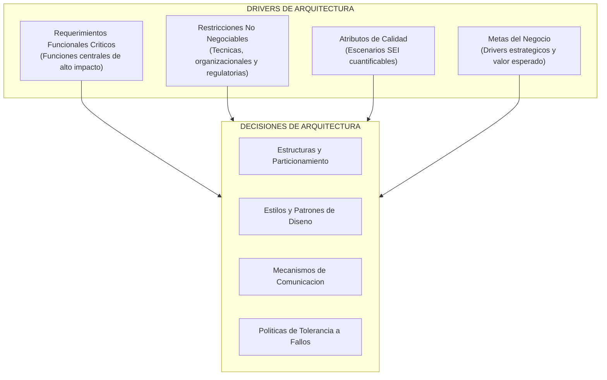
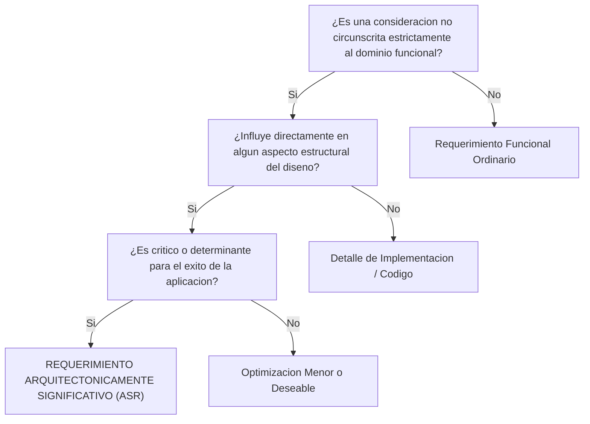
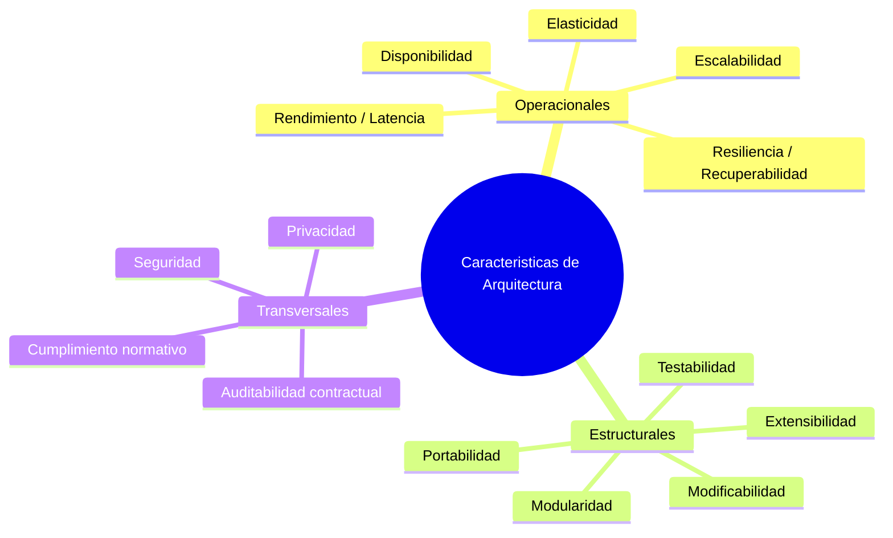
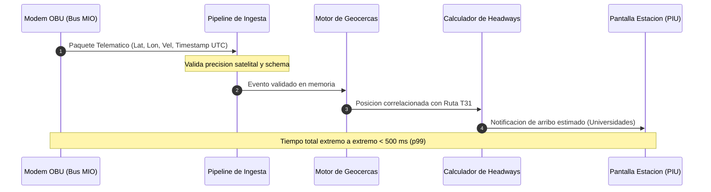
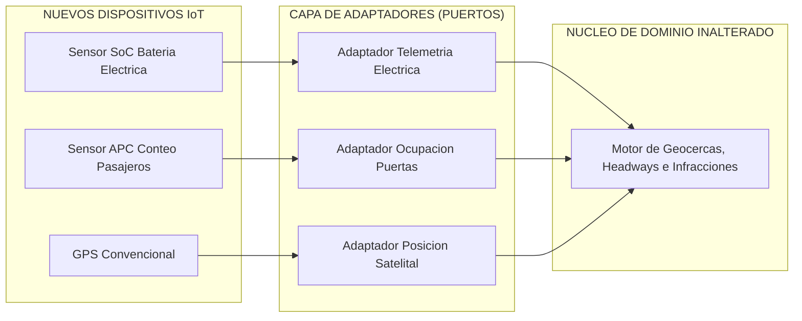
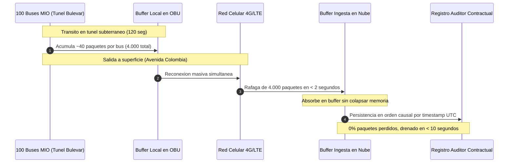
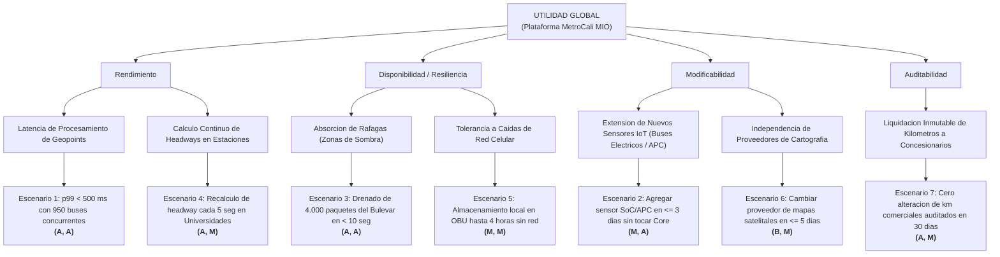
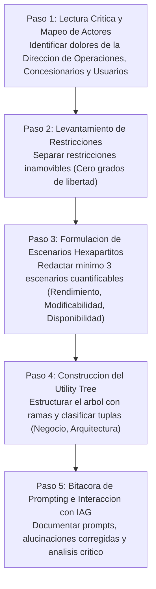

# Drivers de Arquitectura, ASRs y Escenarios de Calidad (SEI)

**Curso:** Diseño de Software I (Patrones de Diseño, Estilos y Arquitecturas de Software)  
**Programa:** Especialización en AI-Powered Software Engineering (AIPSE)  
**Universidad Icesi** - Facultad de Ingeniería, Diseño y Ciencias Aplicadas  
**Alineación Pedagógica:** RAA 1, Saberes SC1, SH2, SS1  
**Entregable Asociado:** ANL-DIS (15% de la evaluación del curso)  
**Nivel de IAG Recomendado:** Nivel 2 (Asistente de refinamiento y auditor de ambigüedades)  

---

## 1. Fundamentos y Concepto de Drivers de Arquitectura

En la ingeniería de software profesional, uno de los errores más comunes consiste en asumir que la arquitectura de un sistema es una consecuencia directa y exclusiva de sus requerimientos funcionales. La experiencia industrial demuestra lo contrario: **la funcionalidad por sí sola no determina la estructura de un software**. 

Tal como argumentan Bass, Clements y Kazman (2021) en la literatura canónica del *Software Engineering Institute* (SEI), si la funcionalidad fuera la única fuerza rectora del diseño, cualquier sistema podría implementarse como un monolito colosal sin modularidad interna ni separación de capas, satisfaciendo estrictamente las entradas y salidas del negocio. Sin embargo, diseñamos sistemas divididos en módulos, capas, componentes desacoplados, colas y servicios para satisfacer otras fuerzas críticas: escalabilidad, mantenibilidad, disponibilidad, rendimiento, seguridad y modificabilidad.

Estas fuerzas determinantes se denominan **Drivers de Arquitectura** (*Architectural Drivers*). Un driver es cualquier requerimiento, restricción o meta de negocio que ejerce una influencia profunda y estructurante sobre la arquitectura de software.



### 1.1. Los Cuatro Componentes de los Drivers de Arquitectura

Siguiendo la clasificación metodológica consolidada por Keeling (2020) y Bass et al. (2021), los drivers arquitectónicos abarcan cuatro categorías:

1. **Requerimientos Funcionales Críticos o Influyentes (*Influential Functional Requirements*):** Aquellas capacidades de negocio que introducen complejidades técnicas inéditas, demandando persistencia distribuida, sincronización fuera de línea, cálculo geoespacial en tiempo real o aislamiento de procesos. En la literatura son conocidos como *arquitecture killers*, porque ignorarlos en las etapas tempranas obliga a demoler y rehacer la solución completa.
2. **Restricciones de Diseño (*Constraints*):** Decisiones con **cero grados de libertad** impuestas al equipo por el negocio, el entorno regulatorio o la infraestructura preexistente. No están sujetas a negociación técnica.
3. **Atributos de Calidad (*Quality Attributes*):** Calificadores cuantitativos de la ejecución del software y del ciclo de vida de desarrollo (*las "-ilities"*). Definen cómo de bien el sistema ejecuta sus responsabilidades bajo condiciones de estrés, concurrencia o fallo.
4. **Metas del Negocio (*Business Goals*):** Los imperativos estratégicos de la organización (reducir costos operacionales, habilitar auditorías contractuales, soportar crecimiento de demanda sin duplicar infraestructura).

---

## 2. Requerimientos Funcionales Ordinarios vs. ASRs

No todos los requerimientos que aparecen en un documento de especificación técnica o en un tablero de historias de usuario tienen relevancia para la arquitectura. 

Un **Requerimiento Arquitectónicamente Significativo** (*Architecturally Significant Requirement - ASR*) es aquel que ejerce un impacto determinante y medible sobre la estructura global del sistema, condicionando la selección de estilos, patrones, particiones de datos y fronteras de módulos (Keeling, 2020).

### 2.1. Criterios de Richards & Ford para Identificar un ASR

En *Fundamentals of Software Architecture*, Richards y Ford (2020) establecen tres criterios estrictos que debe cumplir un aspecto del sistema para ser catalogado como una característica o driver arquitectónico:



1. **Especifica una consideración no de dominio (*Specifies a non-domain design consideration*):** Concierne a criterios operacionales, de despliegue o de evolución técnica (cómo opera o escala el software), y no únicamente a una regla algorítmica de negocio.
2. **Influye en algún aspecto estructural del diseño (*Influences some structural aspect of the design*):** Obliga al arquitecto a introducir un componente, particionar una base de datos, desacoplar un hilo, incorporar una cola de mensajes o adoptar un patrón de arquitectura. Si el requerimiento puede resolverse mediante una función auxiliar o un bloque `if/else` dentro de una clase existente, **no es un ASR**.
3. **Es crítico o importante para el éxito del producto (*Is critical or important to application success*):** Si la arquitectura no satisface este requerimiento, el sistema fallará ante los usuarios, violará contratos normativos o colapsará bajo demanda real.

### 2.2. Características Explícitas vs. Implícitas

- **Explícitas:** Declaradas textualmente en los pliegos o contratos (por ejemplo: *"el sistema debe almacenar las coordenadas satelitales cada 3 segundos"*).
- **Implícitas:** No están escritas en los requerimientos del cliente, pero el arquitecto está obligado a descubrirlas mediante el análisis del contexto (por ejemplo: ante zonas de sombra celular prolongadas, la unidad a bordo debe almacenar en memoria local los eventos para evitar pérdidas de telemetría y auditabilidad financiera).

### 2.3. Tabla Comparativa: Funcionalidad Ordinaria vs. ASRs en MetroCali MIO

| Requerimiento en MetroCali MIO | Clasificación | Justificación Arquitectónica | Decisión Estructural Inducida |
| :--- | :--- | :--- | :--- |
| El operador del Centro de Control puede consultar la placa, modelo y cédula del conductor asignado a un bus padrón. | **Requerimiento Funcional Ordinario** | Es una consulta estándar (CRUD) sobre una base de datos relacional. No condiciona la estructura global ni impone tensiones de concurrencia extremas. | Servicio de catálogo de vehículos o repositorio relacional estándar. No altera la macroarquitectura. |
| La plataforma debe procesar eventos telemáticos emitidos cada 3 segundos por 950 buses en hora pico (cerca de 320 eventos/segundo continuos), evaluando geocercas poligonales en menos de 500 ms por paquete. | **ASR (Rendimiento / Latencia)** | Impacta el throughput, el uso de memoria y la velocidad de cómputo geométrico espacial bajo concurrencia sostenida. | Ingesta asincrónica desacoplada mediante colas/eventos, motor de geocercas en memoria y cómputo geoespacial sin bloqueo de hilos. |
| El sistema debe permitir incorporar nuevos sensores telemáticos (ej. buses eléctricos con SoC de batería, sensores de conteo de pasajeros APC en puertas) sin reescribir ni reiniciar el motor de despacho y cálculo de demoras. | **ASR (Modificabilidad / Extensibilidad)** | Protege el núcleo del dominio de cambios en la capa de telemetría y formatos de tramas externas de múltiples fabricantes de hardware. | Aplicación de arquitectura hexagonal (Puertos y Adaptadores) y patrones de diseño creacionales/estructurales (*Factory Method*, *Adapter*). |
| Al registrar un retraso superior a 5 minutos, el sistema debe pintar en rojo la fila correspondiente en la consola web del despachador. | **Requerimiento Funcional Ordinario** | Es un detalle visual y cosmético de la interfaz de usuario (*UI rendering*). Reside en el cliente web. | Manejo de estado o estilos CSS condicionales en el frontend. Cero impacto arquitectónico en el backend. |
| Si 100 buses atraviesan el Túnel del Bulevar del Río (zona de sombra celular) durante 2 minutos y emergen al mismo tiempo, la plataforma debe absorber la ráfaga masiva de ~4.000 paquetes acumulados sin pérdida de datos ni bloqueo de la consulta pública. | **ASR (Disponibilidad / Resiliencia)** | Impone una demanda súbita de ingesta concurrente (*burst traffic*) con requerimientos de idempotencia y ordenamiento causal de marcas de tiempo satelitales. | Almacenamiento temporal en la OBU (*store-and-forward*), búfer de absorción de ráfagas en la nube, colas de mensajería con procesamiento particionado. |

---

## 3. Taxonomía de Atributos de Calidad y Mapeo de Dolores

Para estructurar los ASRs, Richards y Ford (2020) dividen las características arquitectónicas en tres grandes dimensiones:



### 3.1. Características Operacionales
Atributos que describen el comportamiento del software en tiempo de ejecución (*runtime properties*):
- **Rendimiento (*Performance*):** Tiempos de respuesta, latencia de procesamiento de eventos telemáticos y utilización óptima de CPU/memoria.
- **Escalabilidad (*Scalability*):** Capacidad de procesar incrementos en el volumen de buses, rutas o consultas ciudadanas agregando recursos computacionales.
- **Disponibilidad (*Availability*):** Proporción del tiempo en que el sistema se encuentra en estado operativo y accesible para los centros de control y las estaciones.
- **Resiliencia / Recuperabilidad (*Reliability / Recoverability*):** Habilidad para absorber fallos de comunicación celular sin perder información transaccional.

### 3.2. Características Estructurales
Atributos vinculados a las propiedades internas del código fuente y su ciclo de vida de mantenimiento (*design-time properties*):
- **Modificabilidad (*Modifiability*):** Facilidad con la que los ingenieros pueden alterar reglas de negocio (ej. umbral de velocidad en geocercas) con un esfuerzo medible y acotado.
- **Extensibilidad (*Extensibility*):** Facilidad para acoplar nuevas capacidades (como integración con nuevos tipos de sensores IoT) mediante puntos de extensión limpios.
- **Portabilidad (*Portability*):** Independencia respecto a proveedores específicos de infraestructura en la nube o dispositivos GPS propietarios.
- **Testabilidad (*Testability*):** Grado en que la arquitectura facilita la inyección de dobles de prueba y la verificación de invariantes mediante pruebas unitarias y de integración continuas.

### 3.3. Características Transversales
Atributos de gobernanza, seguridad y aspectos legales que cruzan verticalmente toda la solución:
- **Seguridad e Integridad (*Security*):** Prevención de manipulación maliciosa de geopoints o telemetría para alterar métricas de cumplimiento de rutas.
- **Auditabilidad Contractual (*Auditability*):** Trazabilidad inalterable de los kilómetros comerciales efectivamente prestados por cada operador concesionario para la liquidación monetaria quincenal.

---

## 4. Modelado de Restricciones del Negocio y Técnicas

En la visión de Michael Keeling (2020), una **restricción** (*constraint*) es una decisión de diseño ya tomada que limita severamente las opciones disponibles para el arquitecto. A diferencia de los atributos de calidad, las restricciones no admiten negociación ni compromisos (*trade-offs*): representan condiciones de borde obligatorias.

### 4.1. Restricciones Técnicas vs. de Negocio en MetroCali MIO

| Tipo | Restricción | Origen / Justificación | Impacto en la Arquitectura |
| :--- | :--- | :--- | :--- |
| **Técnica** | Las computadoras a bordo (OBU) operan sobre hardware embebido con memoria flash limitada y módems celulares 4G/LTE con cobertura intermitente en Cali. | Parque automotor concesionado preexistente. No hay presupuesto para reemplazar las 950 unidades físicas. | La arquitectura no puede asumir conectividad permanente (*always-on*). Debe exigir un protocolo de serialización liviano y política de persistencia local en OBU. |
| **Técnica** | El núcleo de procesamiento de eventos y lógica de negocio debe construirse sobre Java 17 LTS o superior utilizando herramientas estándar de construcción. | Estándar corporativo de ingeniería de MetroCali y convenciones del ecosistema de desarrollo de la empresa de transporte. | Las abstracciones deben aprovechar tipado estático, modularidad idiomática de Java y herramientas de pruebas automatizadas como JUnit 5 y ArchUnit. |
| **Negocio / Legal** | La liquidación económica quincenal por kilómetro comercial recorrido a los cuatro concesionarios debe calcularse sobre registros de auditoría inmutables y trazables. | Marco regulatorio y contractual de la concesión municipal de transporte público masivo de Cali. | Exige aislamiento del log de telemetría validado, almacenamiento de series temporales con firmas criptográficas o marcas de tiempo inalterables para auditoría legal. |
| **Negocio / Operacional** | El despliegue de actualizaciones en el servidor central no debe exigir detención del servicio durante el horario de operación comercial (04:30 a 23:00). | Continuidad del servicio público para cientos de miles de ciudadanos caleños. | La arquitectura debe admitir despliegues continuos sin interrupción (*zero-downtime deployment*, versiones compatibles hacia atrás). |

---

## 5. Anatomía Hexapartita de un Escenario de Calidad (SEI)

Un error pedagógico y profesional recurrente es formular los requerimientos de calidad utilizando adjetivos vagos y aspiracionales: *"el sistema debe ser altamente escalable"*, *"la plataforma debe ser rápida"* o *"la telemetría debe ser tolerante a fallos"*.

Para erradicar la ambigüedad, el *Software Engineering Institute* (SEI) propuso una estructura formal rigurosa compuesta por seis elementos, detallada exhaustivamente por Bass, Clements y Kazman (2021):


### 5.1. Definición de los Seis Componentes

1. **Fuente del Estímulo (*Source of Stimulus*):** La entidad interna o externa que desencadena el evento (un sensor GPS satelital, un conductor presionando un botón de pánico, un despachador en estación, un usuario en la aplicación móvil, o un componente del sistema que arroja una excepción).
2. **Estímulo (*Stimulus*):** La condición o evento que arriba al sistema y exige una acción (arribo de un paquete telemático, solicitud masiva de tiempos de llegada, pérdida súbita de conectividad celular, petición de cambio de especificación).
3. **Artefacto (*Artifact*):** El elemento arquitectónico, módulo, subsistema o interfaz sobre el cual recae el estímulo (el servicio de ingesta telemática, la base de datos de auditoría, el motor de cálculo de intervalos, el cliente móvil).
4. **Entorno / Contexto (*Environment*):** Las circunstancias operacionales en las cuales ocurre el estímulo. El comportamiento del software difiere notablemente en condiciones de operación normal, régimen pico, desconexión parcial, modo de mantenimiento o sobrecarga extrema.
5. **Respuesta (*Response*):** La actividad observable y verificable que ejecuta el sistema frente al estímulo (recibir y validar el paquete, encolar el mensaje, calcular el intervalo entre buses, registrar un log de auditoría, degradar el servicio de forma controlada).
6. **Medida de la Respuesta (*Response Measure*):** El criterio cuantitativo y objetivo que determina el éxito o fracaso del escenario. Debe formularse con números, unidades de tiempo, porcentajes, márgenes de error o métricas de costo que permitan escribir una prueba automatizada o de rendimiento para su validación.

---

## 6. Formulación de Escenarios Concretos para MetroCali MIO

A continuación se presentan tres escenarios de atributos de calidad plenamente formalizados y contextualizados en los dolores operacionales de MetroCali MIO descritos en el enunciado del caso transversal.

### 6.1. Escenario 1: Rendimiento y Latencia de Procesamiento Telemático (Operacional)

*Contexto del dominio:* En las horas de máxima congestión en Cali (06:30 a 08:30 y 17:00 a 19:30), la flota completa de aproximadamente 950 buses transmite coordenadas de manera concurrente cada 3 segundos, lo que genera una tasa de entrada continua de aproximadamente 317 eventos por segundo. El sistema debe validar la coherencia temporal/espacial y verificar el cumplimiento de geocercas sin generar cuellos de botella que retrasen la información enviada a las pantallas de las estaciones.



#### Ficha del Escenario Hexapartito: Rendimiento / Latencia

| Componente | Especificación Concreta en MetroCali MIO |
| :--- | :--- |
| **1. Fuente** | Computadoras de a bordo (*OBU*) de los buses en operación comercial. |
| **2. Estímulo** | Transmisión concurrente continua de paquetes telemáticos (identificador de bus, coordenadas GPS, velocidad instantánea, odómetro y marca de tiempo UTC) a una tasa sostenida de 320 eventos por segundo. |
| **3. Artefacto** | Subsistema de Ingesta Telemática y Motor de Detección de Geocercas. |
| **4. Entorno** | Operación en hora pico matutina (06:30 - 08:30) con 950 buses activos simultáneamente y condiciones climáticas con posible degradación leve de señal satelital. |
| **5. Respuesta** | El sistema valida la integridad de cada paquete, descarta rebotes GPS espurios, verifica la pertenencia geográfica respecto a las geocercas de velocidad y corredores troncales, actualiza la última posición del bus en memoria y publica el evento para el cálculo de demoras. |
| **6. Medida de Respuesta** | La latencia de procesamiento de cada paquete (desde su recepción en el conector de red hasta la emisión del evento georreferenciado) no debe superar los **500 milisegundos en el percentil 99 (p99)** y el consumo de CPU en los nodos de procesamiento no debe exceder el **70%** bajo carga sostenida de 350 eventos/segundo. |

---

### 6.2. Escenario 2: Modificabilidad e Incorporación de Sensores IoT (Estructural)

*Contexto del dominio:* MetroCali planea modernizar su flota incorporando buses eléctricos con monitoreo en tiempo real del estado de carga de las baterías (*State of Charge - SoC*) y sensores automáticos de conteo de pasajeros (*Automated Passenger Counting - APC*) en las puertas de ascenso y descenso. La arquitectura de software debe permitir acoplar estos nuevos flujos de datos sin requerir modificaciones ni redespliegues en el motor de cálculo de intervalos (*headways*) ni en las reglas de sanciones por desvío de ruta.



#### Ficha del Escenario Hexapartito: Modificabilidad / Extensibilidad

| Componente | Especificación Concreta en MetroCali MIO |
| :--- | :--- |
| **1. Fuente** | Equipo de ingeniería de desarrollo y mantenimiento de MetroCali. |
| **2. Estímulo** | Solicitud de cambio para incorporar un nuevo tipo de telemetría IoT: monitoreo de estado de carga de batería (SoC) en buses eléctricos y conteo de flujo de pasajeros en puertas (sensores APC). |
| **3. Artefacto** | Modelo de dominio de telemetría y módulo de decodificación de protocolos en la capa de adaptación de entrada. |
| **4. Entorno** | Fase de evolución y mantenimiento del software, con la plataforma en producción comercial. |
| **5. Respuesta** | El equipo implementa los nuevos adaptadores de protocolo y sus correspondientes contratos de datos sin alterar las clases del núcleo de dominio (*Core Domain*), sin modificar las reglas de cálculo de geocercas y sin detener la operación de los buses tradicionales a gas o diésel. |
| **6. Medida de Respuesta** | La incorporación del nuevo protocolo se completa en un esfuerzo de desarrollo no superior a **3 días-hombre**; se requiere tocar **0 líneas de código** en el núcleo de cálculo de *headways* y geocercas; el 100% de la suite de pruebas automatizadas preexistente pasa exitosamente sin modificaciones en sus aserciones. |

---

### 6.3. Escenario 3: Disponibilidad y Resiliencia ante Ráfagas por Zonas de Sombra (Operacional)

*Contexto del dominio:* El tramo subterráneo del Túnel del Bulevar del Río y sectores montañosos de ladera (Siloé) presentan zonas ciegas de comunicación celular. Durante el tránsito por el túnel (un promedio de 2 minutos de viaje), los buses no pueden transmitir sus geopoints. Las computadoras de a bordo acumulan los eventos en memoria local (*store-and-forward*). Al salir a la superficie por la Avenida Colombia, hasta 100 buses simultáneos recuperan señal LTE casi al mismo instante, descargando una ráfaga súbita acumulada de cerca de 4.000 paquetes telemáticos. El sistema no debe descartar datos auditables ni degradar la experiencia de los usuarios en estaciones.



#### Ficha del Escenario Hexapartito: Disponibilidad / Resiliencia

| Componente | Especificación Concreta en MetroCali MIO |
| :--- | :--- |
| **1. Fuente** | Grupo de hasta 100 buses saliendo simultáneamente del Túnel del Bulevar del Río hacia la Avenida Colombia. |
| **2. Estímulo** | Ráfaga repentina de reconexión con envío de aproximadamente 4.000 paquetes acumulados en los últimos 120 segundos de trayecto a oscuras celular. |
| **3. Artefacto** | Búfer de ingesta telemática, colas de mensajería intermedias y base de datos de auditoría histórica. |
| **4. Entorno** | Operación en hora pico con la plataforma bajo carga nominal de 320 eventos/segundo del resto de la ciudad. |
| **5. Respuesta** | El receptor de telemetría absorbe la ráfaga a través de un búfer sin desbordar memoria ni rechazar conexiones; procesa los eventos acumulados respetando el orden cronológico estricto de las marcas de tiempo UTC satelitales y actualiza el estado sin bloquear el cálculo de demoras en tiempo real de los buses en la Estación Universidades. |
| **6. Medida de Respuesta** | Cero por ciento (**0%**) de paquetes telemáticos perdidos o descartados por sobreflujo de búfer; la cola de mensajes acumulada de la ráfaga se drena por completo en un tiempo inferior a **10 segundos** tras el restablecimiento del enlace celular; y la latencia para los usuarios de la aplicación móvil que consultan rutas no se incrementa en más de **200 milisegundos** durante el periodo de drenado. |

---

## 7. Priorización de Drivers: El Árbol de Utilidad (Utility Tree)

En un sistema del mundo real, es materialmente imposible optimizar todas las dimensiones de calidad con la misma intensidad. Intentar maximizar simultáneamente el rendimiento, la disponibilidad, la seguridad, la modificabilidad y la economía de infraestructura genera parálisis por análisis o colapso del diseño.

En el método ATAM (*Architecture Tradeoff Analysis Method*) del SEI, Bass et al. (2021) proponen el **Árbol de Utilidad (*Utility Tree*)** como la herramienta canónica para traducir los objetivos de alto nivel del negocio en un conjunto priorizado de escenarios de calidad.

### 7.1. Estructura del Árbol de Utilidad

1. **Raíz (*Utility*):** Expresa la bondad y adecuación global del sistema de software frente al negocio.
2. **Nivel 1 (Atributos de Calidad):** Las cualidades de alto nivel requeridas (Rendimiento, Disponibilidad, Modificabilidad, Seguridad, Usabilidad).
3. **Nivel 2 (Refinamientos del Atributo):** Subcategorías que descomponen el atributo en preocupaciones específicas del problema (ej. Rendimiento refinado en *Latencia de Telemetría* y *Throughput de Ingesta*).
4. **Nivel 3 (Hojas - Escenarios Concretos):** Escenarios formalizados del modelo SEI con estímulo y respuesta medible.
5. **Calificación de Prioridad `(Importancia, Impacto)`:** Cada hoja se evalúa en una tupla de dos dimensiones con escala **Alto (A/H)**, **Medio (M/M)** y **Bajo (B/L)**:
   - **Dimensión 1: Importancia para el Negocio / Éxito del Producto:** ¿Qué tan grave es para la operación de MetroCali si este escenario no se cumple?
   - **Dimensión 2: Impacto / Dificultad Arquitectónica:** ¿Qué tan difícil, costoso o determinante es estructurar la arquitectura para satisfacer este escenario?



### 7.2. Matriz de Priorización del Utility Tree para MetroCali MIO

| Atributo de Calidad | Refinamiento | Escenario Concreto | Negocio | Arquitectura | Prioridad Global |
| :--- | :--- | :--- | :---: | :---: | :---: |
| **Rendimiento** | Latencia de eventos | **Escenario 1:** 950 buses emitiendo cada 3 s; detección de geocercas y propagación en menos de 500 ms (p99). | **Alto** | **Alto** | **(A, A) - Crítico** |
| **Disponibilidad** | Resiliencia a ráfagas | **Escenario 3:** Salida masiva del Túnel del Bulevar; absorción de 4.000 paquetes acumulados en < 10 s sin pérdida de datos. | **Alto** | **Alto** | **(A, A) - Crítico** |
| **Modificabilidad** | Integración de sensores | **Escenario 2:** Incorporación de telemetría de carga de batería (SoC) y conteo APC en < 3 días sin alterar motor central. | **Medio** | **Alto** | **(M, A) - Arquitectónico** |
| **Auditabilidad** | Integridad contractual | **Escenario 7:** Liquidación quincenal por km recorrido inalterable frente a desconexiones, con log transaccional validado. | **Alto** | **Medio** | **(A, M) - Clave Negocio** |
| **Rendimiento** | Frecuencia de headway | **Escenario 4:** Actualización de estimación de llegada en Estación Universidades cada 5 s para las 15 rutas troncales. | **Alto** | **Medio** | **(A, M) - Clave Negocio** |
| **Disponibilidad** | Persistencia local | **Escenario 5:** Unidad de a bordo OBU retiene en memoria flash hasta 4 horas de telemetría ante corte total de red celular. | **Medio** | **Medio** | **(M, M) - Secundario** |
| **Portabilidad** | Cartografía desacoplada | **Escenario 6:** Migración de proveedor de mapas (de OpenStreetMap a proveedor satelital privado) en menos de 5 días de desarrollo. | **Bajo** | **Medio** | **(B, M) - Diferido** |

> **Regla de Oro Metodológica:** Los escenarios clasificados como **(Alto, Alto)** constituyen los verdaderos núcleos estructurantes de la arquitectura. Son los que justifican la selección de estilos asincrónicos, el diseño de búferes de absorción y los patrones de desacoplamiento. Si un equipo reporta diez escenarios `(Alto, Alto)`, ha incurrido en sobreespecificación y fracasará en cumplir los objetivos del proyecto.

---

## 8. El ASR Workbook (Cuaderno de Trabajo de Arquitectura)

Michael Keeling (2020) en *Design It!* recomienda documentar los drivers tempranos en un artefacto vivo denominado **ASR Workbook**. Este cuaderno condensa en pocas páginas el entendimiento compartido entre los ingenieros de software y los actores del negocio.

### 8.1. Estructura Estándar del ASR Workbook

```text
ASR WORKBOOK: PLATAFORMA METROCALI MIO
├── 1. Proposito y Alcance
│   ├── Contexto del Sistema (Transporte Masivo de Cali)
│   └── Audiencia Objetivo (Despachadores, Pasajeros, Concesionarios, Auditoria)
├── 2. Mapeo de Stakeholders y Metas Estrategicas
│   ├── Direccion de Operaciones -> Disminuir agrupamiento de buses (bus bunching)
│   ├── Pasajeros en Estaciones -> Certidumbre de arribo en Universidades
│   └── Direccion Financiera -> Auditoria exacta de km comerciales recorridos
├── 3. Restricciones No Negociables
│   ├── Restricciones Tecnicas (OBU embebidas, red 4G celular, Java 17 LTS)
│   └── Restricciones de Negocio (Normativa contractual, despliegue zero-downtime)
├── 4. Bateria de Escenarios de Calidad (SEI Hexapartitos)
│   ├── Escenarios Operacionales (Rendimiento, Disponibilidad)
│   ├── Escenarios Estructurales (Modificabilidad, Extensibilidad)
│   └── Escenarios Transversales (Auditabilidad, Seguridad)
├── 5. Arbol de Utilidad (Utility Tree Priorizado)
│   └── Identificacion de Escenarios (Alto, Alto)
└── 6. Requerimientos Funcionales Criticos (Architecture Killers)
    ├── Evaluacion poligonal geoespacial en memoria
    └── Correlacion temporal e historica de eventos fuera de orden
```

### 8.2. El Riesgo de la Sobreespecificación: La Lección del Navío Vasa

Richards y Ford (2020) advierten contra el antipatrón de sobredimensionar los requerimientos de calidad citando la historia del buque de guerra sueco *Vasa* (1628). El rey Gustavo II Adolfo exigió un barco que fuera simultáneamente el mayor transporte de tropas del mundo, que tuviera dos cubiertas de artillería en lugar de una, y que montara cañones del doble de tamaño de los existentes. Al zarpar para su viaje inaugural, una ráfaga de viento hizo escorar el navío; debido al peso excesivo de la cubierta superior, el agua ingresó por las troneras abiertas de los cañones y el buque zozobró en la bahía de Estocolmo a menos de una milla de la costa.

En arquitectura de software, **intentar construir un sistema que soporte todos los atributos de calidad posibles es construir un Vasa digital**. Un sistema no puede ser a la vez ultra-seguro, con latencia sub-milisegundo, costo mínimo, desacoplamiento absoluto y consistencia inmediata distribuida. La labor del ingeniero consiste en elegir las 3 a 5 cualidades verdaderamente críticas y negociar los compromisos (*trade-offs*) restantes.

---

## 9. Guía de Ejecución para el Entregable ANL-DIS (15%)

El primer entregable formal del curso, **ANL-DIS (15%)**, evalúa la competencia de los estudiantes para analizar el problema de MetroCali MIO, extraer sus fuerzas en conflicto y estructurar un informe técnico con rigor profesional.

### 9.1. Pasos Metodológicos para Desarrollar el Entregable



1. **Paso 1: Lectura Crítica y Mapeo de Actores:** Identificar quiénes son los interesados del sistema (reguladores de tráfico, usuarios en Estación Universidades, gerentes de concesionarios privados, auditores contractuales de MetroCali) y qué metas persigue cada uno.
2. **Paso 2: Aislamiento de Restricciones:** Identificar cuáles condiciones son inmodificables (hardware OBU existente, conectividad celular intermitente en Cali, uso de Java 17 LTS, inmutabilidad de la auditoría de kilómetros) y no confundirlas con requerimientos de calidad.
3. **Paso 3: Redacción de Escenarios Hexapartitos Cuantificables:** Elaborar al menos tres escenarios completos (uno de Rendimiento, uno de Modificabilidad y uno de Disponibilidad/Resiliencia), garantizando que las medidas de respuesta contengan números y unidades verificables (latencia en ms, porcentaje de eventos perdidos, días-hombre de esfuerzo).
4. **Paso 4: Construcción y Justificación del Utility Tree:** Elaborar el árbol jerárquico y clasificar cada escenario con su tupla `(H, M, L)`. Justificar con argumentos técnicos por qué los escenarios marcados como `(Alto, Alto)` merecen esa designación.
5. **Paso 5: Bitácora de Interacción con IA Generativa (AIPSE):** Documentar el proceso de trabajo con modelos de lenguaje (ChatGPT, Claude, Gemini). Indicar los prompts empleados, las respuestas iniciales imprecisas o adjetivadas generadas por el modelo, y cómo el estudiante aplicó su criterio ingenieril para forzar la cuantificación de las métricas.

### 9.2. Prompts Recomendados para Refinamiento con IA

Para el desarrollo del entregable ANL-DIS, se sugiere utilizar prompts estructurados orientados a la auditoría técnica de requerimientos:

```text
PROMPT 1: AUDITORÍA DE AMBIGÜEDADES Y CONVERSIÓN A ESCENARIOS SEI
"Actúa como un arquitecto de software senior especializado en el modelo de evaluación ATAM del SEI.
Analiza el siguiente texto de requerimiento del caso MetroCali MIO:
[Insertar texto del requerimiento o historia de usuario]

Identifica todos los adjetivos imprecisos (ej. rápido, tolerante a fallos, altamente disponible, escalable).
Posteriormente, reescribe el requerimiento como un escenario de calidad formal de seis partes:
- Fuente del estímulo:
- Estímulo:
- Artefacto:
- Entorno:
- Respuesta observable:
- Medida cuantitativa de la respuesta:
Asegúrate de que la medida incluya umbrales numéricos medibles y realistas para el dominio de transporte masivo."
```

```text
PROMPT 2: ANÁLISIS DE TRADE-OFFS ANTE OPTIMIZACIÓN DE DRIVERS
"Actúa como un arquitecto de soluciones de sistemas distribuidos.
En el sistema de telemetría de MetroCali MIO se ha priorizado como (Alto, Alto) el siguiente escenario:
'Ingesta de 320 paquetes telemáticos por segundo con evaluación de geocercas en menos de 500 ms (p99)'.

Explica:
1. ¿Qué otros atributos de calidad entran en conflicto directo (trade-off) al optimizar este rendimiento estricto?
2. ¿Qué decisiones de diseño o estructuras arquitectónicas se ven comprometidas al satisfacer esta meta?
3. Plantea una estrategia para mitigar el impacto negativo sobre los atributos de calidad secundarios."
```

---

## 10. Referencias Bibliográficas

- **Bass, L., Clements, P., & Kazman, R.** (2021). *Software Architecture in Practice* (4th ed.). Addison-Wesley Professional.
  - Capítulo 4: *Understanding Quality Attributes* (pp. 59-78).
  - Capítulo 16: *Architecture and Requirements* (pp. 297-316).
  - Capítulo 17: *Architecturally Significant Requirements* (pp. 317-338).
- **Keeling, M.** (2020). *Design It!: From Programmer to Software Architect*. Pragmatic Bookshelf.
  - Capítulo 4: *Empathize with Stakeholders* (pp. 39-48).
  - Capítulo 5: *Dig for Architecturally Significant Requirements* (pp. 49-62).
  - Capítulo 6: *Choose an Architecture (Before It Chooses You)* (pp. 63-78).
- **Richards, M., & Ford, N.** (2020). *Fundamentals of Software Architecture: An Engineering Approach*. O'Reilly Media.
  - Capítulo 4: *Architecture Characteristics Defined* (pp. 55-64).
  - Capítulo 5: *Identifying Architectural Characteristics* (pp. 65-76).
  - Capítulo 6: *Measuring and Governing Architecture Characteristics* (pp. 77-100).
- **MetroCali S.A.** (2026). *Plataforma Inteligente de Monitoreo de Flota, Geocercas y Gestión de Demoras: Enunciado de Caso de Estudio Transversal*. Departamento de Computación y Sistemas Inteligentes, Universidad Icesi.
