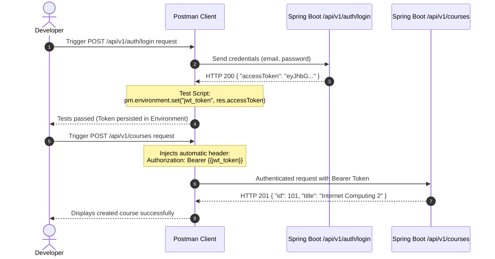

# Postman

In enterprise software development with **Spring Boot**, building REST controllers, services, and JPA repositories is only half the battle. To ensure services respond consistently, properly parse input payloads, and reject malicious or malformed requests, maintaining a disciplined testing strategy for HTTP endpoints is essential.

**Postman** is the industry-standard platform for designing, testing, documenting, and automating HTTP APIs. It allows developers to simulate frontend or mobile clients, inspect responses in real time, chain authentication flows based on JSON Web Tokens (JWT), and automate regression test suites prior to production deployments.

---

## 1. Theoretical Foundations & Architecture

### Why Use Postman for Testing Spring Boot APIs?

While terminal utilities like `curl` or `.http` files can dispatch raw HTTP requests, Postman provides a complete environment across the API development lifecycle:

- **Structured Visual Inspection**: Automatic formatting of JSON payloads, HTTP header inspection, response latency metrics, and payload transfer sizes.
- **Modular Environment Management**: Effortlessly switch configuration variables (such as local development URLs `http://localhost:8080` vs. staging or production cloud hosts) with a single click without altering route paths.
- **Reactive Request Chaining**: Dynamically extract JWT tokens generated at an authentication endpoint (`/api/v1/auth/login`) and automatically inject them into subsequent requests using environment variables.
- **Assertion Automation**: JavaScript testing scripts (`pm.test`, `pm.expect`) to validate HTTP status codes, schema contracts, and response latency.
- **Suite Automation with Collection Runner**: Sequentially execute full request collections for regression testing and continuous verification.

---

### Anatomy of the Postman Interface

Walk through each critical component of the user interface interactively to understand how to configure environments, construct requests, and inspect responses from your Spring Boot backend:

<iframe src="/interactive/computacion-2/semana-13/postman-interface/index.html" title="Postman Interface Anatomy" style={{ width: '100%', height: 750, border: 0 }} loading="lazy" />

---

### Request Lifecycle: Postman and Spring Boot

When you click **Send**, the request travels through an interconnected architecture: originating from the Postman client, entering the embedded Tomcat server on port 8080, flowing through the Spring Security filter chain, the DispatcherServlet, the controller, and the database, before returning in reverse order back to Postman to evaluate assertions and persist variables.

Explore each of the 6 phases step-by-step using the interactive player below:

<iframe src="/interactive/computacion-2/semana-13/postman-spring-lifecycle/index.html" title="Postman and Spring Boot Lifecycle" style={{ width: '100%', height: 790, border: 0 }} loading="lazy" />

---

### Variable Hierarchy & Scopes

Postman manages variables within nested scopes: the innermost, most specific scope carries highest precedence and overrides any values declared in outer scopes.


| Scope | Scope Boundary | Common Spring Boot Use Case |
| :--- | :--- | :--- |
| **Global** | Entire Postman workspace | Universal constants or helper functions shared across multiple APIs. |
| **Collection** | Exclusive to a single collection | Relative base paths or constants specific to one microservice. |
| **Environment** | Tied to active target environment (Dev, Staging, Prod) | `base_url` (`http://localhost:8080`) and active session tokens (`jwt_token`). |
| **Data** | Loaded from external files (`.csv` or `.json`) | Test data matrices for bulk executions in the Collection Runner. |
| **Local** | Single request execution run | Ephemeral variables within test scripts (`pm.variables.set('tempVal', 123)`). |

---

### Authentication Flow & Request Chaining

In applications secured with JSON Web Tokens (JWT) and Spring Security, copying and pasting tokens across endpoints by hand is inefficient and error-prone. Automated chaining synchronizes the entire workflow:



---

## 2. Step-by-Step Hands-on Guide: Testing a Spring Boot API

Next, we will build a complete end-to-end testing workflow for a Spring Boot backend secured with JWT authentication and protected DTO validation endpoints.

<StepByStep>
  <Step number="1" title="Create Collection and Define Environment">
    The first step is organizing your requests inside a collection and configuring the base variables for your local server.

    1. Open Postman and in the left sidebar select **Collections** > **Create Collection (+)**. Name it `Spring Boot Web API`.
    2. In the left navigation, switch to **Environments** > **Create Environment (+)**. Name it `Dev - Spring Boot (Local)`.
    3. Add the following environment variables:

    | Variable | Type | Initial Value | Current Value |
    | :--- | :--- | :--- | :--- |
    | `base_url` | default | `http://localhost:8080` | `http://localhost:8080` |
    | `jwt_token` | secret | *(empty)* | *(empty)* |
    | `course_id` | default | *(empty)* | *(empty)* |

    :::tip[Initial Value vs. Current Value]
    The **Initial Value** field is synced when sharing workspaces with collaborators or exporting collections. The **Current Value** field is saved only on your local machine, protecting sensitive secrets from accidental leakage into shared repositories.
    :::
  </Step>

  <Step number="2" title="Create the User Login Request">
    Configure the HTTP request to authenticate against the Spring Boot authentication controller (`AuthController`).

    1. Inside the `Spring Boot Web API` collection, select **Add request**.
    2. Configure the following parameters:
       - **Name**: `01 - User Login`
       - **Method**: `POST`
       - **URL**: `{{base_url}}/api/v1/auth/login`
    3. In the **Headers** tab, confirm that the following header is present:
       - `Content-Type: application/json`
    4. In the **Body** tab, choose **raw** with **JSON** format, entering the corresponding login payload:

    ```json title="request-body-login.json"
    {
      "email": "estudiante@icesi.edu.co",
      "password": "PasswordSeguro123!"
    }
    ```
  </Step>

  <Step number="3" title="Configure Automated Tests and Extract JWT Token">
    In the **Tests** tab of the login request, write assertions to validate the response code and extract the `accessToken` into the active environment.

    ```javascript title="postman-tests-login.js" showLineNumbers
    // 1. Verify that server responds with HTTP 200 OK
    pm.test("Status code is 200 OK", function () {
        pm.response.to.have.status(200);
    });

    // 2. Validate that response body contains JWT access token
    pm.test("Response body contains an accessToken in JWT format", function () {
        const responseData = pm.response.json();
        
        pm.expect(responseData).to.have.property("accessToken");
        pm.expect(responseData.accessToken).to.be.a("string").and.not.empty;

        // 3. Persist the received token into the jwt_token environment variable
        pm.environment.set("jwt_token", responseData.accessToken);
        console.log("JWT Token successfully updated in the active environment.");
    });

    // 4. Ensure response latency is within acceptable performance bounds
    pm.test("Response time is below 800ms", function () {
        pm.expect(pm.response.responseTime).to.be.below(800);
    });
    ```

    Click **Send**. In the bottom panel, verify **Test Results (3/3 PASS)** and that the `jwt_token` variable has been populated.
  </Step>

  <Step number="4" title="Configure Protected Endpoint with Bearer Token">
    Now create an endpoint protected by Spring Security that consumes the `{{jwt_token}}` variable.

    1. Add a new request inside the collection:
       - **Name**: `02 - Create Protected Course`
       - **Method**: `POST`
       - **URL**: `{{base_url}}/api/v1/courses`
    2. Navigate to the **Authorization** tab:
       - **Type**: `Bearer Token`
       - **Token**: `{{jwt_token}}`
    3. In the **Body** tab, select **raw** > **JSON** and supply the course data matching the Spring Boot DTO contract:

    ```json title="request-body-create-course.json"
    {
      "title": "Internet Computing 2",
      "code": "C2-2026-1",
      "credits": 3,
      "description": "Enterprise backend engineering with Spring Boot and automated testing"
    }
    ```
    
    4. In the **Tests** tab, add assertions to verify database persistence and save `course_id`:

    ```javascript title="postman-tests-create-course.js" showLineNumbers
    // Validate successful resource creation according to REST conventions
    pm.test("Status code is 201 Created", function () {
        pm.response.to.have.status(201);
    });

    // Validate schema contract returned by the controller
    pm.test("Returned object contains autogenerated numerical id", function () {
        const body = pm.response.json();
        pm.expect(body).to.have.property("id");
        pm.expect(body.id).to.be.a("number");
        pm.expect(body.title).to.eql("Internet Computing 2");
        
        // Save the newly created ID for subsequent GET or DELETE operations
        pm.environment.set("course_id", body.id);
    });
    ```
  </Step>

  <Step number="5" title="Boundary Testing and Validation Errors (@Valid)">
    A comprehensive testing suite must also verify negative scenarios and reject invalid input payloads.

    1. Add a request with deliberately invalid data:
       - **Name**: `03 - DTO Validation Error (Negative Test)`
       - **Method**: `POST`
       - **URL**: `{{base_url}}/api/v1/courses`
       - **Authorization**: `Bearer Token` with `{{jwt_token}}`
    2. Provide negative credit numbers and a blank title to trigger `@NotBlank` and `@Positive`:

    ```json title="request-body-invalid.json"
    {
      "title": "",
      "code": "C2-INVALID",
      "credits": -5,
      "description": "Attempt to register course with inconsistent inputs"
    }
    ```

    3. Write the test script to confirm that `@RestControllerAdvice` returns `400 Bad Request` with an array of validation errors:

    ```javascript title="postman-tests-validation-error.js" showLineNumbers
    // Validate that Spring Boot intercepts DTO inconsistencies
    pm.test("Server responds with HTTP 400 Bad Request", function () {
        pm.response.to.have.status(400);
    });

    pm.test("Response body contains a list of validation errors", function () {
        const errorResponse = pm.response.json();
        pm.expect(errorResponse).to.have.property("errors");
        pm.expect(errorResponse.errors).to.be.an("array").and.not.empty;
    });
    ```
  </Step>

  <Step number="6" title="Execute Full Suite with Collection Runner">
    The **Collection Runner** enables sequential execution of all requests within a collection, testing the overall system stability.

    1. In the Postman left sidebar, click the three dots `...` next to `Spring Boot Web API` > **Run collection**.
    2. Verify the execution sequence:
       - `01 - User Login`
       - `02 - Create Protected Course`
       - `03 - DTO Validation Error`
    3. Ensure the active environment is set to `Dev - Spring Boot (Local)`.
    4. Click **Run Spring Boot Web API**. Postman will execute the requests sequentially and provide a summary report showing all passed assertions.
  </Step>
</StepByStep>

---

## 3. Best Practices for Postman API Testing

When designing automated test suites for Spring Boot backends, adhere to the following quality guidelines:

### Built-in Dynamic Variables

To prevent test execution collisions caused by duplicate database records (such as PostgreSQL unique key constraints when registering duplicate emails or course codes), Postman provides native generators using `{{$...}}` syntax:

- `{{$randomEmail}}`: Generates a unique, simulated email address.
- `{{$randomFullName}}`: Generates a randomized full name.
- `{{$randomUUID}}`: Generates a random version 4 UUID.
- `{{$timestamp}}`: Generates the current Unix timestamp in seconds.

Use these variables directly in request payloads:

```json title="request-body-dynamic.json"
{
  "email": "{{$randomEmail}}",
  "fullName": "{{$randomFullName}}"
}
```

### Resource Lifecycle Isolation (CRUD)

Structure your collections to reflect the natural lifecycle of a resource:

1. **POST**: Create the resource and persist its identifier (`pm.environment.set("course_id", res.id)`).
2. **GET**: Retrieve the resource individually using `{{base_url}}/api/v1/courses/{{course_id}}`.
3. **PATCH / PUT**: Update specific resource fields and verify changes.
4. **DELETE**: Remove the resource at the end of the suite to keep test databases clean.

### Granular and Resilient Assertions

Reliable tests should not stop at checking `200 OK`. Always evaluate:

- **HTTP Status Code**: Validate expected codes like `200 OK` or `201 Created`.
- **Response Headers**: Ensure `Content-Type` includes `application/json`.
- **Schema Contracts and Data Types**: Validate that required fields exist and match expected types (`string`, `number`, `array`).
- **Response Latency**: Ensure endpoints respond below defined thresholds (e.g., `pm.expect(pm.response.responseTime).to.be.below(500)`).

:::warning[Environment Variable Security in Source Control]
Never commit production access tokens, database credentials, or secret keys into **Initial Value** fields when exporting or sharing environments. Keep secrets strictly in **Current Value**, which stays on your local machine.
:::

---

## Self-Assessment Quiz

<Quiz id="c2-semana-13-postman-quiz-en">
  <Question title="What is the primary purpose of Pre-request Scripts in Postman?">
    <Option>To inspect the HTTP status code received from the backend server.</Option>
    <Option correct>To execute JavaScript code before the HTTP request is dispatched in order to configure dynamic parameters, signatures, or variables.</Option>
    <Option>To automatically export the API documentation into OpenAPI/Swagger format.</Option>
    <Option>To compile the Java source code of Spring Boot before booting the server.</Option>
  </Question>

  <Question title="At what point in the Postman request lifecycle do scripts in the Tests tab execute?">
    <Option>Before the HTTP request is serialized across the network.</Option>
    <Option>While the Spring Security filter chain is actively evaluating the JWT token.</Option>
    <Option correct>Synchronously immediately after receiving the full HTTP response from the backend server.</Option>
    <Option>Only when the HTTP request fails with a 500 Internal Server Error.</Option>
  </Question>

  <Question title="If a variable named 'base_url' is defined simultaneously at both Global and Environment scope, which value takes precedence?">
    <Option>The Global variable, because it has higher hierarchy in the workspace.</Option>
    <Option correct>The Environment variable, because it is an inner, more specific scope than Global scope.</Option>
    <Option>Postman throws a naming collision exception and refuses to send the request.</Option>
    <Option>Both values are concatenated with a forward slash separator.</Option>
  </Question>

  <Question title="Which Postman API method allows programmatically storing a received token to inject it into subsequent requests?">
    <Option>pm.variables.export('jwt_token', token)</Option>
    <Option>localStorage.setItem('jwt_token', token)</Option>
    <Option correct>pm.environment.set('jwt_token', token)</Option>
    <Option>pm.request.headers.add('Authorization', token)</Option>
  </Question>

  <Question title="What is the critical distinction between 'Initial Value' and 'Current Value' when managing environment variables?">
    <Option>'Initial Value' supports only strings, whereas 'Current Value' supports integers.</Option>
    <Option>'Initial Value' is wiped when closing Postman, whereas 'Current Value' is saved permanently.</Option>
    <Option correct>'Initial Value' is synced when sharing workspaces or exporting collections, while 'Current Value' resides exclusively on your local client machine.</Option>
    <Option>'Current Value' is automatically sent to Spring Boot as a query parameter in the request URL.</Option>
  </Question>

  <Question title="How do you automatically inject an environment-saved JWT token into a secured Postman request?">
    <Option>By manually typing the token string into the JSON body of every request.</Option>
    <Option correct>By selecting 'Bearer Token' in the Authorization tab with the value &#123;&#123;jwt_token&#125;&#125;.</Option>
    <Option>By passing the token as a session cookie using a GET query parameter.</Option>
    <Option>By disabling Spring Security in application.properties.</Option>
  </Question>

  <Question title="When running boundary tests against a DTO annotated with @NotBlank and @Positive, what HTTP response and structure is expected from the backend?">
    <Option>HTTP 200 OK with a warning header from the embedded server.</Option>
    <Option>HTTP 500 Internal Server Error with the exception stack trace logged in the response.</Option>
    <Option correct>HTTP 400 Bad Request intercepted by @RestControllerAdvice containing an array of validation errors.</Option>
    <Option>HTTP 401 Unauthorized indicating that the token lacks write permissions.</Option>
  </Question>

  <Question title="Why is it recommended to use built-in dynamic variables such as &#123;&#123;$randomEmail&#125;&#125; or &#123;&#123;$randomUUID&#125;&#125; during resource creation tests?">
    <Option>To reduce RAM consumption on the Spring Boot server.</Option>
    <Option correct>To prevent record collisions and unique key constraint violations in the database across repeated test executions.</Option>
    <Option>Because Postman cannot send literal string values in raw JSON bodies.</Option>
    <Option>To encrypt user credentials before they traverse the network.</Option>
  </Question>

  <Question title="What is the primary role of the Collection Runner in an enterprise API testing workflow?">
    <Option>To automatically format Java source code for Spring Boot controllers.</Option>
    <Option>To monitor processor temperature on the host running the Tomcat container.</Option>
    <Option correct>To execute all requests within a collection in automated sequence for regression testing and continuous verification.</Option>
    <Option>To generate UML class diagrams from the exported JSON collection file.</Option>
  </Question>

  <Question title="According to testing best practices, what is the recommended sequence to structure a full CRUD test suite for an entity?">
    <Option>DELETE -> PUT -> GET -> POST to wipe the database before creating new records.</Option>
    <Option correct>POST (create and store ID) -> GET (verify retrieval) -> PUT/PATCH (update and check changes) -> DELETE (remove and clean up).</Option>
    <Option>GET -> GET -> GET repeatedly to calculate average endpoint latency.</Option>
    <Option>Direct PUT without initial creation to rely on Hibernate schema auto-generation.</Option>
  </Question>
</Quiz>

---

## Recommended Resources

- [Official Postman Documentation](https://learning.postman.com/)
- [Postman Variables and Environments Guide](https://learning.postman.com/docs/sending-requests/variables/)
- [Spring Boot REST API Testing Strategies](https://spring.io/guides/tutorials/rest)
