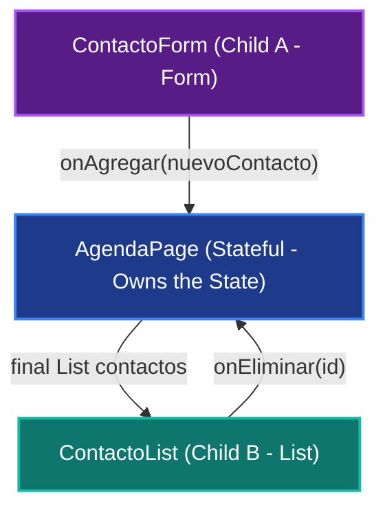

import Tabs from '@theme/Tabs';
import TabItem from '@theme/TabItem';

# State Lifting, Callbacks and Modular Refactoring

In this hands-on workshop you will build **Part 2 (of 2)** of the **In-Memory Contacts Agenda** app. 

In [Week 11 (Session 22)](/docs/seminario-de-i-d-i/semana-11/taller-agenda-contactos-monolitica) you built the first working version by concentrating all local memory, text controllers, mutation methods and visual presentation in a single monolithic file (`agenda_page.dart`). Although that approach let you validate the interaction quickly, it showed problems of coupling and lack of modularity.

In this session we will carry out an **architectural refactoring** of that same code, applying the principles of declarative frontend design in Flutter:
1. **State Lifting:** The state lives in the host page (`AgendaPage`) and the child components receive it through their constructor (*props*).
2. **Functions as Parameters (*Callbacks*):** Child components report events upward (`onAgregar`, `onEliminar`) without knowing the parent or the persistence layer.
3. **Immutable Models with `copyWith`:** Predictable state updates without destructive in-memory mutations.
4. **Prop Drilling Analysis:** Understand up to which depth of nesting this technique is healthy and which signs tell you it is starting to create architectural friction.

---

## 1. Diagnosing the Monolith: Why Refactor?

In the previous session, the `agenda_page.dart` file contained more than 150 lines of code accumulating three unrelated responsibilities:
* **State Ownership:** Declaration of `List<Contacto> _contactos`, instantiation of `_nombreCtrl` and `_telefonoCtrl`, and direct execution of `_contactos.add()` and `_contactos.removeWhere()`.
* **Form Presentation:** Drawing of decorated cards, `TextField` fields, empty-text validation and display of `SnackBar` messages.
* **Directory Presentation:** List mapping (`.map()`), circular avatars and action buttons for deletion.

This concentration causes three direct limitations:

1. **Violation of the Single Responsibility Principle (SRP):** A change in the look of the add button forces you to modify the same file where the list and the deletion logic live.
2. **Impossibility of Reuse:** If on another screen of the app we only wanted to show the contact list, we could not extract it without dragging along the form and its controllers.
3. **Hard to Maintain:** The `build()` method becomes enormous and hard to audit visually.

---

## 2. State Lifting

Flutter follows the principle of **Unidirectional Data Flow**:

:::info[Golden Rule of Unidirectional Flow]
**Data goes down (*Data Down*):** A parent widget supplies information to its descendants by passing it as arguments in their constructors.  
**Events go up (*Events Up*):** A child widget notifies that something happened in the interface by executing a callback function provided by its parent.
:::

When two sibling widgets need to interact (the form that creates a contact and the list that must show it immediately), **neither of them should hold a direct reference to the other**. 

To solve this need, we **lift the state (*State Lifting*)** to their closest common ancestor (`AgendaPage`):



In this scheme:
* `AgendaPage` is the `StatefulWidget` that holds the `_contactos` list and centralizes the calls to `setState()`.
* `ContactoForm` is a specialized component whose only job is to capture text, validate fields and emit a ready-made `Contacto` object.
* `ContactoList` is a purely visual component (`StatelessWidget`) that receives the list and notifies when the user taps delete.

---

## 3. Functions as Parameters: Decoupled Callbacks

In Dart, functions are **first-class citizens**. This means a function can be assigned to a variable, stored in a list or passed as an argument to a class constructor.

### Types of Callbacks in Flutter

| Signature Type | Dart Declaration | When to Use It |
| :--- | :--- | :--- |
| **`VoidCallback`** | `void Function()` | For events that carry no data (e.g. refresh, cancel, close dialog). |
| **`ValueChanged<T>`** | `void Function(T value)` | For events that carry a single primitive value (e.g. a `String`, an `int`, a `bool`). |
| **Custom Signature** | `void Function(Contacto contacto)` | For domain events that emit complete entities or specific models. |

### The Child Reports Without Knowing the Parent

Notice how the child widget defines its contract:

```dart title="lib/components/contacto_form.dart (Callback Signature)" showLineNumbers
class ContactoForm extends StatefulWidget {
  final void Function(Contacto nuevoContacto) onAgregar;

  const ContactoForm({
    super.key,
    required this.onAgregar,
  });
  
  // ...
}
```

When the user presses the button, the form simply executes:

```dart title="Child form with callback" showLineNumbers
// The child does not know whether the parent saves to SQLite, memory or Supabase:
// It only fulfills its contract of announcing that a new contact is ready.
widget.onAgregar(nuevo);
```

---

## 4. Immutable Models and the `copyWith` Method

In Flutter, **mutating existing objects directly in memory is a frequent source of visual bugs**. If you mutate an inner field of an object inside a list, the framework may assume the reference in memory has not changed and skip rebuilding the screen.

To avoid this, we apply the **Immutability with `copyWith`** pattern:

```dart title="lib/models/contacto.dart" showLineNumbers
class Contacto {
  final String id;
  final String nombre;
  final String telefono;

  const Contacto({
    required this.id,
    required this.nombre,
    required this.telefono,
  });

  Contacto copyWith({
    String? id,
    String? nombre,
    String? telefono,
  }) {
    return Contacto(
      id: id ?? this.id,
      nombre: nombre ?? this.nombre,
      telefono: telefono ?? this.telefono,
    );
  }
}
```

### Why Is `copyWith` So Valuable?

If in a later version you let the user edit the phone number of an existing contact, instead of performing a destructive mutation (`contacto.telefono = '300...'`), you create a new object cloned immutably:

```dart title="Using copyWith" showLineNumbers
final contactoActualizado = contactoOriginal.copyWith(
  telefono: '310 999 0011',
);
```

And in the page list, you replace the element by producing a new collection:

```dart title="Update the list" showLineNumbers
setState(() {
  _contactos = _contactos.map((c) {
    return c.id == idObjetivo ? c.copyWith(telefono: nuevoTelefono) : c;
  }).toList();
});
```

---

## 5. Prop Drilling: What It Is, How Far It Is Acceptable and When It Hurts

:::note[Definition of Prop Drilling]
**Prop Drilling** happens when we pass data or callbacks through multiple intermediate levels of widgets that **do not need them for themselves**, but only to forward them to a deeper descendant widget.
:::

<Tabs>
  <TabItem value="saludable" label="Healthy Zone (1 to 2 levels)" default>


In this 1 to 2 level scenario (`AgendaPage` $\rightarrow$ `ContactoList`):
* **Each level consumes what it receives:** The list needs the contacts to run `.map()` and draw them on screen.
* **Direct traceability:** Any developer can *Ctrl + Click* on the constructor and know for certain where each piece of data comes from.
* **Zero dependencies:** It requires no external libraries or global context setup.

```dart title="lib/components/contacto_list.dart" showLineNumbers
class ContactoList extends StatelessWidget {
  final List<Contacto> contactos;
  final void Function(String id) onEliminar;

  const ContactoList({
    super.key,
    required this.contactos,
    required this.onEliminar,
  });

  @override
  Widget build(BuildContext context) {
    // ContactoList CONSUMES the contactos property directly
    return Column(
      children: contactos.map((c) {
        return Card(
          child: ListTile(
            title: Text(c.nombre),
            subtitle: Text(c.telefono),
            trailing: IconButton(
              icon: const Icon(Icons.delete),
              onPressed: () => onEliminar(c.id),
            ),
          ),
        );
      }).toList(),
    );
  }
}
```

  </TabItem>
  <TabItem value="critica" label="Critical Zone (Painful Prop Drilling)">


In this scenario of 3 or more levels with pass-through widgets:
* **Pass-Through widgets:** Intermediate components such as `DashboardShell` or `SectionTabBody` do not use `userRole` in their own `build()`, but are forced to declare it in their constructor just to hand it to the next child.
* **Fragile refactors:** If the type of `userRole` changes, you must edit 3 or 4 intermediate files that have no business relationship with that data.

```dart title="Anti-Pattern: Intermediary Pass-Through Widget" showLineNumbers
class DashboardShell extends StatelessWidget {
  // Pass-through widget: receives properties it NEVER uses in its own build
  final String userRole;
  final VoidCallback onLogout;

  const DashboardShell({
    super.key,
    required this.userRole,
    required this.onLogout,
  });

  @override
  Widget build(BuildContext context) {
    return Scaffold(
      body: SectionTabBody(
        userRole: userRole, // Mandatory forwarding with no local benefit
        onLogout: onLogout,
      ),
    );
  }
}
```

:::warning[Architectural Warning Sign]
When you find constructors bloated with properties that the widget does not use in its own `build()`, it is the exact moment to migrate to **Global State Management / Dependency Injection** tools such as `Riverpod`, `Provider` or `BLoC`.
:::

  </TabItem>
</Tabs>

---

## 6. Hands-On Workshop: Step-by-Step Refactoring

Next we take **literally the same code from the previous workshop** and break it down into independent modules:

```
lib/
├── models/
│   └── contacto.dart
├── components/
│   ├── contacto_form.dart
│   └── contacto_list.dart
├── pages/
│   └── agenda_page.dart
├── screens/
│   └── main_screen.dart
└── main.dart
```

<StepByStep>
  <Step number="1" title="Update the Model with copyWith">
    We keep the `Contacto` class with its `final` fields, remove unnecessary helper functions and add the `copyWith` method:

    ```dart title="lib/models/contacto.dart" showLineNumbers
    class Contacto {
      final String id;
      final String nombre;
      final String telefono;

      const Contacto({
        required this.id,
        required this.nombre,
        required this.telefono,
      });

      Contacto copyWith({
        String? id,
        String? nombre,
        String? telefono,
      }) {
        return Contacto(
          id: id ?? this.id,
          nombre: nombre ?? this.nombre,
          telefono: telefono ?? this.telefono,
        );
      }
    }
    ```
  </Step>

  <Step number="2" title="Extract the Form into ContactoForm">
    We move the form to its own file. It keeps its text controllers as **local ephemeral UI state**, performs the validation and notifies the parent by executing `widget.onAgregar`:

    ```dart title="lib/components/contacto_form.dart" showLineNumbers
    import 'package:flutter/material.dart';
    import '../models/contacto.dart';

    class ContactoForm extends StatefulWidget {
      final void Function(Contacto nuevoContacto) onAgregar;

      const ContactoForm({
        super.key,
        required this.onAgregar,
      });

      @override
      State<ContactoForm> createState() => _ContactoFormState();
    }

    class _ContactoFormState extends State<ContactoForm> {
      late final TextEditingController _nombreCtrl;
      late final TextEditingController _telefonoCtrl;

      @override
      void initState() {
        super.initState();
        _nombreCtrl = TextEditingController();
        _telefonoCtrl = TextEditingController();
      }

      @override
      void dispose() {
        _nombreCtrl.dispose();
        _telefonoCtrl.dispose();
        super.dispose();
      }

      void _enviarFormulario() {
        final nombre = _nombreCtrl.text.trim();
        final telefono = _telefonoCtrl.text.trim();

        if (nombre.isEmpty || telefono.isEmpty) {
          ScaffoldMessenger.of(context).showSnackBar(
            const SnackBar(
              content: Text('Enter both the name and the phone number.'),
              backgroundColor: Colors.orange,
            ),
          );
          return;
        }

        final nuevoContacto = Contacto(
          id: DateTime.now().millisecondsSinceEpoch.toString(),
          nombre: nombre,
          telefono: telefono,
        );

        widget.onAgregar(nuevoContacto);

        _nombreCtrl.clear();
        _telefonoCtrl.clear();
        FocusScope.of(context).unfocus();
      }

      @override
      Widget build(BuildContext context) {
        return Card(
          elevation: 0,
          color: const Color(0xFFF5F3FF),
          shape: RoundedRectangleBorder(
            borderRadius: BorderRadius.circular(12),
            side: const BorderSide(color: Color(0xFFDDD6FE)),
          ),
          child: Padding(
            padding: const EdgeInsets.all(16.0),
            child: Column(
              crossAxisAlignment: CrossAxisAlignment.stretch,
              children: [
                const Text(
                  'Register New Contact',
                  style: TextStyle(
                    fontSize: 16,
                    fontWeight: FontWeight.bold,
                    color: Color(0xFF6B21A8),
                  ),
                ),
                const SizedBox(height: 12),
                TextField(
                  controller: _nombreCtrl,
                  decoration: const InputDecoration(
                    labelText: 'Name',
                    prefixIcon: Icon(Icons.person_outline),
                    filled: true,
                    fillColor: Colors.white,
                    border: OutlineInputBorder(),
                  ),
                ),
                const SizedBox(height: 12),
                TextField(
                  controller: _telefonoCtrl,
                  keyboardType: TextInputType.phone,
                  decoration: const InputDecoration(
                    labelText: 'Phone',
                    prefixIcon: Icon(Icons.phone_outlined),
                    filled: true,
                    fillColor: Colors.white,
                    border: OutlineInputBorder(),
                  ),
                ),
                const SizedBox(height: 16),
                FilledButton.icon(
                  onPressed: _enviarFormulario,
                  icon: const Icon(Icons.person_add),
                  label: const Text('Add Contact'),
                  style: FilledButton.styleFrom(
                    backgroundColor: const Color(0xFF6750A4),
                  ),
                ),
              ],
            ),
          ),
        );
      }
    }
    ```
  </Step>

  <Step number="3" title="Extract the List into ContactoList">
    We extract the contact list as a `StatelessWidget`. It receives the list as a parameter, handles the empty view and draws each card with its delete button:

    ```dart title="lib/components/contacto_list.dart" showLineNumbers
    import 'package:flutter/material.dart';
    import '../models/contacto.dart';

    class ContactoList extends StatelessWidget {
      final List<Contacto> contactos;
      final void Function(String id) onEliminar;

      const ContactoList({
        super.key,
        required this.contactos,
        required this.onEliminar,
      });

      @override
      Widget build(BuildContext context) {
        return Column(
          crossAxisAlignment: CrossAxisAlignment.stretch,
          children: [
            Row(
              mainAxisAlignment: MainAxisAlignment.spaceBetween,
              children: [
                const Text(
                  'Active Directory',
                  style: TextStyle(fontSize: 16, fontWeight: FontWeight.bold),
                ),
                Chip(
                  label: Text('${contactos.length} contacts'),
                  backgroundColor: const Color(0xFFE2E8F0),
                ),
              ],
            ),
            const SizedBox(height: 12),
            if (contactos.isEmpty)
              const Center(
                child: Padding(
                  padding: EdgeInsets.all(32.0),
                  child: Text(
                    'No contacts registered in the agenda.',
                    style: TextStyle(color: Colors.grey),
                  ),
                ),
              )
            else
              ...contactos.map((contacto) {
                return Card(
                  margin: const EdgeInsets.only(bottom: 8.0),
                  elevation: 1,
                  shape: RoundedRectangleBorder(
                    borderRadius: BorderRadius.circular(10),
                  ),
                  child: ListTile(
                    leading: CircleAvatar(
                      backgroundColor: const Color(0xFFE0E7FF),
                      child: Text(
                        contacto.nombre.isNotEmpty ? contacto.nombre[0].toUpperCase() : '?',
                        style: const TextStyle(
                          color: Color(0xFF4338CA),
                          fontWeight: FontWeight.bold,
                        ),
                      ),
                    ),
                    title: Text(
                      contacto.nombre,
                      style: const TextStyle(fontWeight: FontWeight.w600),
                    ),
                    subtitle: Text(contacto.telefono),
                    trailing: IconButton(
                      icon: const Icon(Icons.delete_outline, color: Colors.redAccent),
                      tooltip: 'Delete contact',
                      onPressed: () => onEliminar(contacto.id),
                    ),
                  ),
                );
              }),
          ],
        );
      }
    }
    ```
  </Step>

  <Step number="4" title="Simplify AgendaPage as the State Host">
    `AgendaPage` keeps the in-memory contact list (`_contactos`) and the mutation methods (`_agregarContacto`, `_eliminarContacto`). Its `build()` method now simply coordinates the two child components:

    ```dart title="lib/pages/agenda_page.dart" showLineNumbers
    import 'package:flutter/material.dart';
    import '../models/contacto.dart';
    import '../components/contacto_form.dart';
    import '../components/contacto_list.dart';

    class AgendaPage extends StatefulWidget {
      const AgendaPage({super.key});

      @override
      State<AgendaPage> createState() => _AgendaPageState();
    }

    class _AgendaPageState extends State<AgendaPage> {
      // 1. In-memory state of the agenda
      final List<Contacto> _contactos = [
        const Contacto(
          id: '1',
          nombre: 'María Camila Gómez',
          telefono: '312 456 7890',
        ),
        const Contacto(
          id: '2',
          nombre: 'Alejandro Soto',
          telefono: '300 123 9988',
        ),
        const Contacto(
          id: '3',
          nombre: 'Daniela Valderrama',
          telefono: '315 789 1122',
        ),
      ];

      // 2. Method to add a contact (executed by the ContactoForm callback)
      void _agregarContacto(Contacto nuevo) {
        setState(() {
          _contactos.add(nuevo);
        });

        ScaffoldMessenger.of(context).showSnackBar(
          SnackBar(
            content: Text('Contact "${nuevo.nombre}" added successfully.'),
            backgroundColor: const Color(0xFF10B981),
          ),
        );
      }

      // 3. Method to delete a contact (executed by the ContactoList callback)
      void _eliminarContacto(String id) {
        setState(() {
          _contactos.removeWhere((c) => c.id == id);
        });

        ScaffoldMessenger.of(context).showSnackBar(
          const SnackBar(
            content: Text('Contact removed from the list.'),
            duration: Duration(seconds: 2),
          ),
        );
      }

      @override
      Widget build(BuildContext context) {
        return SingleChildScrollView(
          padding: const EdgeInsets.all(16.0),
          child: Column(
            crossAxisAlignment: CrossAxisAlignment.stretch,
            children: [
              // Form component (reports upward with a callback)
              ContactoForm(onAgregar: _agregarContacto),

              const SizedBox(height: 24),

              // List component (receives contacts as a prop and the delete callback)
              ContactoList(
                contactos: _contactos,
                onEliminar: _eliminarContacto,
              ),
            ],
          ),
        );
      }
    }
    ```
  </Step>

  <Step number="5" title="Define MainScreen with Scaffold">
    Following the **Screen vs. Page** architectural convention, `MainScreen` hosts the `Scaffold` and the top navigation bar:

    ```dart title="lib/screens/main_screen.dart" showLineNumbers
    import 'package:flutter/material.dart';
    import '../pages/agenda_page.dart';

    class MainScreen extends StatelessWidget {
      const MainScreen({super.key});

      @override
      Widget build(BuildContext context) {
        return Scaffold(
          appBar: AppBar(
            title: const Text('Contacts Agenda'),
            centerTitle: true,
            elevation: 2,
          ),
          body: const AgendaPage(),
        );
      }
    }
    ```
  </Step>

  <Step number="6" title="Entry Point in main.dart">
    `main.dart` starts the application by directly mounting `MainScreen`:

    ```dart title="lib/main.dart" showLineNumbers
    import 'package:flutter/material.dart';
    import 'screens/main_screen.dart';

    void main() {
      runApp(const AgendaApp());
    }

    class AgendaApp extends StatelessWidget {
      const AgendaApp({super.key});

      @override
      Widget build(BuildContext context) {
        return MaterialApp(
          title: 'Contacts Agenda',
          debugShowCheckedModeBanner: false,
          theme: ThemeData(
            colorScheme: ColorScheme.fromSeed(seedColor: const Color(0xFF6750A4)),
            useMaterial3: true,
          ),
          home: const MainScreen(),
        );
      }
    }
    ```
  </Step>
</StepByStep>

---

## 7. Architecture Comparison: Before vs. After

| Technical Criterion | Monolithic Version (Week 11) | Refactored Version (Week 12) |
| :--- | :--- | :--- |
| **State Location** | Captive and tangled inside `agenda_page.dart`. | Lifted and owned by `AgendaPage`. |
| **Form Responsibility** | Mixed with list drawing and direct mutation. | Autonomous `ContactoForm` component focused only on input capture. |
| **List Responsibility** | Code scattered inside the same `build()`. | Modular `ContactoList` component that only draws. |
| **Communication Between Components** | Nonexistent (everything accesses private `_` variables). | Explicit contracts through constructors and typed callbacks. |
| **Code Reuse** | 0% (impossible to use the list or the form in isolation). | High (you can instantiate `ContactoForm` or `ContactoList` anywhere). |
| **Maintainability** | Difficult (a single file with multiple responsibilities). | Excellent (small modules of fewer than 70 lines each). |

---

## Self-Assessment Quiz

<Quiz id="s12-elevacion-estado-callbacks-quiz">
  <Question title="What is the primary technical reason to apply State Lifting in Flutter?">
    <Option>Let a child widget directly access the private variables of its sibling widget without going through the parent.</Option>
    <Option correct>Move the state to the closest common ancestor so that two or more widgets can share it and coordinate changes predictably.</Option>
    <Option>Avoid using StatefulWidget across the entire app by turning every widget into a Stateless one.</Option>
    <Option>Speed up the framework compile time by removing the need for constructors with parameters.</Option>
  </Question>

  <Question title="In the unidirectional data flow pattern, how do child widgets communicate with their parent widget?">
    <Option>By directly calling the setState() method of the parent widget through a global static reference.</Option>
    <Option>By invoking the ElementTree through context.findAncestorStateOfType to force the mutation.</Option>
    <Option correct>By executing a callback function received through the constructor when an interaction event occurs.</Option>
    <Option>By writing the new value directly to local storage before redrawing.</Option>
  </Question>

  <Question title="What is the purpose of the copyWith method in an immutable model such as Contacto?">
    <Option>Copy the in-memory reference of the original object to allow destructive mutations on its final fields.</Option>
    <Option correct>Create a new independent instance with updated values in certain fields, preserving the originals in the rest.</Option>
    <Option>Automatically serialize the Contacto class to a JSON map without needing external packages.</Option>
    <Option>Destroy the previous object from RAM to avoid memory leaks when using controllers.</Option>
  </Question>

  <Question title="Regarding the Prop Drilling phenomenon, which of the following statements is correct?">
    <Option>It is always a serious architectural mistake and must be avoided even in hierarchies of 1 or 2 levels.</Option>
    <Option>All intermediate components must use the data in their build() method before forwarding it.</Option>
    <Option correct>It is a clean and healthy practice at 1 or 2 levels; it becomes problematic when pass-through widgets only forward data without using it.</Option>
    <Option>It only appears in applications that use advanced State Management such as Riverpod or BLoC.</Option>
  </Question>
</Quiz>
